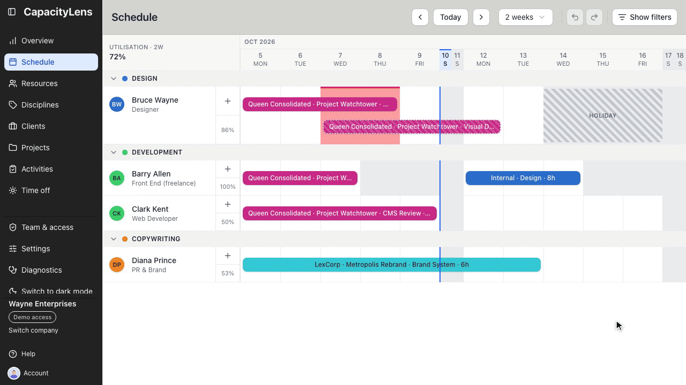

# CapacityLens

**Who's free next week?**

<a href="docs-src/screenshots/demo.mp4">
  
</a>

Every small agency answers that question badly. It lives in someone's head, a colour-coded
spreadsheet, or a group chat at 5pm on a Friday. So work gets promised to people who are already
full, the quiet capacity nobody noticed goes unsold, and the person who was going to be on holiday
finds out about their new project the week before they leave.

CapacityLens puts the answer on one shared screen: people down the side, days across the top, the
work and time off in between. Red means someone is booked for more than they can do that day. See
who is busy, who has room and who is about to be buried, and move work before it becomes a problem.

## Get started

**Installing it?** Four steps; the install itself takes about ten minutes on a host that already
runs Node 24: [install CapacityLens](https://kevinjohn.github.io/capacitylens/self-hosting/index.html).

**Own the company?** Sign in with the setup token, create the company, invite an Admin:
[set up your company](https://kevinjohn.github.io/capacitylens/owner/index.html).

**Set the work?** Add your people, clients and projects, then book the first work:
[get the schedule ready](https://kevinjohn.github.io/capacitylens/admin/index.html).

**Just want to see your work?** Accept your invitation and your week is on the first screen:
[see your work](https://kevinjohn.github.io/capacitylens/using/index.html).

Doing all of it yourself? [The whole setup on one page](https://kevinjohn.github.io/capacitylens/getting-started/quick-start.html).

## Try it in two minutes

The demo runs on your computer with sample data and no sign-in; it needs Node 24 and git. Drag
things about, book time off, break something: changes reset when you reload. No terminal? Watch
the walkthrough above instead.

```bash
corepack enable
pnpm install
pnpm run dev:demo
```

Then open the **Local** address it prints (usually <http://127.0.0.1:5173>), select the sample
sign-in on **Choose an account**, then pick a company on **Choose a company**.

## What you get

- **The weeks ahead at a glance:** 1 to 8 weeks, filtered by discipline, client, project or activity.
- **Early warning:** over-capacity days in red, plus a 14-day warning for trouble off screen.
- **Work you haven't won yet:** tentative bookings, placeholders for roles you haven't filled, and
  external parties who don't count against your capacity.
- **Time off in the same picture:** holidays, closures and each person's start and end dates sit
  beside the work.
- **How full everyone is:** utilisation per person and across the weeks on screen.
- **Offline, read-only:** an optional snapshot of the schedule on your device, kept for seven days.
- **Your own server:** your data in one SQLite file you control, under AGPL-3.0.

## What it deliberately isn't

CapacityLens does not track tasks, tickets, deadlines, budgets or timesheets, and it doesn't
schedule anyone by the hour. If you need Jira, use Jira. This is the view you check _before_ you
open Jira.

## Install it in five steps

Every release from 0.73.0-alpha.1 carries a server archive. You need Node 24.19.0 or newer within
24.x and a hostname with HTTPS. Node 26.9.0 or newer within 26.x is
[experimental](https://kevinjohn.github.io/capacitylens/reference/development.html#check-node-26-compatibility).

1. **Download** `capacitylens-X.Y.Z.tar.gz` from the [latest release](https://github.com/Kevinjohn/capacitylens/releases/latest) and unpack it.
2. **Pick a folder** for the database; its file is created there on first start.
3. **Configure:** in the unpacked folder, run `node server/dist/index.mjs init --public-url <address> --db <file in step 2's folder>`. It prints the environment file with both secrets generated: paste it into your host's environment editor, or add `--out /etc/capacitylens.env` to write the file.
4. **Start it** with `node --env-file=<your env file> server/dist/index.mjs`, or as a service.
5. **Open the address** and check the first-Owner screen loads. If you are also the Owner, [set up your company](https://kevinjohn.github.io/capacitylens/owner/index.html) with the setup token from step 3; otherwise send the address, and the setup token separately and privately, to the Owner.

[Install CapacityLens](https://kevinjohn.github.io/capacitylens/self-hosting/install.html) has the commands for a managed host or a
Linux host; [Docker](https://kevinjohn.github.io/capacitylens/self-hosting/install-with-docker.html) is another route. Sign-in is by
password, with Google Workspace and Microsoft Entra ID as
[company login](https://kevinjohn.github.io/capacitylens/company-login/index.html) options.

## Documentation

Read the [documentation](https://kevinjohn.github.io/capacitylens/) online, open
[`docs/index.html`](docs/) straight from a checkout with no server or build, or read the Markdown
sources in [`docs-src/`](docs-src/). [What is CapacityLens?](https://kevinjohn.github.io/capacitylens/getting-started/what-is-capacitylens.html)
is the one-page introduction.

## Project status

CapacityLens is alpha software with a single maintainer. Beta will mean the upgrade path and the
settings are stable. Database upgrades are tested from thirteen released database
snapshots, the oldest from 0.20.0-alpha.1, so a database created by that release or any later one
is expected to upgrade in place. See [how it is tested](docs-src/reference/how-it-is-tested.md) and
the [release notes](https://github.com/Kevinjohn/capacitylens/releases/latest).

## Contributing

React, TypeScript and Vite in the browser; Fastify and Better Auth over Node's built-in SQLite on
the server; a shared TypeScript domain in `shared/` for the scheduling rules. Start with
[CONTRIBUTING.md](CONTRIBUTING.md), then the [development guide](docs-src/reference/development.md#checks)
and the [standing decisions](DECISIONS.md).

[Governance](GOVERNANCE.md) · [Support](SUPPORT.md) · [Security policy](SECURITY.md) ·
[Security review](docs-src/security/reviews/security-review-2026-08-18.md) ·
[ASVS 5.0.0 ledger](docs-src/security/owasp-asvs-5.0.0.md) · [Changelog](CHANGELOG.md) ·
[Trademarks](TRADEMARKS.md)

## Licence

CapacityLens is [AGPL-3.0-only](LICENSE). Product names and logos are handled separately in
[TRADEMARKS.md](TRADEMARKS.md).

[](https://github.com/Kevinjohn/capacitylens/actions/workflows/gate.yml)
[](https://github.com/Kevinjohn/capacitylens/actions/workflows/e2e.yml)
[](https://codecov.io/gh/Kevinjohn/capacitylens)
[](https://github.com/Kevinjohn/capacitylens/actions/workflows/codeql.yml)
[](https://scorecard.dev/viewer/?uri=github.com/Kevinjohn/capacitylens)
[](https://www.bestpractices.dev/projects/14555)
[](https://github.com/Kevinjohn/capacitylens/actions/workflows/docker.yml)
[](.nvmrc)
[](LICENSE)
