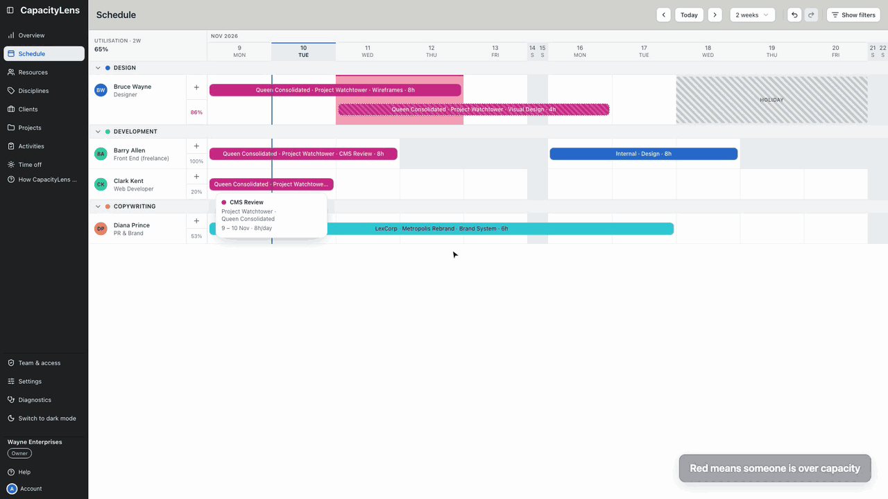

# CapacityLens

**Who's free next week?**

- **What:** self-hosted resource scheduling and capacity planning for small agencies, by the week.
- **For:** agency owners, studio and operations leads and project managers who decide whether the
  team can take work on; everyone else on the team sees their own week.
- **Licence and cost:** free and open source under GPL-3.0-or-later, with no paid tier and no
  hosted version; the only cost is your own server.
- **Requirements:** one Linux host with Node 24, an SQLite database file and HTTPS from a proxy on
  the same machine.
- **Status:** alpha, maintained by one person; see the
  [latest release](https://github.com/Kevinjohn/capacitylens/releases/latest).
- **Links:** [demo](#try-it-in-two-minutes) (`pnpm run dev:demo`) ·
  [install guide](https://kevinjohn.github.io/capacitylens/self-hosting/install.html) ·
  [documentation](https://kevinjohn.github.io/capacitylens/)

<a href="docs-src/screenshots/demo.mp4">
  
</a>

A 50-second walkthrough of the demo, recorded with fictional data.

Every small agency answers that question badly. It lives in someone's head, a colour-coded
spreadsheet, or a group chat at 5pm on a Friday. So work gets promised to people who are already
full, the quiet capacity nobody noticed goes unsold, and the person who was going to be on holiday
finds out about their new project the week before they leave.

CapacityLens puts the answer on one shared screen: people down the side, days across the top, the
work and time off in between. Red means someone is booked for more than they can do that day. See
who is busy, who has room and who is about to be buried, and move work before it becomes a problem.

It is free and open source (GPL-3.0), with no paid tier and no hosted version. You run it on your
own server, and the only cost is that server
([server size](https://kevinjohn.github.io/capacitylens/self-hosting/install.html#server-size)).

## Get started

**Manage the hosting?** Install it with one command on a host that runs Node 24, ending with
opening the setup link. You manage HTTPS, backups and upgrades:
[install CapacityLens](https://kevinjohn.github.io/capacitylens/self-hosting/index.html).

**Own the company?** Open the setup link, create the company, invite an Admin:
[set up your company](https://kevinjohn.github.io/capacitylens/owner/index.html).

**Set the work?** Add your people, clients and projects, then book the first work:
[get the schedule ready](https://kevinjohn.github.io/capacitylens/admin/index.html).

**Just want to see your work?** Accept your invitation and your week is on the first screen:
[see your work](https://kevinjohn.github.io/capacitylens/using/index.html).

Doing all of it yourself? [The whole setup on one page](https://kevinjohn.github.io/capacitylens/getting-started/quick-start.html).

## Try it in two minutes

For people comfortable with a terminal: the demo runs the full server and web app on your computer
with sample data. It needs Node 24, git and [pnpm](https://pnpm.io/installation). Node 26 is an
experimental, best-effort option. Install pnpm separately before running these commands; Node 25
and later no longer bundle Corepack. Sign in with the credentials printed in the
terminal. Changes survive refresh and reset when you restart the command. Everyone else can watch
the walkthrough above.

```bash
pnpm install --frozen-lockfile
pnpm run dev:demo
```

Open the address printed in the terminal and sign in with the printed development account. The
sample company's schedule opens automatically.

## What you get

- **The weeks ahead at a glance:** 1 to 8 weeks, filtered by discipline, client, project or activity.
- **Early warning:** over-capacity days in red, plus a 14-day warning for trouble off screen.
- **Work you haven't won yet:** tentative bookings, placeholders for roles you haven't filled, and
  external parties who don't count against your capacity.
- **Time off in the same picture:** holidays, closures and each person's start and end dates sit
  beside the work.
- **How full everyone is:** utilisation per person and across the weeks on screen.
- **Server-owned scheduling:** a connection is required; failed requests show an error and retry controls.
- **Your own server:** your data in one SQLite file you control, under GPL-3.0.

## What it deliberately isn't

CapacityLens does not track tasks, tickets, deadlines, budgets or timesheets, and it doesn't
schedule anyone by the hour. If you need Jira, use Jira. This is the view you check _before_ you
open Jira.

There is no importer from spreadsheets or other tools: you enter your people, clients and projects
in the app, and the JSON import only moves data between CapacityLens installations.

## Alternatives

Float, Productive, awork, Runn, Teamwork, Resource Guru and eResource Scheduler are good tools,
and each covers several jobs, such as budgets, timesheets, project management and reporting.
CapacityLens tries to do less: it shows who is busy and who is free, week by week, on a server you
run, with no licence fee. If you need budgets, timesheets, hour-level booking or a hosted service, choose
one of them.

## Install it

On a Linux host with systemd, Node 24 installed system-wide, Caddy (or another HTTPS proxy on the
same machine) and your domain's DNS pointing at the host with ports 80 and 443 open, download a
release archive and its checksum, then run:

```bash
sha256sum -c capacitylens-X.Y.Z.tar.gz.sha256
sudo install -d -m 0755 /opt/capacitylens
sudo tar -xzf capacitylens-X.Y.Z.tar.gz -C /opt/capacitylens
sudo sh /opt/capacitylens/capacitylens-X.Y.Z/install.sh capacity.example.com owner@example.com
```

The install command asks no questions and ends by printing a one-time setup link for the Owner.
To confirm the service is up, `curl -s https://capacity.example.com/health/ready` answers HTTP 200
with `"isHealthy":true`; HTTP 503 means the database checks failed.

CapacityLens is currently supplied as a native Node.js release archive. Follow the
[installation guide](https://kevinjohn.github.io/capacitylens/self-hosting/install.html), then
configure HTTPS at a proxy on the same machine. Whoever manages your hosting handles ongoing
maintenance. The operator guides cover
[configuration](https://kevinjohn.github.io/capacitylens/self-hosting/configuration.html),
[backups](https://kevinjohn.github.io/capacitylens/self-hosting/backups-and-restore.html),
[upgrades](https://kevinjohn.github.io/capacitylens/self-hosting/upgrades.html) and
[monitoring](https://kevinjohn.github.io/capacitylens/self-hosting/monitoring.html). Docker
support remains optional; see
[Install with Docker](https://kevinjohn.github.io/capacitylens/self-hosting/install-with-docker.html).
For the native installation, proxies in separate containers or on separate machines are not yet
supported; use the native same-machine proxy setup for the first release. Sign-in is by password,
and invitations and password resets need email delivery. See
[sign-in and access](https://kevinjohn.github.io/capacitylens/company-login/index.html).

## Documentation

Read the [documentation](https://kevinjohn.github.io/capacitylens/) online, open
[`docs/index.html`](docs/) straight from a checkout with no server or build, or read the Markdown
sources in [`docs-src/`](docs-src/). [What is CapacityLens?](https://kevinjohn.github.io/capacitylens/getting-started/what-is-capacitylens.html)
is the one-page introduction.

To update the site, edit `docs-src/` and run `pnpm run docs:build`, then commit the sources and
rebuilt `docs/` together. Documentation checks verify that they match. GitHub Pages publishes the
committed output only on a manual run of **Publish documentation** from `main`; neither a
documentation merge nor a published release updates the live site. See the
[documentation contribution instructions](CONTRIBUTING.md#documentation-and-github-pages).

## Project status

Your schedule stays yours: it is one SQLite file on your server, **Export JSON** downloads the
scheduling records at any time, and the licence lets anyone carry the code on. `app:upgrade` backs
up the database before it runs pending migrations, which are forward-only from one baseline.

CapacityLens is an alpha release maintained by one person. Until beta, settings and the upgrade
path may still change between releases; the release notes say when they do.
[Before you adopt](https://kevinjohn.github.io/capacitylens/getting-started/what-is-capacitylens.html#before-you-adopt)
covers status, getting your data out and support. See
[how it is tested](docs-src/reference/how-it-is-tested.md) and the
[release notes](https://github.com/Kevinjohn/capacitylens/releases/latest).

## Contributing

React, TypeScript and Vite in the browser; AdonisJS and Lucid over SQLite on the server; a shared
TypeScript domain package for the scheduling rules. Start with [CONTRIBUTING.md](CONTRIBUTING.md),
the [architecture reference](docs-src/reference/architecture.md) and the
[standing decisions](DECISIONS.md).

### Where do I edit?

| To change…                                        | Edit                                                                                                                                        |
| ------------------------------------------------- | ------------------------------------------------------------------------------------------------------------------------------------------- |
| A screen, form or the schedule grid               | [`apps/frontend/`](apps/frontend/) (React SPA)                                                                                              |
| An API route, authorization, a migration or a job | [`apps/backend/`](apps/backend/) (AdonisJS server)                                                                                          |
| A scheduling or validation rule both sides share  | [`packages/shared/`](packages/shared/), for example [`src/domain/`](packages/shared/src/domain/) and [`src/lib/`](packages/shared/src/lib/) |
| A user guide                                      | [`docs-src/`](docs-src/), the guide sources                                                                                                 |
| The offline documentation site                    | Nothing: [`docs/`](docs/) is generated from `docs-src/` by `pnpm run docs:build` and committed                                              |
| What a feature must do (acceptance criteria)      | [`user-stories/`](user-stories/)                                                                                                            |

Guides explain how to use the product; stories state the behaviour a change must keep; `docs/` is
build output, so a hand edit there is overwritten. The
[architecture reference](docs-src/reference/architecture.md) maps modules within each directory.

[Governance](GOVERNANCE.md) · [Support](SUPPORT.md) · [Security policy](SECURITY.md) ·
[Reviews and compliance](docs-src/security/reviews.md) ·
[ASVS 5.0.0 ledger](docs-src/security/owasp-asvs-5.0.0.md) · [Releases](https://github.com/Kevinjohn/capacitylens/releases) ·
[Trademarks](TRADEMARKS.md)

## Licence

CapacityLens is [GPL-3.0-or-later](LICENSE). Product names and logos are handled separately in
[TRADEMARKS.md](TRADEMARKS.md).

[](https://github.com/Kevinjohn/capacitylens/actions/workflows/validation.yml?query=branch%3Amain)
[](https://app.codecov.io/gh/Kevinjohn/capacitylens/tree/main/apps/frontend/src)
[](https://github.com/Kevinjohn/capacitylens/actions/workflows/codeql.yml?query=branch%3Amain)
[](https://scorecard.dev/viewer/?uri=github.com/Kevinjohn/capacitylens)
[](https://www.bestpractices.dev/projects/14555)
[](https://github.com/Kevinjohn/capacitylens/actions/workflows/docker.yml)
[](.nvmrc)
[](LICENSE)

Validation includes application/backend checks, native packages and Chromium, Firefox and WebKit
E2E tests. Coverage measures frontend source files; backend coverage is not included.
