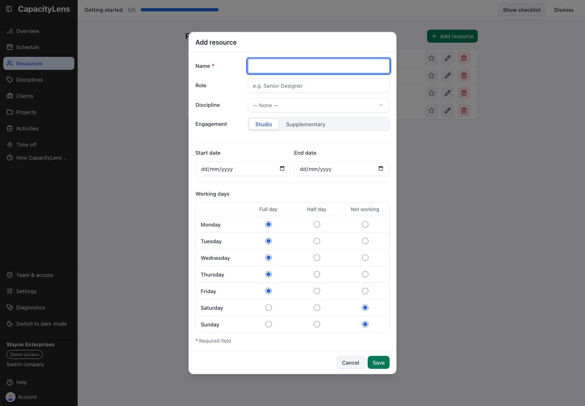
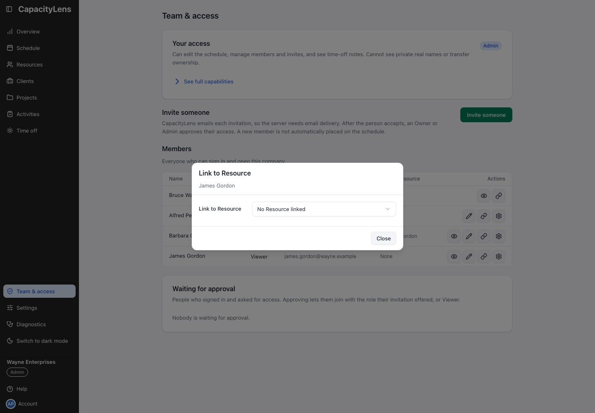

# Add people to the schedule

Give each person a row on Schedule so you can book their work and time off. They don't need a
sign-in. Editors, Admins and the Owner can add and edit people; Viewers cannot.

1. Open **Resources** and select **Add resource**.
2. Enter the **Name**, then add a **Role**, choose **Engagement** and, if your company uses them, a
   **Discipline**. Create disciplines on the [Disciplines page](/using/disciplines) first.
3. Set **Working days** to their usual week. Use **Start date** and **End date** if they are only
   available for a set period.
4. Select **Save**.

## Connect their sign-in

1. If they also need to sign in, [invite them](/admin/invite-teammates).
2. In **Team & access**, select the link icon beside the member and choose their row. The choice
   saves immediately.

Each person and each member can have only one link; remove an old link before reassigning it.
Linking does not change permissions or create a schedule row.

## Plan an unfilled role

A [placeholder](/reference/glossary#placeholder) stands for a role you have not filled yet.

1. In **Resources**, select **Add placeholder**.
2. Choose its **Bound project** and select **Save**.

Its bookings stay tied to that project and can use only that project's activities or the shared
**All projects** ones. When someone takes the role, edit or reassign the bookings to them.

Placeholders follow company working days. If **Add placeholder** is missing, turn on **Show
placeholders** in [Company settings](/admin/company-settings). Turning the setting off hides
placeholders without deleting them.

Next: [Resources](/using/resources) — working patterns, placeholders and external parties in
detail.
