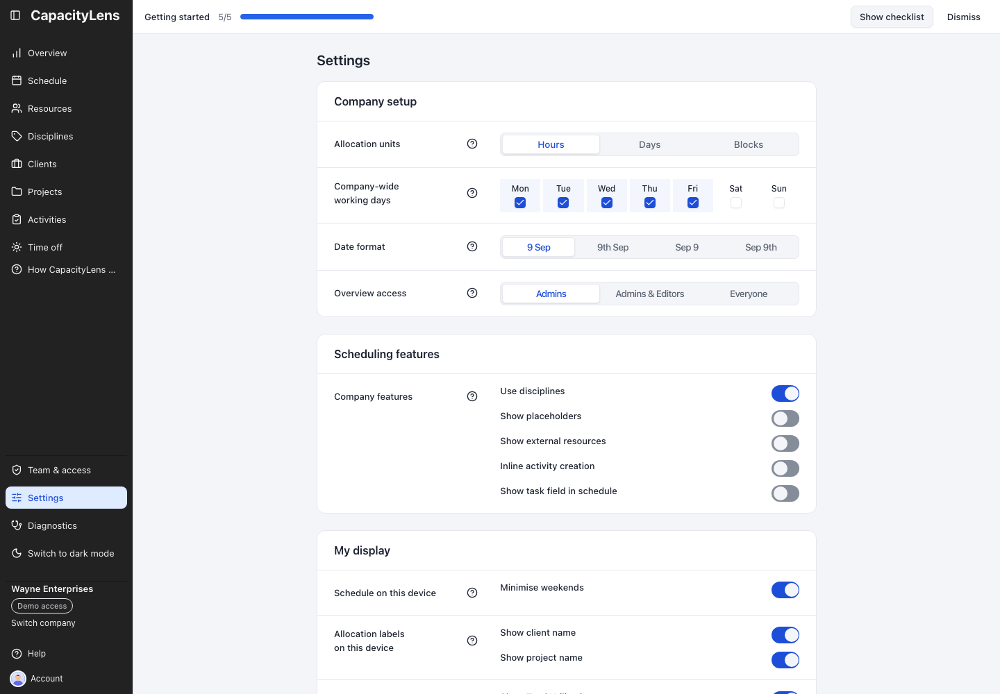

# Choose company settings

Set the scheduling rules and features everyone in the company shares. Open **Settings** near the
bottom of the left menu. Editors can change most of these; only Owners and Admins can change
**Overview access**.

## Company setup

| Setting                   | What it changes                                                                                     |
| ------------------------- | --------------------------------------------------------------------------------------------------- |
| Allocation units          | Enter work in Hours, Days or Blocks. Days is the default.                                           |
| Company-wide working days | Set the shared working week. A person's own working pattern also applies.                           |
| Date format               | Change how planning dates appear for everyone.                                                      |
| Overview access           | Choose who can open **Overview**. **Admins** is the default (Owners and Admins always have access). |

Changing working days recalculates capacity for existing work; it does not move bookings.

## Scheduling features

Under **Company features**, **Use disciplines** starts on for a new company; the others start off.

| Setting                     | What it changes                                                          |
| --------------------------- | ------------------------------------------------------------------------ |
| Use disciplines             | Group people by discipline. Create the names and colours on Disciplines. |
| Show placeholders           | Plan unfilled project roles.                                             |
| Show external resources     | Track work assigned outside your team.                                   |
| Inline activity creation    | Add activities while making a booking.                                   |
| Show task field in schedule | Add a short task description to bookings.                                |

Turning a switch off hides existing information; it does not delete it.

Internal work always appears in neutral grey. Resources and Schedule split people into Studio and
Supplementary only once someone is marked Supplementary.

## Tell company settings from your own

**My display** changes only the current browser. Each teammate chooses their own
[display preferences](/using/settings).

Week start and time zone are fixed when the company is created. They are shown under **Data and
support → Company details**.

Next: [Settings](/using/settings) — every setting in detail.
