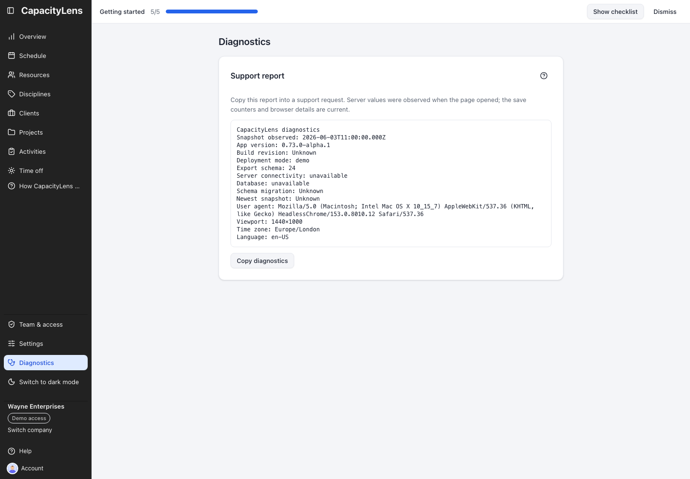

# Diagnostics

Copy a support report from here and paste it into your problem report.

Only Owners and Admins see **Diagnostics**, below Settings in the left menu, or can find it in the
command palette. Editors and Viewers who visit `/diagnostics` return to the schedule. When sign-in
is off, as in the demo, everyone can open it.

## Copy a support report

1. Open **Diagnostics**.
2. Select **Copy diagnostics**. A message confirms the copy, or says the browser blocked the
   clipboard.
3. Paste the report into your request.

The page shows exactly the text that is copied:

- the app version, build revision, deployment mode and export schema;
- server connectivity, database schema, persistence and backup status, as observed when the page
  opened (**Snapshot observed**);
- the company's sign-in mode;
- this browser session's save counters: failed saves, retries, reconciliations, superseded
  reloads, rebased and discarded edits, and whether saving is suspended;
- the browser's user agent, window size, time zone and language.

A value the page cannot read shows **Unknown** or **unavailable**. The demo has no server, so its
server values are always unavailable. If the build provides a revision or feedback address,
**Build details** shows it and may include a **Send feedback** link.

The native server leaves backup status **unavailable**. Operators check service logs and completed
snapshots as described in [Backups and restore](/self-hosting/backups-and-restore).

The report is a snapshot: reopen the page to check the server again.

## What the report leaves out

No names, email addresses, identifiers, company data, passwords, invitation or session values,
hostnames, file paths or raw error messages.
