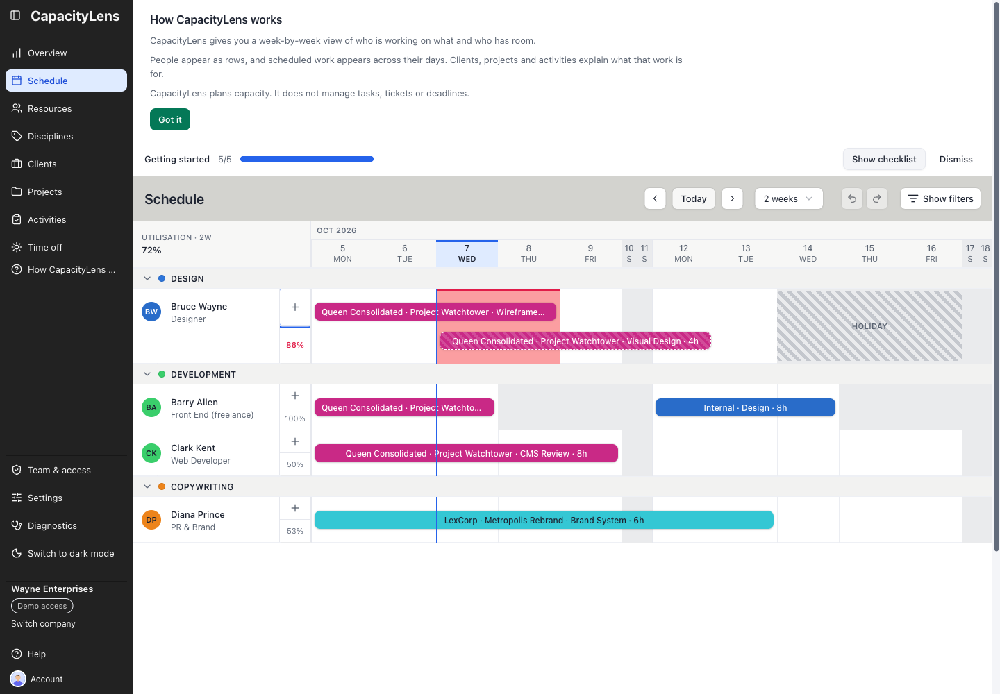
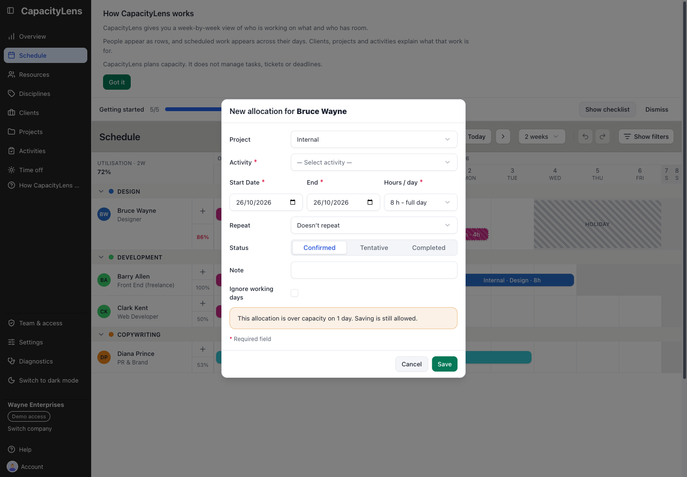

# Make the first booking

Book one piece of work to check everything is ready. You need a
[person on the schedule](/admin/add-people) and an [activity](/admin/prepare-work).

1. 

   **Start the booking.** Open **Schedule**. Select **+** on the person's row, or drag
   across the dates.

2. 

   **Fill in the form.** Choose **Project**, then **Activity**. For work without a project, choose
   **Internal** or **No specific project**. Check the assignee, dates, amount and status, then
   select **Save**. The amount is **Days of work** in a company that plans in Days, the default,
   or **Hours / day** in one that plans in Hours.

The booking appears on the person's row and in their
[work list](/using/read-the-schedule#your-work-list).

Next: [Schedule and change work](/using/schedule-work) — move, change, repeat or remove a booking.
