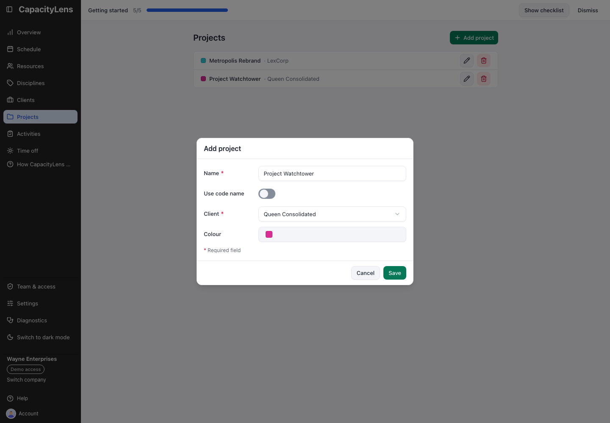

# Get the schedule ready

You set the work. Five steps take a new company to a schedule the team can use. You don't need
the Owner or installation guides.

1. 

   **Set the working week.** Open **Settings**. Under **Company setup**, choose whether work is
   entered in **Hours**, **Days** or **Blocks**, and which days your company works. Days is the
   default. [Every company setting](/admin/company-settings)

2. 

   **Add the people you plan for.** Open **Resources** and select **Add resource**. Enter a name,
   set their working days and select **Save**. They now have a row on Schedule. They don't need a
   sign-in to be scheduled. [Add people to the schedule](/admin/add-people)

3. 

   **Add a client, a project and an activity.** Use **Clients**, **Projects** and **Activities**
   in the left menu, in that order. An activity is the kind of work being booked, such as Design
   or Development. [Prepare clients and work](/admin/prepare-work)

4. 

   **Book the first work.** Open **Schedule** and drag across some days in a person's row. Choose
   the project and activity, then select **Save**. Drag the bar to move it; **Undo** puts it
   back. [Make the first booking](/admin/first-booking)

5. 

   **Invite the team.** Open **Team & access** and select **Invite someone**. Choose a role,
   enter their email and pick their row under **Link to Resource**, so their own work is waiting
   for them. Select **Create invite**. [Invite teammates](/admin/invite-teammates)

The **Getting started** checklist on Schedule ticks off steps 2 to 4 as you go, in any order.
If the Owner kept the example data, those are ordinary records: delete them from Resources,
Clients and Projects when you no longer need them.

## Who gets which role

| Role   | Can                                                          |
| ------ | ------------------------------------------------------------ |
| Viewer | See the schedule and everyone's work                         |
| Editor | Change the schedule, people, clients, projects and time off  |
| Admin  | Everything an Editor can, plus invite people and set access  |

Most of the team only need **Viewer**. Give **Editor** to whoever books work.

**Are you an Editor?** You can do steps 1 to 4. Inviting people is for an Admin or the Owner.
[Plan work as an Editor](/using/editor) is your day-to-day guide.

## Two records, one person

Inviting someone lets them sign in. Adding them in **Resources** gives them a row on the
schedule. Most people need both, and **Link to Resource** joins the two. Neither creates the
other.

## Already up and running?

- [Ongoing administration](/admin/ongoing-administration): change access, working patterns and
  closures.
- [Diagnostics](/admin/diagnostics): what to copy when you report a problem.
- [Admin FAQ](/admin/faq)
