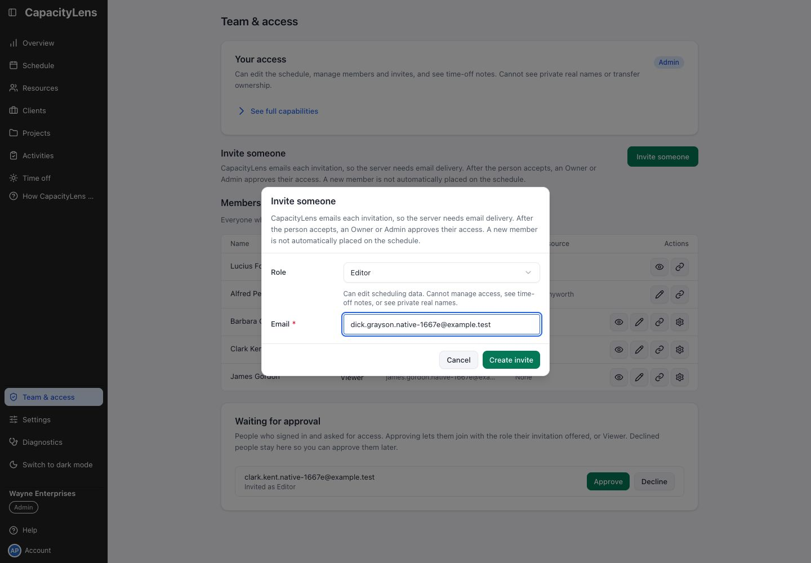
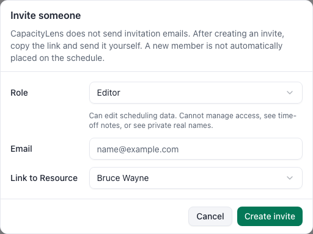
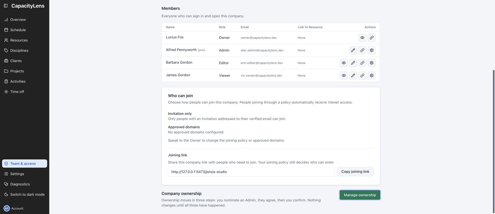

# Invite teammates

You invite people, choose what they can do, and later change or stop their access. Only an Owner or
Admin can do this. An Editor or Viewer who opens **Team & access** sees their own role instead of
**Invite someone**.

## Send an invitation

Open **Team & access** and select **Invite someone**. Choose the **Role** and enter the teammate's
email; only that address can accept the invitation. The dialog spells out what the chosen role can
and can't do, and **See full capabilities** lists everything.
[Roles and permissions](/getting-started/roles-and-permissions) compares the roles.

If the person already has a row on the schedule, choose it under **Link to Resource**. Otherwise
leave **No Resource linked**.

Select **Create invite**. If email is set up, CapacityLens sends the invitation. If it isn't, or
sending fails, select **Copy** and send the link privately.

The link is shown only in this dialog. CapacityLens keeps only a hash of it, so nobody can retrieve
it later. If it is lost, revoke the invite under **Outstanding invites** and create a new one; the old link stops working at once.
If you close the dialog before the invite finishes creating, a notice says the link was not shown.

The **Link to Resource** choice is a proposal: it does not reserve the person, and the recipient
cannot see it. If that person is no longer available when the invite is accepted, the member still
joins and their row shows **Resource link needs attention**. Select **Choose another person** or
**Dismiss**.

## What the invitee sees

The link opens a preview of your company name, the proposed role, what it allows and when the link
expires. Opening it does not change [membership](/reference/glossary). They then:

- sign in with their existing password and select **Accept invite**;
- choose **Create account**, which creates the sign-in and accepts in one step; or
- choose a company login provider, return to the invitation and select **Accept invite**.

The preview shows only the start of the invited address, such as `selina.kyle@…`. They must enter
the full address. Entering a different one cannot change who the invitation is for. When they
accept, they land on your schedule.

## Outstanding invites

Invites not yet accepted are listed under **Outstanding invites**, above your members. A proposed
Resource stays marked pending until the invite is accepted. Select **Revoke** to cancel an invite.

## Managing someone who already joined

Send new members the [day-to-day guide](/using/). Members are listed by role, Owner first. On each
row:

- The **pencil** changes their role. The dialog explains the consequences before you **Save role**.
- The **link icon** opens **Link to Resource**. Choosing a person saves immediately and does not
  change their access. **Remove link to resource** unlinks them immediately.
  [Link a person to a member](/using/resources#link-a-person-to-a-member)
- **More actions** offers the rest: reset their password, sign them out everywhere, **Disable
  Access**, archive or remove them.

## Stop access

All three are in **More actions**. None affects the person's other company memberships.

- **Disable Access** stops them opening the company immediately, including through an existing
  session or a later invitation. It stays in force even after removal, until an Owner or Admin
  selects **Enable Access**, which is also available for people under **No longer active**.
- **Archive user** stops their access but keeps an inactive record. **Restore membership**
  reactivates it, but does not clear Disable Access.
- **Remove** ends the membership. They may return later if the joining policy allows it.

Archiving or removing does not block a new invitation; a returning person gets the invitation's
role. After **Enable Access**, an active member keeps their role, but an archived or removed person
still needs restoring or a new invitation.

If the person creates a new sign-in with the same address, the restriction follows them only when
both identities proved mailbox ownership, through verified company sign-in or a completed mailbox
check. An invitation or an older "email verified" flag does not count. An established Microsoft
sign-in keeps its stable identity, but a returning sign-in does not add mailbox proof to an older
identity without it. You can still manage the original restriction from **No longer active**.

## Review who can join

**Team & access → Who can join** shows the joining policy and approved domains. Only the Owner can
change it; ask them if a teammate cannot join or registration should be tighter. You can copy the
**Joining link** and share it; the policy still decides who gets in. People who join through the
policy get Viewer, so send an addressed invitation for any other role.
[Decide who can join](/owner/responsibilities#decide-who-can-join) explains each policy.

A fresh install allows one company. An operator can allow more with `CAPACITYLENS_MULTI_ACCOUNT`;
see [Configuration](/self-hosting/configuration).

[How company joining works](/company-login/#invitations-and-the-first-owner) ·
[Admin FAQ](/admin/faq)
