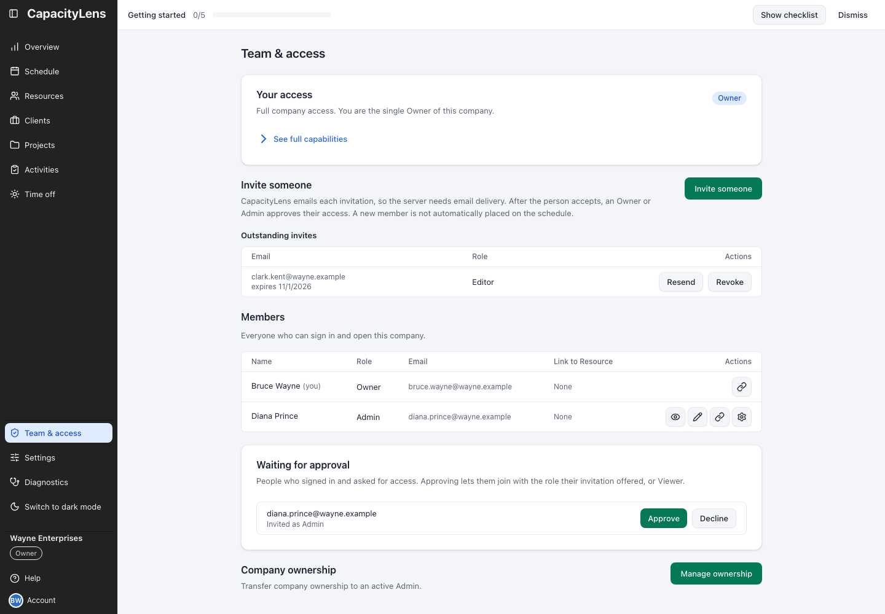

# Invite teammates

Invite people, choose what they can do, and later change or stop their access. Only an Owner or
Admin can do this. An Editor or Viewer who opens **Team & access** sees their own role instead of
**Invite someone**.

## Send an invitation

1. Open **Team & access** and select **Invite someone**.
2. Choose the **Role**. The dialog spells out what the role can and can't do, and **See full
   capabilities** lists everything. [Roles and permissions](/getting-started/roles-and-permissions)
   compares the roles.
3. Enter the teammate's email. Only that address can accept the invitation.
4. Select **Create invite**. CapacityLens emails the link.

Invitations need the server's email delivery. Without it, the dialog says so and nothing is
created; ask your installer to set up email. If the invitation was saved but the email failed, a
warning says so: select **Resend** on its row to try again.

The link is never shown in CapacityLens. It works once and expires after seven days. **Resend**
emails a fresh link and stops the old one working. An invitation never adds the person to the
schedule: [link their membership to a Resource](#change-a-member-s-role-or-schedule-row) after they
join.

## Check what the invitee sees

The link shows your company name and the invited role. The invitee enters their name, chooses a
password and selects **Accept invitation**. An invitation creates a new sign-in, so an address that
already has one is refused; the installer can record the invitation for that account instead.
[Sign-in and access](/company-login/#join-through-an-invitation) has their steps.

## Approve new people

After accepting, the person selects **Ask for access** and appears under **Waiting for approval**
in **Team & access**, with the role their invitation offered. Select **Approve** to let them in
with that role, or **Decline** to refuse. They see the result the next time they select **Check
again**. Nobody can reach company data before an Owner or Admin approves them.

A declined person stays in the list, marked **Declined**, so you can still select **Approve** if
you declined by mistake.

## Revoke an invitation

Invitations not yet accepted are listed under **Outstanding invites**, above your members. Select
**Revoke** to cancel an invitation that has not expired, or **Resend** to email a fresh link.

## Change a member's role or schedule row

Send new members [See your work](/using/). Members are listed by role, Owner first. On each
row:

- The edit icon changes their role. The dialog explains the consequences before you **Save role**.
- The **link icon** opens **Link to Resource**. Choosing a person saves immediately and does not
  change their access. **Remove link to resource** unlinks them immediately.
  [Link a person to a member](/using/resources#link-a-person-to-a-member)
- **More actions** offers the rest: **Disable Access**, **Archive user** or **Remove**.

You cannot reset another member's password or end their sessions from CapacityLens. A member who
is locked out selects **Forgot password?** on the sign-in page; the installer can help otherwise.

## Stop access

All three are in **More actions**. None affects the person's other company memberships.

- Use **Disable Access** when they must not get back in. It works at once, including on an
  existing session or a later invitation, and stays in force even after removal until an Owner or
  Admin selects **Enable Access** (also offered under **No longer active**).
- Use **Archive user** when they leave but you want to keep their membership on record. It stops
  their access; **Restore membership** reactivates it but doesn't clear Disable Access.
- Use **Remove** when they no longer belong to the company. It ends that membership and keeps them
  out: they move to **No longer active**, and **Enable Access** brings them back with the role they
  held when removed. You cannot remove yourself.

Invitations go only to addresses without an account, so a person who has signed in before comes
back through **Restore membership** or **Enable Access**, never a new invitation. After **Enable
Access**, an active member keeps their role and an archived person still needs restoring.

A disabled or removed person cannot rejoin until an Owner or Admin selects **Enable Access** under
**No longer active**.

A new installation allows one company. Ask your installer if you need more;
[Configuration](/self-hosting/configuration) has the setting.

Next: [Admin FAQ](/admin/faq) — fix a stuck invitation.
