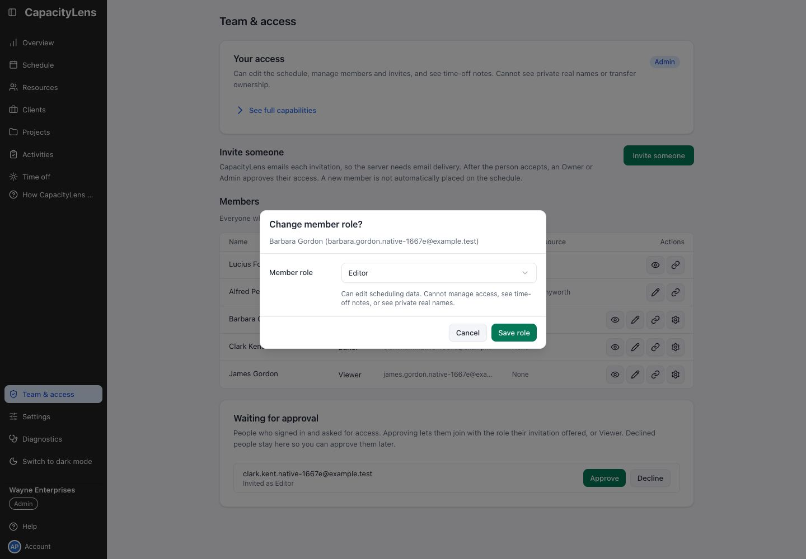
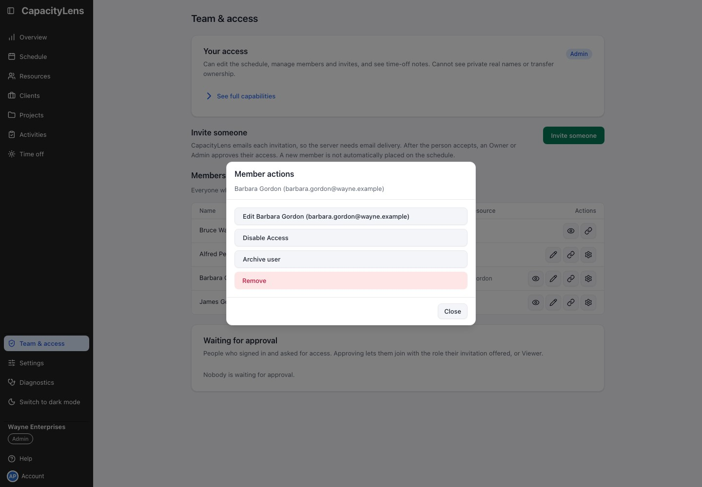
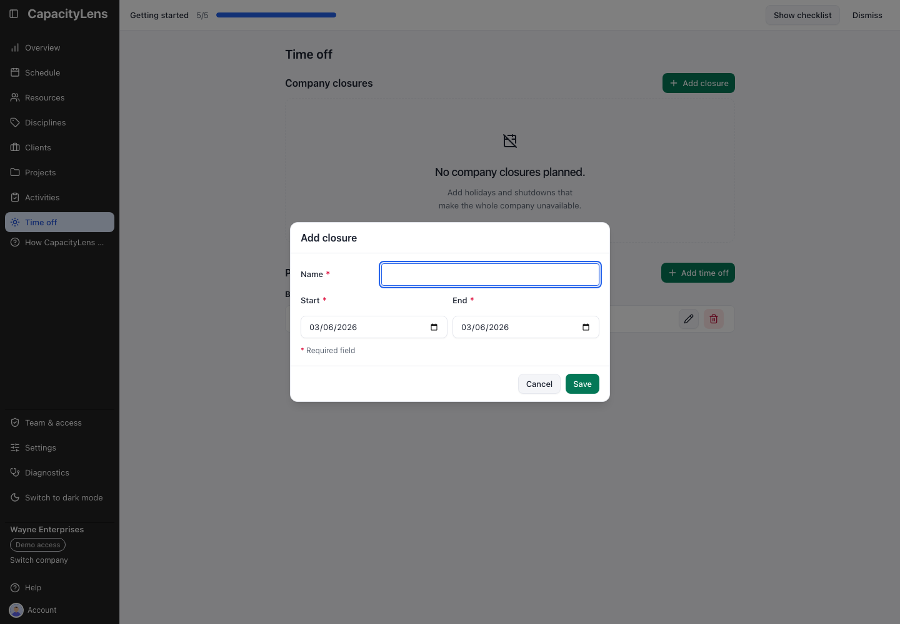

# Handle ongoing administration

You keep access, working patterns and closures up to date as people and work change.

## Change access

Open **Team & access**. Review **Outstanding invites** and revoke any that are no longer needed.
Use the pencil to change a member's role and the link icon to change their schedule row.

**More actions** holds **Disable Access**, **Enable Access**, **Archive user**, **Restore
membership** and **Remove**. Disable Access blocks entry to the company even after removal, until an
Owner or Admin clears it. Archive keeps the record and can be restored. Removal ends the membership
in this company only. [Stop access](/admin/invite-teammates#stop-access) covers each one.

## Change working patterns

Open **Resources**, edit the person, update **Working days** or **Start date** and **End date**, and
select **Save**.

A person's working days, together with the company's, set their capacity. Changing them
recalculates Utilisation and conflicts; it does not move bookings. Availability dates are inclusive.
Outside them capacity is zero, but existing bookings stay visible. Check
[Set availability dates](/using/resources#set-availability-dates) before narrowing someone's
availability.

Archive a person when they leave active scheduling. Archived people are listed at the bottom of
Resources.

## Add a company closure

Open **Time off**. Under **Company closures**, select **Add closure**, enter the name and the
**Start** and **End** dates (inclusive), and select **Save**.

A closure sets capacity to zero for every person and placeholder on those dates, including people
added later. It does not cover external parties or remove bookings; overlapping work shows as a
conflict. Shortening or deleting the closure restores capacity without moving bookings.

For one person's absence, [record time off](/using/time-off#record-time-off).

## Who to ask

Ask the Owner to transfer ownership, delete the company or import scheduling data. Ask the service
operator about backups, upgrades and company-login setup. When something goes wrong, copy a report
from [Diagnostics](/admin/diagnostics).

[Company settings](/admin/company-settings) · [Admin FAQ](/admin/faq)
