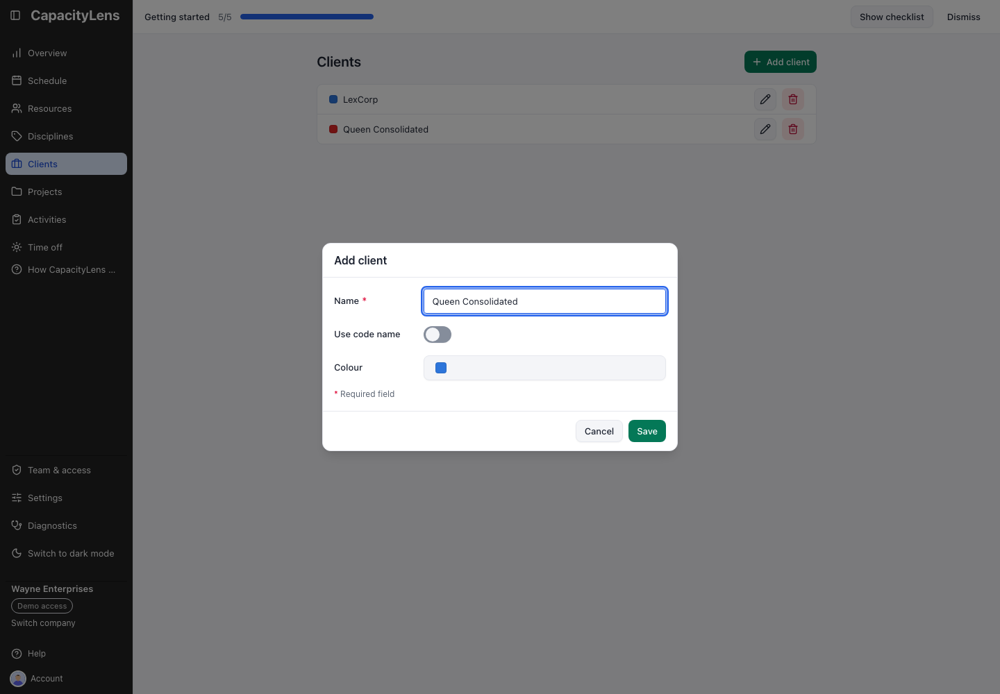
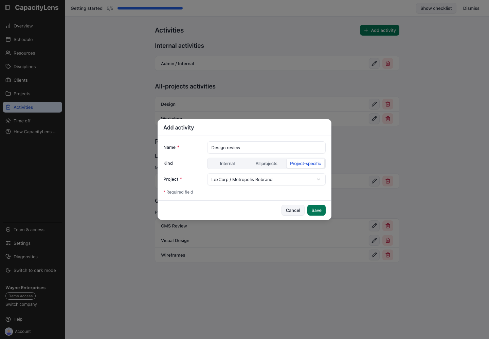

# Prepare clients and work

Create the clients, projects and activities that the booking form offers. Internal and
All-projects activities don't need a client or project first.

1. 

   **Add the client.** Open **Clients**, select **Add client**, enter the name and select **Save**.

2. 

   **Add the project.** Open **Projects**, select **Add project**, enter the name, choose its
   **Client** and select **Save**.

3. 

   **Add an activity.** Open **Activities**, select **Add activity**, enter the name, choose a
   **Kind** from the table below and select **Save**.

| Kind             | Use it for                                   |
| ---------------- | -------------------------------------------- |
| Project-specific | One project, which you choose                |
| All projects     | Work you reuse across projects               |
| Internal         | Non-billable work, booked under the **Internal** project |

Next: [Make the first booking](/admin/first-booking) — check the setup works.
