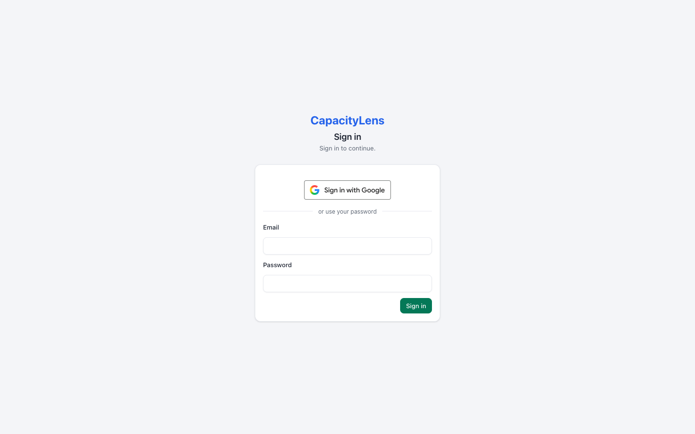

# Company login

Sign in with a password or Google, depending on what the installer has turned on. The demo, and an
installation with `CAPACITYLENS_MODE=off`, have no sign-in.

With Google sign-in, CapacityLens sends you to Google and never sees your Google password. A Google
account alone does not grant access: the first person on an empty installation needs the installer's
approval, and later new Google identities need an addressed invitation. A member still needs an
invitation or enabled joining policy to enter the installation company.

## Passwords and company sign-in

In mixed mode (`password-and-sso`), **Sign in with Google** appears above the password form with an
**or use your password** divider. Google-only sign-in shows no password form; password-only
sign-in shows no provider action.

On a fresh installation, the first Google identity must use an address in the operator's bootstrap
allowlist. Signing in creates the identity, not a company; that Owner then completes company setup.

When Google sign-in is required (`sso-only`), password sessions cannot satisfy it. The company
provider is Google.

[Set up Google sign-in](/company-login/set-up-company-login) covers registration and server
settings. [Require Google sign-in](/company-login/move-to-single-sign-on) covers the operator
procedure.

## Invitations and the first Owner

On an empty installation, the installer can allow a specific email address to create the first
Google identity. That person follows [Set up your company](/owner/) to become its
Owner. The allowance closes once the first identity exists.

After that, the Owner chooses **Who can join** in **Team & access**: **Invitation only** (the
default), open registration, approved email domains, or approved domains plus invitations. An
Admin can see the policy and ask the Owner to change it. An existing Google identity with a verified
address can join through a policy and receives Viewer access; an addressed invitation can grant its
chosen role. **Approved domains** match exactly, so `team.example.com` is not `example.com`.

To join through a company link, open the page, sign in with an existing Google identity or password
account, then select **Join company**. The server checks the current company policy and trusted
email proof when the person completes the join:

- A new Google identity cannot be created through open or domain registration. It needs an unused
  invitation addressed to its verified Google email.
- Password signup through an open or domain policy is not available.
- When email delivery is enabled, a password user can choose **Email me a verification link** and
  open it within 60 minutes while signed in to join through an open or approved-domain policy.
- A Google callback never adds company membership or consumes an invitation. The person must
  explicitly accept an invitation or complete the company join.

A company can disable someone's access even when its joining policy allows them.

## Connect an existing account

1. Sign in to your existing account and open **Account → Security**.
2. Under **Company sign-in**, choose **Connect Google**. You may be asked to confirm it's you.
3. Sign in at Google with the same email address. Your local email must already be verified, and
   the Google address must match it.

Connecting keeps your memberships and work. CapacityLens never merges accounts because their email
addresses match, and a Google identity already connected to someone else cannot be connected again.
Google sign-in uses the provider's stable account identity; an email change does not connect a
different Google account.

### If connecting fails

- **You cancel Confirm it's you.** No connection starts.
- **Confirmation cannot refresh your session.** Sign out, sign in again and retry.
- **Your local email is unverified.** When password sign-in and email verification are available,
  open the company's **Join company** link, sign in, and choose **Join company**. When prompted,
  choose **Email me a verification link** and open it within 60 minutes in the same signed-in
  session. The link returns you to the join page; choose **Join company** again to verify the address
  and finish joining when company policy allows it. Then retry **Connect Google**. Google must
  return that same verified address. If email verification is unavailable, ask your installer
  about the company's supported sign-in options.

## Sessions and sensitive actions

A session lasts at most twelve hours from sign-in; activity does not extend it. Thirty minutes
without activity also signs you out.

These actions ask you to confirm your identity again when needed: connecting or repairing a
company identity, transferring ownership, resetting another member's password, revoking another
member's sessions, deleting a company, and importing or purging company data. Invitations, role
changes and removing members need only the right role.

If confirming through Google takes you away from the page, return and submit the
action again. Confirming does not apply the original change.

## Multi-factor sign-in at Google

CapacityLens has no local MFA. If your agency requires MFA, set it up at Google. Enabling company
sign-in does not turn it on, and CapacityLens cannot see or enforce Google's policy or tell whether
a challenge happened. Test the policy, its recovery path and session behaviour before relying on it.

## When someone leaves

1. Disable their work account at the provider.
2. In **Team & access**, remove their membership or select **Disable Access**.
3. Select **Revoke sessions** to end their existing CapacityLens sessions across all their
   companies. This needs the corresponding authority. Disabling them at the provider does not end
   those sessions.

## If someone returns with a new sign-in

A **Disable Access** restriction follows a new sign-in with the same address only when both
identities proved mailbox ownership, through verified Google sign-in or a completed mailbox check.
An invitation or an older "email verified" flag does not count. An established Google sign-in keeps
its stable identity. A returning Google sign-in refreshes mailbox proof only when its verified
address exactly matches the local account email; it never changes that email or merges accounts. An
Owner or Admin can still manage the original restriction from **No longer active** in
**Team & access**.
