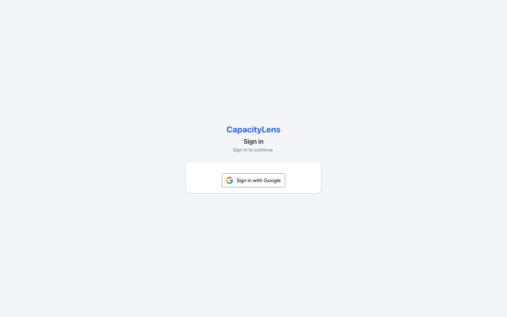

# Require company sign-in

Run Google or Microsoft alongside passwords, or require everyone to use one of them. This page is
for the server operator.



## Configure and check a provider

1. Register Google, Microsoft or both by following
   [Set up Google or Microsoft sign-in](/company-login/set-up-company-login). Microsoft also needs a
   tenant-specific Entra registration and working SMTP for first connections that need mailbox
   proof.
2. Set `CAPACITYLENS_MODE=password-and-sso` while both password and company sign-in should remain
   available, and restart.
3. Check the provider buttons appear and complete one sign-in with an allowed account before
   asking teammates to connect.

## Connect existing accounts

Each person connects their existing account from **Account → Security**, as
[Connect an existing account](/company-login/#connect-an-existing-account) describes. Connecting
keeps their memberships, role and scheduled work.

If CapacityLens reports that the local account email is unverified, the server operator first
confirms which mailbox the person controls. Then, in mixed mode, an authorised administrator
sends the guarded repair request:

```http
PATCH /api/accounts/{accountId}/members/{principalId}/email
Content-Type: application/json

{"email":"verified-address@example.com"}
```

Take the company and principal IDs from the member directory. The request needs a fresh
authenticated session, membership-management permission in that company and identity-wide
authority over the target across their companies; the server rechecks these in the write
transaction. The repair marks the address verified and revokes the target's sessions, so they sign
in again before connecting. There is no email-correction control in Account, and a joining
verification link does not satisfy this check.

## Require a company provider

Keep `CAPACITYLENS_DEPLOYMENT_PROFILE=self-hosted-mixed` while preparing. With Google, Microsoft or
both configured, run the read-only all-company check against the current database:

```bash
pnpm --filter capacitylens-server cutover:preflight -- /path/to/capacitylens.db
```

To pass, every existing sign-in account needs a verified connection to any configured company
provider, every company needs active members and an active Owner, and open password signup must
be disabled.

Decide from the top-level `ready` result and `issues` list; each issue has a stable reason code and
an explanation. The `diagnostics` list gives per-provider repair details and may flag a missing
connection to one provider even when another satisfies the check; it adds no restrictions. The
same checks run when the server starts. Resolve blocking issues in mixed mode and rerun the check.
It does not switch modes itself.

If a finding needs identity or membership repair, the guarded `cutover:repair` command can:

- remove one exact provider link
- remove a credential-only or providerless identity with no active company memberships
- make an existing active member Owner of an ownerless company
- erase a company with no active members.

::: warning
Some repairs permanently remove identity or company data. Keep a backup, follow the command's
exact target checks, and do not use it to work around a finding you do not understand.
:::

The command requires the mixed profile, password mode and a current supported schema. It refuses
unless the server is stopped and the exact `--confirm-server-stopped` flag is supplied, locks and
checks the database, refuses ambiguous identities and unsafe targets, and records successful
repairs in the audit outbox.

When preflight reports ready, set these values and restart:

```dotenv
CAPACITYLENS_MODE=sso-only
CAPACITYLENS_DEPLOYMENT_PROFILE=self-hosted-sso-only
```

Keep at least one company provider's credentials configured. After restart, sign-in and
invitation acceptance need a company-provider session
([Passwords and company sign-in](/company-login/#passwords-and-company-sign-in)).
There is no in-app readiness panel, so verify provider access directly before switching.

## Restore password sign-in

If a provider becomes unavailable or someone cannot use their connected identity, set both values
and restart:

```dotenv
CAPACITYLENS_MODE=password-and-sso
CAPACITYLENS_DEPLOYMENT_PROFILE=self-hosted-mixed
```

Local-password accounts can sign in again, and company sign-in stays available. This does not
reset passwords or change provider connections; use the ordinary password reset for a lost
password. A sole Owner who cannot use any available sign-in method can use the stopped-server
[Owner password recovery procedure](/self-hosting/incidents#the-sole-owner-has-lost-their-password).
