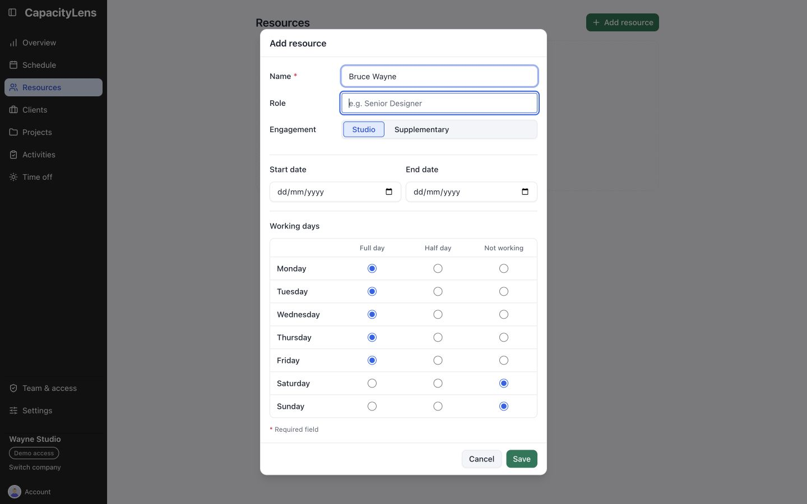
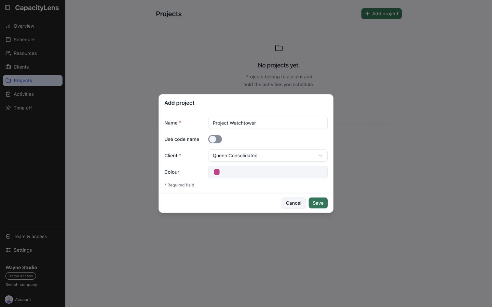
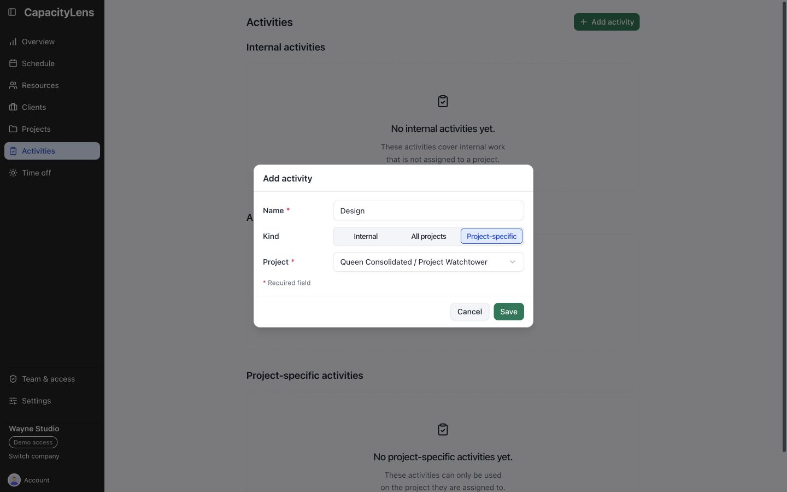
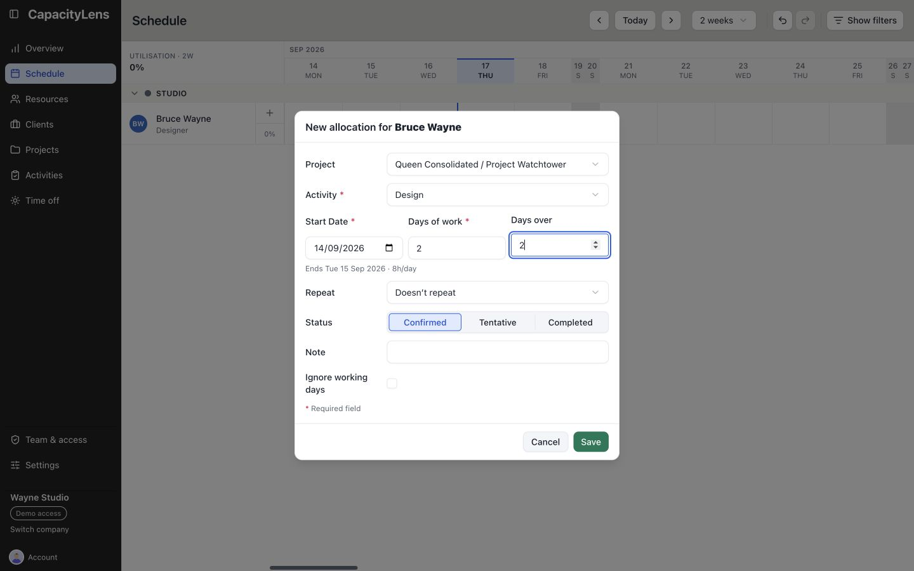
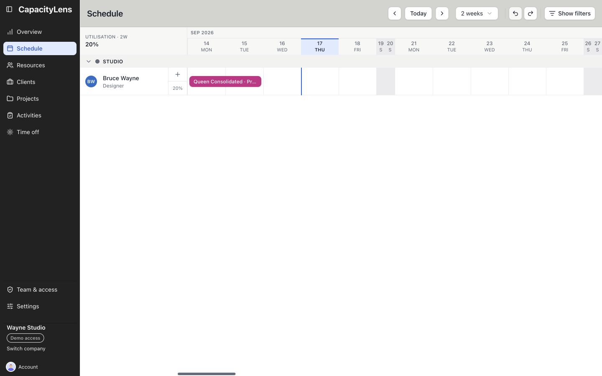

# Quick start

<span id="get-started-quickly"></span>

At a small agency, one person often installs CapacityLens, owns the company and sets the
work. This page is that whole route, from download to a booking on screen. Each step links
to the guide with the detail.

## Install it

You need a server with Node 24 and a hostname pointing at it. On a managed host such as Forge
you never open a terminal.

<div class="steps">

1. **Download** the release archive from the
   [latest release](https://github.com/Kevinjohn/capacitylens/releases/latest) and unpack it.

2. **Pick a folder** for the data. The database file is created there on first start.

3. **Configure** with one command. It prints your settings, with the secrets and a one-time
   setup token generated for you:

   ```bash
   node server/dist/index.mjs init --public-url https://capacity.example.com --db /var/lib/capacitylens/capacitylens.db
   ```

4. **Start it** as a background process, with HTTPS in front.

5. **Open the address.**

</div>

[Install CapacityLens](/self-hosting/install) has the exact commands for a managed host and
for your own Linux server.

## Create your company

<div class="steps">

1. 

   **Sign in.** Enter your name, email and a password, and paste the setup token from step 3.
   Select **Create my sign-in**.

2. 

   **Create the company.** Name it and choose the day your week starts and your timezone. These
   two **cannot be changed later**. Clear **Start with example data** if you'd rather start
   empty. Select **Create company**.

</div>

[Set up your company](/owner/) covers company login and what stays with the Owner.

## Make the schedule yours

<div class="steps">

1. 

   **Add a person.** Open **Resources**, select **Add resource**, enter their name and working
   days, and select **Save**.

2. 

   **Add a client and a project.** Open **Clients** and select **Add client**. Then open
   **Projects**, select **Add project** and choose that client.

3. 

   **Add an activity**, the kind of work being booked. Open **Activities**, select **Add
   activity**, choose **Project-specific** and pick the project.

4. 

   <span id="first-booking"></span>**Book the work.** Open **Schedule** and drag across some days
   in the person's row. Choose the project and activity, then select **Save**.

5. 

   **Move it.** Drag the bar to another day or another person. **Undo** puts it back.

</div>

That's a working schedule.

## The Getting started checklist

<span id="make-your-first-schedule-useful"></span>


While setup is incomplete, **Getting started** on Schedule ticks off these five steps as you go,
in any order. **Show me around** starts a short tour.

Steps complete from the company's records, including imported ones. Internal work doesn't count
towards the client or project steps. Editors can open and close the checklist; Viewers don't see
it. An Owner or Admin can dismiss it for everyone, and is asked to confirm if steps remain.

## Bring in the team

Open **Team & access**, select **Invite someone**, choose a role and enter their email. Most
people need **Viewer**; give **Editor** to anyone who books work.
[Get the schedule ready](/admin/) covers roles, settings and linking each invitation to the
right row on the schedule.

Before you rely on it, [check your backups](/self-hosting/backups-and-restore).
