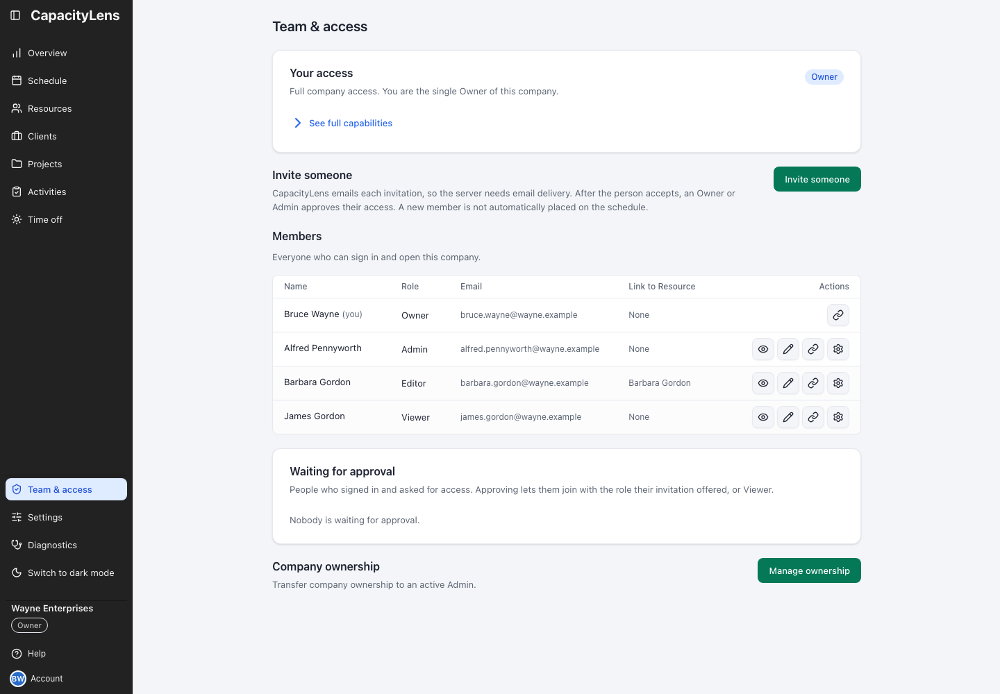
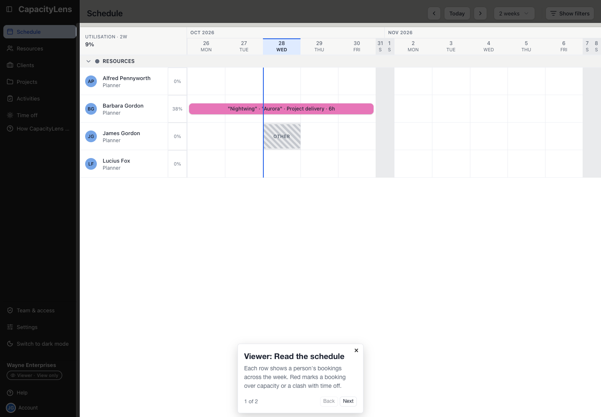

# Roles and permissions

Choose a role for someone, or find out why a control is missing. Roles are nested: **Viewer < Editor < [Admin](/reference/glossary#admin) < [Owner](/reference/glossary#owner)**. The
server enforces them; hiding a control in the interface is not the only protection.

Some pages also depend on company settings. [Overview access](/using/overview#control-access), for
example, defaults to Owners and Admins. People without access don't see the link and cannot open
the page directly.

## Compare the roles

| Capability                                            |  Viewer  |  Editor  |   Admin    | Owner |
| ----------------------------------------------------- | :------: | :------: | :--------: | :---: |
| See the schedule                                      |   Yes    |   Yes    |    Yes     |  Yes  |
| Create and edit scheduling data                       |    —     |   Yes    |    Yes     |  Yes  |
| Change ordinary company settings                      |    —     |   Yes    |    Yes     |  Yes  |
| See time-off notes                                    |    —     |    —     |    Yes     |  Yes  |
| See private client/project real names                 |    —     |    —     |     —      |  Yes  |
| List members and manage invites                       |    —     |    —     |    Yes     |  Yes  |
| Disable or Enable Access; archive or restore a member |    —     |    —     |    Yes     |  Yes  |
| Export the schedule                                   | Redacted | Redacted | Code names |  Full |
| Import, delete the company, transfer ownership        |    —     |    —     |     —      |  Yes  |

Each company has exactly one Owner. Nobody becomes Owner through an invitation or a role change, only
through [an ownership transfer](#hand-the-company-to-someone-else). An Admin can invite, remove,
disable or change the role of any other member except the Owner. Nobody, not even the Owner, can
disable or archive the Owner or themselves.

**Team & access** lists members by role, Owner first. Disabled, archived and removed people move to
the collapsed **No longer active** table beneath.
[Change a member's role or schedule row](/admin/invite-teammates#managing-someone-who-already-joined)
covers each action. If a company has no Owner at all, follow
[A company has no Owner](/self-hosting/incidents#a-company-has-no-owner).

## Tell sign-ins, members and people apart

Three separate things can look like a [person](/reference/glossary#person) in the interface:

- A **sign-in identity**: the email and password, or company login, someone uses to reach
  CapacityLens. One identity can belong to several companies.
- A **member**: that identity's role in one company, created by
  [inviting them](/admin/invite-teammates).
- A **person** on the schedule: a row that can receive bookings and time off.

Adding a person doesn't give them a sign-in, and inviting a member doesn't put them on the
schedule. Freelancers and contractors can be scheduled without ever getting a sign-in.

## Hand the company to someone else

Ownership moves in three steps: the Owner nominates an active Admin, the Admin agrees, and the
Owner confirms. Nothing changes until all three happen.
[Transfer ownership](/owner/responsibilities#transfer-ownership) has the procedure and recovery
steps.

## Take a role-based tour

Anyone can start the tour for their role from **Help** in the left menu, even after Getting started
is dismissed. Owners, Admins and Editors can also select **Show me around** on the Getting started
card; Viewers don't see that card. The
tour opens Schedule first and continues through the guidance for lower roles:

| Role   | Stops                                                         |
| ------ | ------------------------------------------------------------- |
| Owner  | Eight                                                         |
| Admin  | Seven                                                         |
| Editor | Five, ending with the two Viewer stops                        |
| Viewer | Two, read-only                                                |

Server-backed companies include an Admin stop about example data; the demo leaves it out. The tour
is unavailable while permissions are being checked or can't be confirmed, and while a read-only
offline snapshot is open.

## View the company as a member

An Owner or Admin can see what another active member sees without changing their role. In **Team &
access**, select the eye button on the member's row and confirm. A red **Masquerading as _name_**
bar stays visible throughout.

You see the company with that member's role and redactions, but you cannot change anything; the
server blocks every change. It never applies to another company. An Admin who views the company as
the Owner sees what the Owner sees, including real names.

Select **End now** to return to your own view. Switching company, signing out, a revoked or expired
session, a disabled membership on either side, or a server restart also ends it. Starting and ending
are recorded in the audit log.

## Check what exports and offline snapshots contain

An export is redacted the same way as the screen:

| What the export contains     | Viewer / Editor | Admin      | Owner      |
| ---------------------------- | --------------- | ---------- | ---------- |
| Archived and deleted rows    | Left out        | Included   | Included   |
| Private client/project names | Code names      | Code names | Real names |

[Offline access](/using/settings#offline-access) always behaves like Viewer access: while a cached
snapshot is open, nobody can create, edit, delete, import or change membership. A snapshot holds
what that person could see when last online, so an Owner's snapshot may contain real private names.
Protect the Owner's device accordingly.

Next: [Invite teammates](/admin/invite-teammates) — give someone the role you chose.
