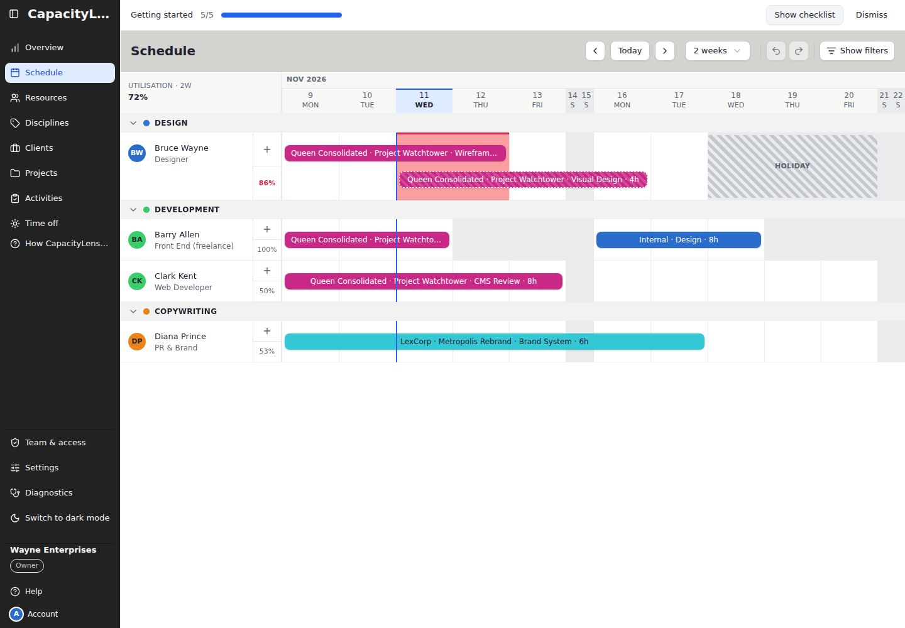
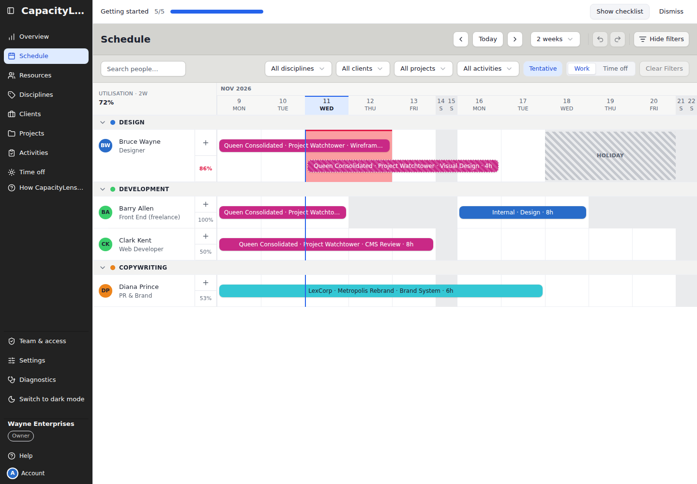
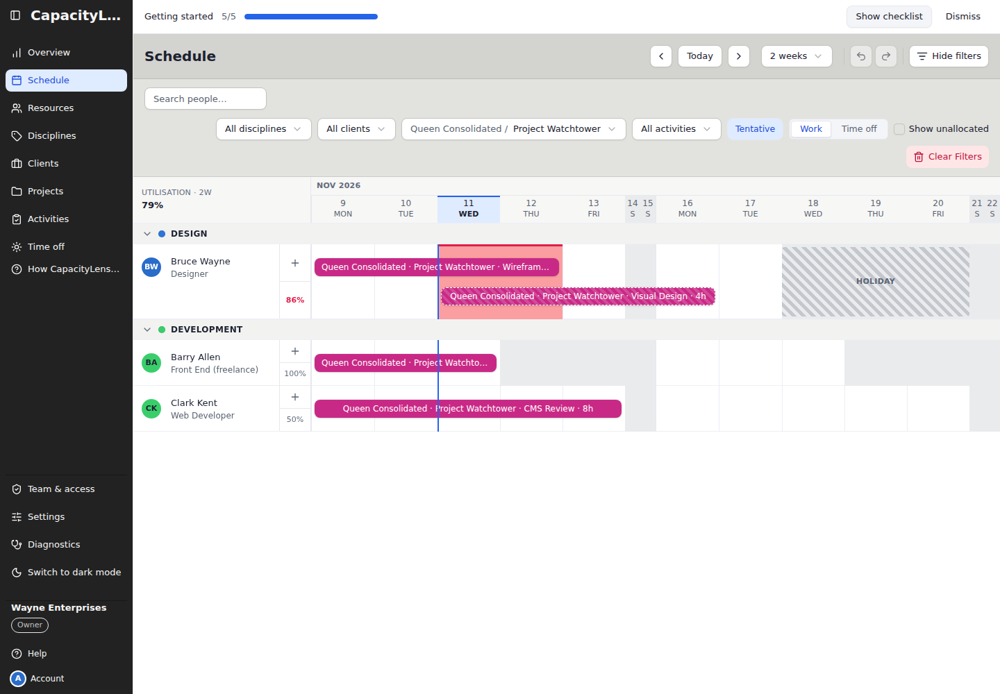
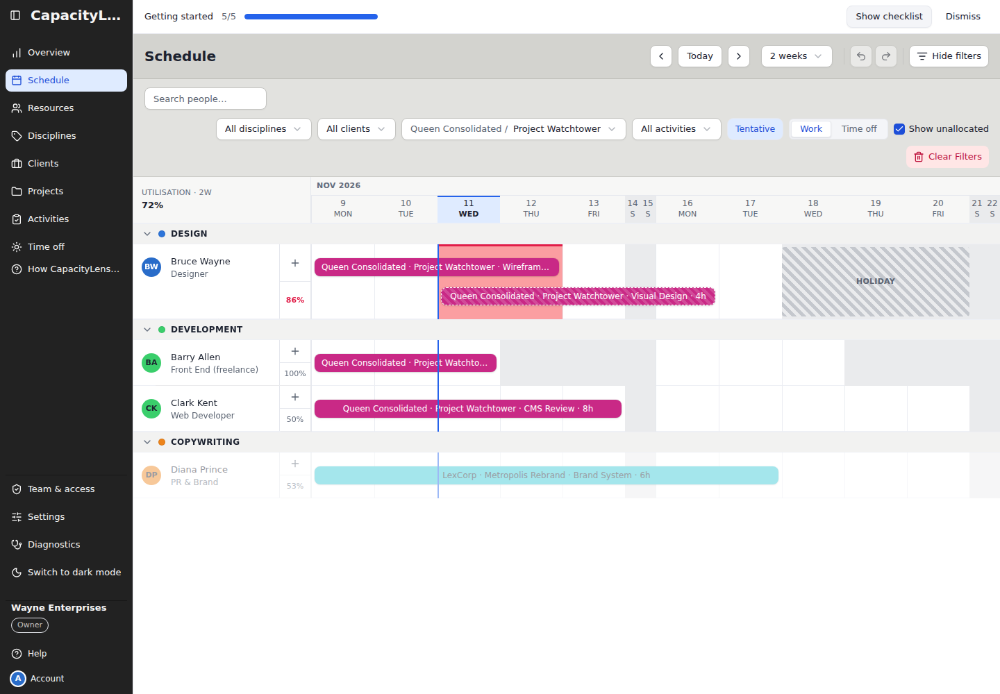

# Try the demo

Run a sample agency's schedule on your own machine. The command starts the full server and web
app with disposable SQLite storage. Schedule changes survive refresh and reset when you restart
the command. Display preferences may stay in your browser. To keep real data, [install CapacityLens](/self-hosting/install) instead.

You need [Node.js](https://nodejs.org) 24 (24.19.0 or newer within 24.x) or 26 (26.9.0 or newer within 26.x; check with
`node --version`) and
[pnpm](https://pnpm.io), which `corepack` in Node provides.

## Run it

1. Clone the repository, check out a release and install dependencies:

   ```bash
   git clone https://github.com/Kevinjohn/capacitylens.git
   cd capacitylens
   git checkout vX.Y.Z
   corepack enable && pnpm install --frozen-lockfile
   ```

   Replace `vX.Y.Z` with the newest tag on the
   [releases page](https://github.com/Kevinjohn/capacitylens/releases/latest). Otherwise you run
   unreleased changes on `main`.

2. Start the demo:

   ```bash
   pnpm run dev:demo
   ```

3. Open the address printed when the demo is ready. Sign in with the development email and
   password printed alongside it. The sample company opens automatically.

No setup link or `.env` file is needed. The command creates its disposable database locally.

## Explore the sample company

The schedule opens with people, clients, projects and bookings already in place. The development
identity is its Owner, so the same server permissions and password confirmations apply.



## Try these first

<div class="steps">

1. 

   **Open the filters.** Select **Show filters** at the far right of the Schedule toolbar.

2. 

   **Filter to a project.** Open **All projects** and choose one. **Clear Filters** turns red
   while the view is narrowed.

3. 

   **See who is free.** Select **Show unallocated**. People without work on that project return
   as dimmed rows.

4. **Move some work.** Select **Clear Filters**, then drag a booking to another week and watch the
   [utilisation](/reference/glossary#utilisation) percentage update.

5. **Zoom out.** Change **Weeks visible** from two weeks to four or six.

</div>

<span id="what-s-next"></span>

Next: [Install CapacityLens](/self-hosting/install) — keep real data with real sign-in.
