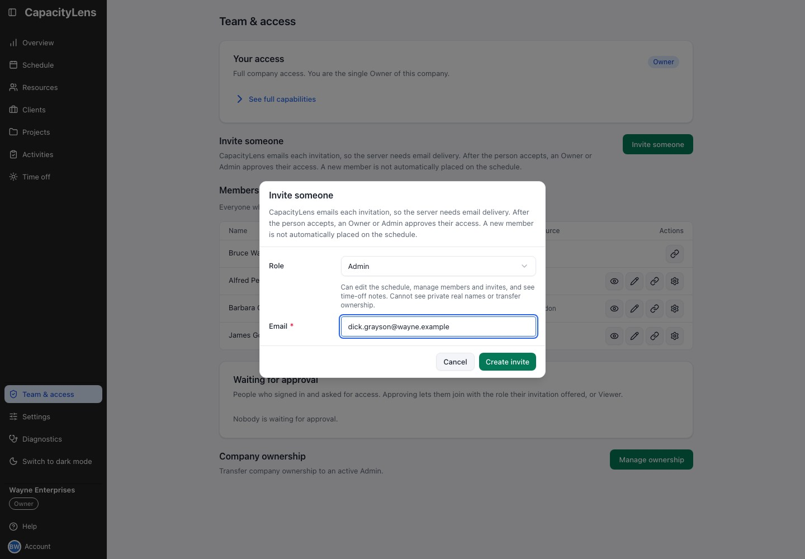
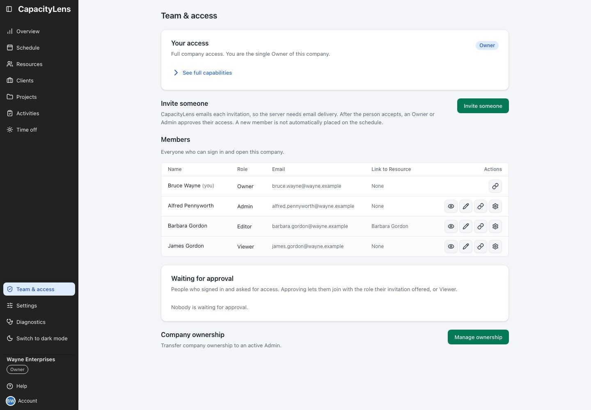

# Appoint an Admin

Invite one person as Admin to run the company day to day. You stay the Owner.

1. Open **Team & access** and select **Invite someone**.
2. Set **Role** to **Admin** and enter their email.
3. Leave **No Resource linked** unless they already have a row on the schedule. An invitation gives
   sign-in access; it does not put anyone on the schedule.
4. Select **Create invite**. If email is set up, CapacityLens sends the invitation. If it isn't, or
   sending fails, select **Copy** and send the link privately.

The link is shown only now. If it is lost, revoke the invite under **Outstanding invites** and
create a new one.

## Hand over

When their row in **Team & access** shows **Admin**, send them
[Get the schedule ready](/admin/). If the invite is still pending, ask whether they received the
email or link.

Next: [Owner responsibilities](/owner/responsibilities) — the decisions that stay with you.
