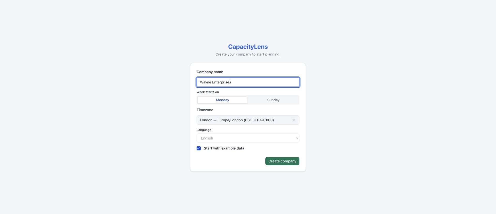

# Create your company

Sign in with the setup token from your installer, then create the company. You need the
CapacityLens address and that token.

## Sign in for the first time

1. Open the address. The sign-in page says **Setup the account Owner**.
2. Enter your name, email and password, and paste the token into **Owner setup token**.
3. Select **Create my sign-in**.

The token is not shown again. If you do not have it, or the form rejects it, ask the installer.

If the installer set up [company login](/reference/glossary#company-login), choose that provider
instead and use the email address the installer approved for the first Owner. If no provider
accepts your address, ask the installer to check the first-Owner setup before you try a different
identity.

## Create the company

1. Enter the **Company name**.
2. Choose **Week starts on** and **Timezone**. The list is searchable and starts with your browser's
   time zone. These two apply to everyone and **cannot be changed later**, so agree them
   with your team first.
3. Keep **Start with example data** to add fictional people, a client, a project and sample
   bookings, or clear it to start with an empty schedule. It is selected by default for your first
   company.
4. Select **Create company**. CapacityLens opens Schedule.

**Language** offers only English. Week start and time zone stay visible, read only, under
**Settings → Data and support → Company details**.

## If adding the example data fails

The company is still created. An Owner or Admin can retry from **Settings → Data and support →
Example data** while the company has no people, clients, projects or bookings. The in-memory demo
does not show the checkbox.

Next: [Appoint an Admin](/owner/appoint-an-admin) — hand the day-to-day running to someone else.
