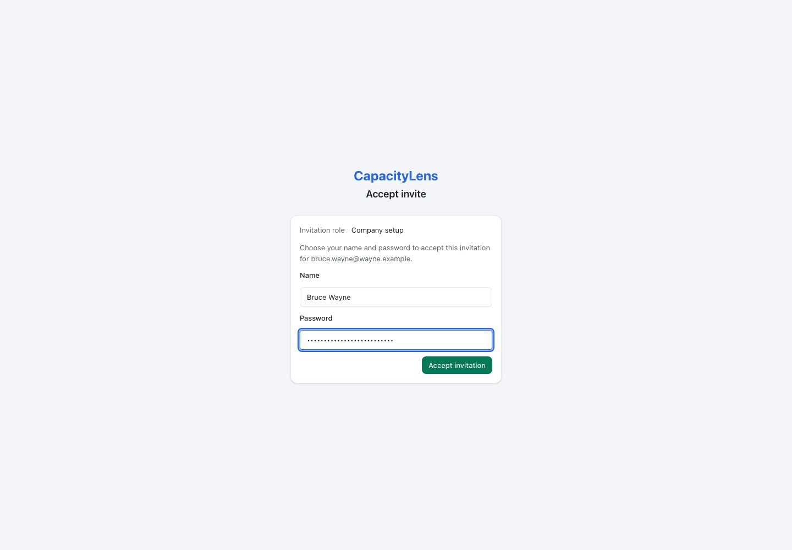
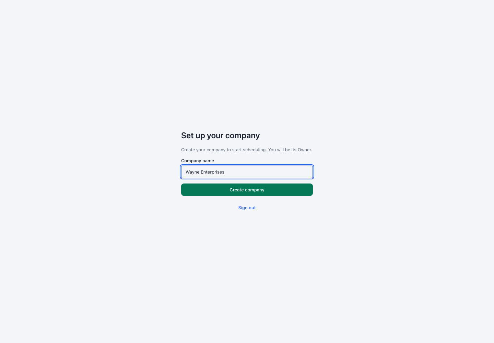

# Access your company

Sign in with the setup token from your installer. You need the CapacityLens address and that token.
The first sign-in leads to company setup in the browser.

## Sign in for the first time

1. Open the address. The sign-in page says **Setup the account Owner**.
2. Enter your name, email and password, and paste the token into **Owner setup token**.
3. Select **Create my sign-in**.

The token is not shown again. If you do not have it, or the form rejects it, ask the installer.

If the installer set up [company login](/reference/glossary#company-login), choose that provider
instead and use the email address the installer approved for the first Owner. If no provider
accepts your address, ask the installer to check the first-Owner setup before you try a different
identity.

## Set up your company

Enter **Company name** and select **Create company**. Your company opens on Schedule, with you as
Owner. The service keeps running throughout setup. If a save fails, the name stays in the form and
the error explains what to do before trying again.

The company starts with Monday as the first day of the week, Monday–Friday as working days and
day-based scheduling. It contains the built-in Internal client and no sample scheduling records.
Setup is available only when your identity is the only sign-in and no company or membership exists.
The server blocks additional open signup until your company exists, so another signup cannot
interrupt this first-run setup.
If multiple identities already exist, ask whoever manages hosting to resolve access. Setup cannot
create a second company or replace an Owner.
The temporary [demo](/getting-started/try-the-demo) lets you explore fictional companies without
storing their records.

Next: [Appoint an Admin](/owner/appoint-an-admin) — hand the day-to-day running to someone else.
