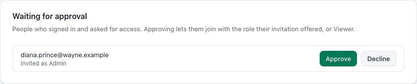

# Access your company

Create your sign-in, name the company and give someone its day-to-day running. Whoever manages
hosting remains responsible for the server, backups and upgrades.

You need the one-time setup link from whoever installed CapacityLens.

1. 

   **Sign in for the first time.** Open the setup link. Enter your **Name** and a **Password**, then
   select **Accept invitation**. The link works once.

2. **Create your company.** On **Set up your company**, enter **Company name** and select
   **Create company**. Schedule opens with you as Owner. [Company setup](/owner/create-your-company)
   explains what to do if access is unavailable.
   The [demo](/getting-started/try-the-demo) lets you edit fictional companies, but its changes are
   lost on reload.

3. 

   **Invite an Admin.** Open **Team & access** and select **Invite someone**. Set **Role** to
   **Admin**, enter their email and select **Create invite**. CapacityLens emails the invitation;
   the server needs email delivery for this.

4. 

   **Approve and hand over.** Until they accept, the invitation waits under **Outstanding
   invites**. Once they have chosen a password and selected **Ask for access**, they appear under
   **Waiting for approval**: select **Approve**. When their row shows **Admin**, send them [Get the schedule ready](/admin/).

Running the company yourself as well? Skip step 3 and go straight to
[Get the schedule ready](/admin/).

## What stays with you

Appointing an Admin does not make them the Owner. Transferring ownership and importing data stay
with you.
[Owner responsibilities](/owner/responsibilities) covers each of them.

## Go further

- [Access your company](/owner/create-your-company): the setup link, an expired link, and the
  first-company setup.
- [Appoint an Admin](/owner/appoint-an-admin): lost links, pending invitations and linking a
  scheduled person.
- [Roles and permissions](/getting-started/roles-and-permissions) for what each role can see and
  do.
- [Owner FAQ](/owner/faq)
