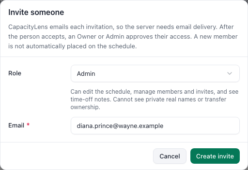
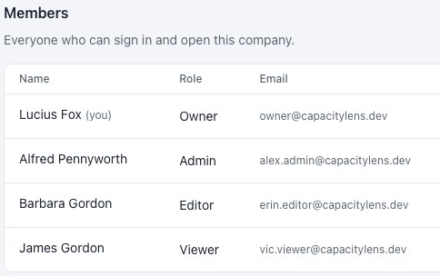

# Set up your company

You own the company in CapacityLens. Your job is short: create the company and give someone
the day-to-day running of it. Four steps, then you can stop.

You need the CapacityLens address and the setup token from whoever installed it.

1. 

   **Sign in for the first time.** Open the address. Enter your name, email and a password, and
   paste the setup token into **Owner setup token**. Select **Create my sign-in**. The token works
   once. If your installer set up Google or Microsoft sign-in, choose that instead.

2. 

   **Create the company.** Enter its name, then choose the day the week starts and your timezone.
   These two apply to everyone and **cannot be changed later**. Leave **Start with example data**
   ticked to see a working schedule straight away, or clear it to start empty. Select **Create
   company**.

3. 

   **Invite an Admin.** Open **Team & access** and select **Invite someone**. Set **Role** to
   **Admin**, enter their email and select **Create invite**. CapacityLens emails the invitation
   if email is set up. If it isn't, select **Copy** and send them the link yourself.

4. 

   **Hand over.** When their row in **Team & access** shows **Admin**, send them
   [Get the schedule ready](/admin/). They take it from here.

Running the company yourself as well? Skip step 3 and go straight to
[Get the schedule ready](/admin/).

## What stays with you

Appointing an Admin does not make them the Owner. Transferring ownership, importing data and
deleting the company stay with you.
[Owner responsibilities](/owner/responsibilities) covers each of them.

## In more detail

- [Create your company](/owner/create-your-company): company login, a rejected token, and the
  example data.
- [Appoint an Admin](/owner/appoint-an-admin): lost links, pending invitations and linking a
  scheduled person.
- [Roles and permissions](/getting-started/roles-and-permissions) for what each role can see and
  do.
- [Owner FAQ](/owner/faq)
