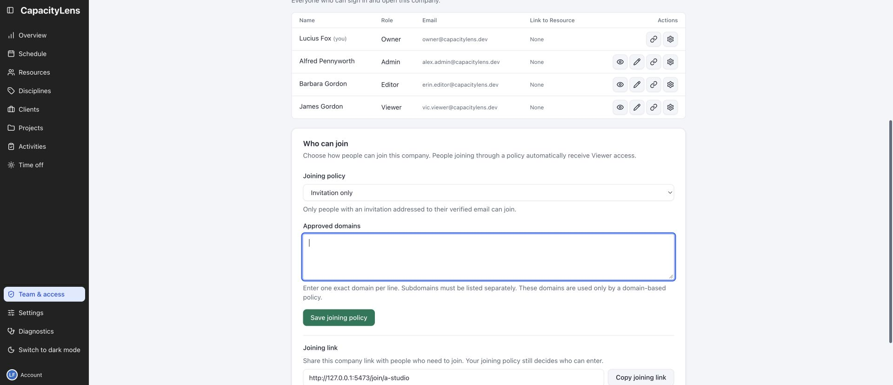
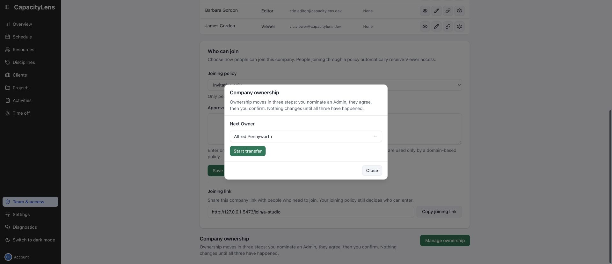
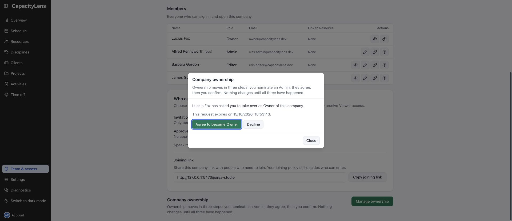
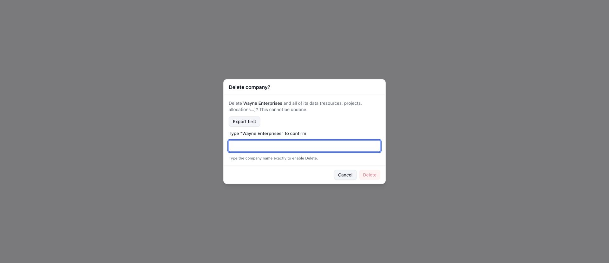

# Owner responsibilities

Four decisions stay with you: who can join, transferring ownership, importing a replacement
schedule and deleting the company. Your Admin runs everything else in the company. The service
operator handles installation, backups, upgrades and company-login setup.

## Decide who can join

Open **Team & access → Who can join** and choose a policy:

- **Invitation only**: an addressed invitation is required.
- **Open registration**: anyone with a verified email can join through the company link.
- **Approved domains**: verified addresses from the domains you list can join through the link.
- **Approved domains or invitation**: those domains, plus addressed invitations for people outside
  them.

For a domain policy, enter each exact domain on its own line, up to 50 domains and 16 KiB of text,
and select **Save joining policy**. An empty or invalid list cannot be saved. Under **Approved
domains**, even an invitation is accepted only from a listed domain.

People who join through the policy get **Viewer**. Send an addressed invitation when someone needs
Editor or Admin. Owners and Admins can copy the **Joining link** here; Admins can see the policy but
not change it. A change affects future joins only: it does not change current members or override
**Disable Access**.

If a teammate cannot join, check the policy and the domain spelling. They need a verified address
that meets the policy, or an invitation to their email.
[Join your team](/using/join-your-team) has their steps.

## Transfer ownership

Nothing changes until all three steps are complete.

1. 

   **Nominate an Admin.** In **Team & access → Company ownership**, select **Manage ownership**,
   choose an active Admin in **Next Owner** and select **Start transfer**.

2. 

   **They agree.** The nominee opens the same modal and selects **Agree to become Owner** or
   **Decline**. Only they can agree.

3. **You confirm.** Return to **Manage ownership** and select **Confirm the transfer**. You become
   an Admin; they become the Owner.

Until you confirm, you can **Cancel the transfer** or nominate another Admin, and the nominee can
withdraw their agreement. The request expires after seven days, and ends if either person's
membership changes. **Manage ownership** shows whether a request was declined, cancelled, replaced,
expired or invalidated. If it cannot load, select **Try again**.

Sensitive transfer actions ask you to confirm your sign-in; viewing the request does not. If your access cannot
refresh after the transfer, follow the recovery message before continuing.

## Import or delete company data

Import replaces the active company's planning records; it does not add to them. Check the
destination and file before you confirm. It needs a recent sign-in.
[Import and export](/using/settings#import-and-export)

To delete the company, select **Delete** on its row in the company chooser. **Switch company**
appears only when you can access two or more companies; if it is missing, ask the service operator
how to proceed.

Select **Export first** if you need a copy, then type the exact company name to enable **Delete**.

::: warning
Deleting the company permanently removes it and all its data for everyone. There is no undo.
:::

Deleting needs a recent sign-in. To take away one person's access instead, use
[Stop access](/admin/invite-teammates#stop-access).

[Roles and permissions](/getting-started/roles-and-permissions) · [Owner FAQ](/owner/faq)
