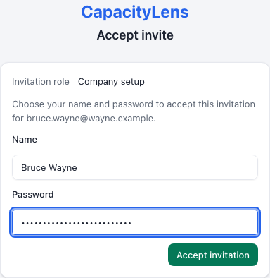

# Install and run CapacityLens

You put CapacityLens on a server and hand it to the company's Owner. It is one Node process and
one SQLite file. There is no database server to run and nothing to build. On a host that already
runs Node 24 and has a hostname pointing at it, the install takes about ten minutes.

1. **Install it.** Download the release archive, pick a folder for the data, generate the
   settings with one command, start the server, and open the address. Those are the
   [five install steps](/self-hosting/install), the same on a managed host such as Forge as on
   your own Linux server.

2. **Put HTTPS in front.** A managed host issues the certificate for you. On your own server,
   [Caddy does it in four lines](/self-hosting/install-without-docker#https). Finish this before
   anyone enters a password. [TLS and networking](/self-hosting/tls-and-networking)

3. **Check backups.** In production, CapacityLens snapshots the database every hour into a
   `backups` folder beside it. Set `CAPACITYLENS_BACKUP_DIR` to change where. Copy the snapshots
   and the environment file off the server.
   [Backups and restore](/self-hosting/backups-and-restore)

4. 

   **Hand over.** Check `https://your-address/api/health` shows `"ok":true`. If you are also the
   Owner, continue with [Set up your company](/owner/). Otherwise send the Owner the address and
   that guide, and send the setup token separately and privately. This is the screen they will
   see. After the Owner has signed in, remove `CAPACITYLENS_SETUP_TOKEN` and restart.
   [Verify and hand over](/self-hosting/verify-and-hand-over)

## What you're taking on

Self-hosting means you, or someone you name, own the service after handover. That means keeping
backups tested, watching health and disk space, installing new releases, and making configuration
changes through a reviewed restart, agreed with an Owner or Admin when they affect sign-in or
members. Support is community help on a best-effort basis, with no guaranteed response time. [Get
help](/open-source#get-help) explains where to ask.

## Follow the full steps for your host

- [Deploy on a managed host](/self-hosting/managed-vps/) such as Forge, Ploi or
  RunCloud, working in the platform's own screens.
- [Install without Docker](/self-hosting/install-without-docker) on a Linux host with systemd.

## Other ways to install

- [Install with Docker](/self-hosting/install-with-docker) if your host already runs Docker.
- [Try the demo](/getting-started/try-the-demo) first if you only want to look around.

## Run it

- [Configuration](/self-hosting/configuration): every setting, including sign-in and storage.
- [Company login](/company-login/): Google or Microsoft sign-in, and moving a team onto it.
- [Upgrades](/self-hosting/upgrades) to a newer release.
- [Monitoring and health checks](/self-hosting/monitoring) for health, storage and certificates.
- [When something goes wrong](/self-hosting/incidents) for diagnosis and recovery.
- [Recover a blocked ownership transfer](/self-hosting/ownership-transfer-recovery).
- [Install and operations FAQ](/self-hosting/faq).
