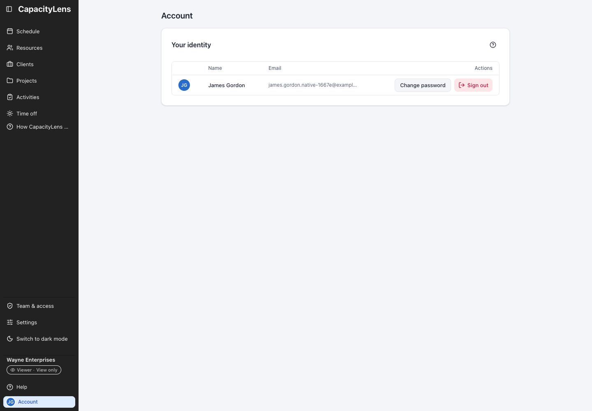
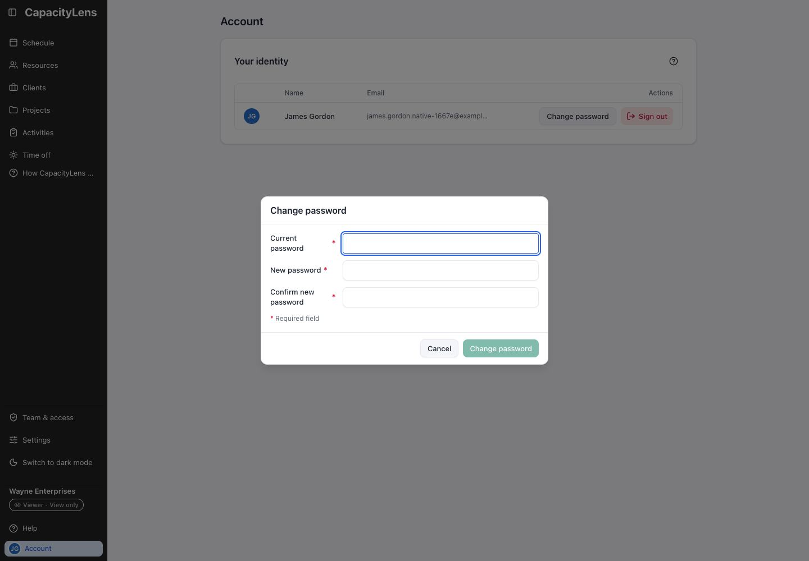

# Account

Check who you're signed in as, change your password or delete your account. Every member can
use it, including a Viewer.

Open **Account** at the bottom of the left menu. It shows the identity you signed in with: avatar,
name, email and the actions available to you. Hover over or focus a shortened email to read it in
full. On a narrow screen, scroll the row sideways.

Check **Team & access → Your access** for your role in the company.

## Change your password

1. Select **Change password**.
2. Enter your **Current password**, a **New password** of 15–128 characters and the same value in
   **Confirm new password**.
3. Select **Change password** and wait for **Password changed. Sign in again with your new
   password.**

Every browser and device, including this one, must then sign in again. A wrong current password or a rejected
new password leaves the password unchanged: correct the form and try again. **Cancel** clears it.

If the message says **Password changed, but some follow-up cleanup failed**, your new password is
already active. The form clears; use the new password if asked to sign in again.

If the connection fails and the result cannot be confirmed, try signing in with the new password
before submitting another change.

## Sign out

Select **Sign out** when you finish, especially on a shared device. It ends this browser's
session only; your membership and scheduling records stay.

Account doesn't list your other sessions. Changing your password signs out every browser and
device.

To leave a company, ask its Owner or Admin to suspend your membership. Only an Owner or Admin can
restore it, with the same role.

## Delete your account

1. Select **Delete account**.
2. Enter your **Current password** and select **Delete account**.

Your sign-in, sessions and company memberships are removed and this browser returns to the sign-in
page. Invitations you sent stay valid. Your name stays on past schedules and audit entries; an Owner
or Admin can anonymise the person record afterwards. Deletion cannot be undone.

If the message says **Your account was deleted, but a follow-up step failed**, the account is
already gone and you are signed out.

An Owner cannot delete their account while they own a company: transfer ownership first in
**Team & access**, then delete.

## If you can't sign in

Forgotten your password? Select **Forgot password?** on the sign-in page and open the emailed link.
If the email doesn't arrive, ask your installer. Resetting your password ends your existing sessions
on every browser and device.

Next: [Team & access](/using/team-access) — check your role.
