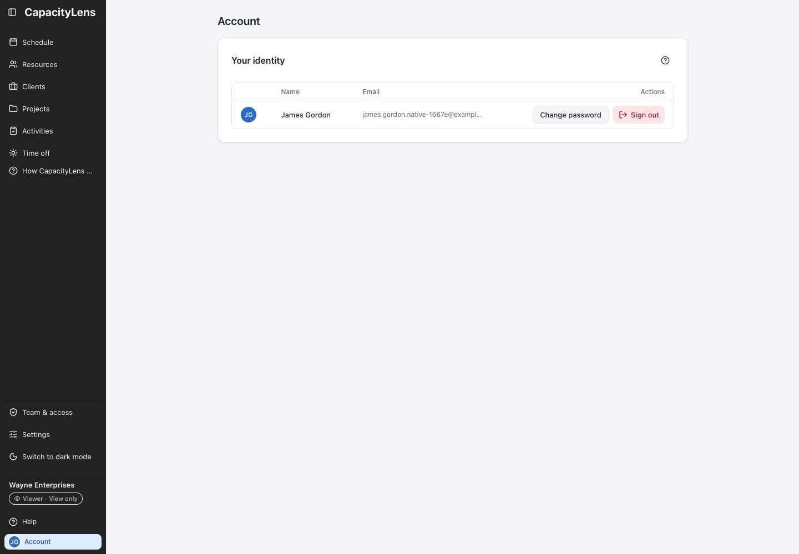
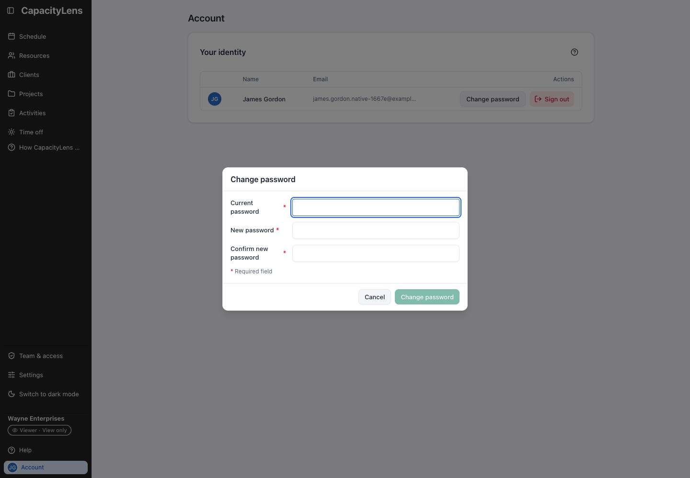

# Account

Check who you're signed in as, change your password and connect company login. Every member can
use it, including a Viewer.

Open **Account** at the bottom of the left menu. It shows the identity you signed in with: avatar,
name, email and the actions available to you. Hover over or focus a shortened email to read it in
full. On a narrow screen, scroll the row sideways.

Your role isn't shown here, because one identity can belong to several companies with a different
role in each. Check **Team & access → Your access** for your role in the current company.

## Change a local password

1. Select **Change password**.
2. Enter your **Current password**, a **New password** of 15–128 characters and the same value in
   **Confirm new password**.
3. Select **Change password** and wait for **Password changed. Other sessions were revoked.**

Every other browser and device must then sign in again, including sessions in other companies.
If you see an error instead, such as a wrong current password or a rejected new one, the change
didn't happen: correct it or try again later. **Cancel** clears the form.

If you use company login, your provider owns your password and this button may be absent. Don't
create a second identity to get one.

## Connect company login

When the operator has set up Google or Microsoft, Account can show a **Connect** button for it.
Your local email must already be verified; you don't need an invitation.

1. Sign in with the identity you want to keep.
2. Select **Connect** and confirm your sign-in when asked.
3. Complete the provider's steps with the matching email address. If Microsoft asks for mailbox
   proof, open its message in the same browser.
4. Back on Account, check for the provider's **Connected** badge. A failed or cancelled connection
   shows an error.

If the message says your email is not verified, ask the operator to confirm you own the mailbox
and an Owner or Admin to arrange the repair. The repair signs you out everywhere; sign in again
before retrying. See
[Connect existing accounts](/company-login/move-to-single-sign-on#connect-existing-accounts) and
[Company login](/company-login/).

Installations that use only company login have no password controls here. Your provider handles
any multi-factor checks; there is no authenticator setup on this page.

## Sign out

Select **Sign out** when you finish, especially on a shared device. It ends this browser's
session only; your membership and scheduling records stay. To leave a company, ask its Owner or
Admin.

Account doesn't list your other sessions. Ask an Owner or Admin to revoke them if needed.

## If you can't sign in

Forgotten a local password? Use the recovery option on the sign-in page, if your installation
offers one. If it doesn't, or the email doesn't arrive, ask an Owner or Admin. For company login,
use your provider's recovery process.

An administrator's password reset or session revocation applies across every company you can
enter.

Display preferences are in [Settings → My display](/using/settings#my-display). Roles are
explained in [Team & access](/using/team-access).
