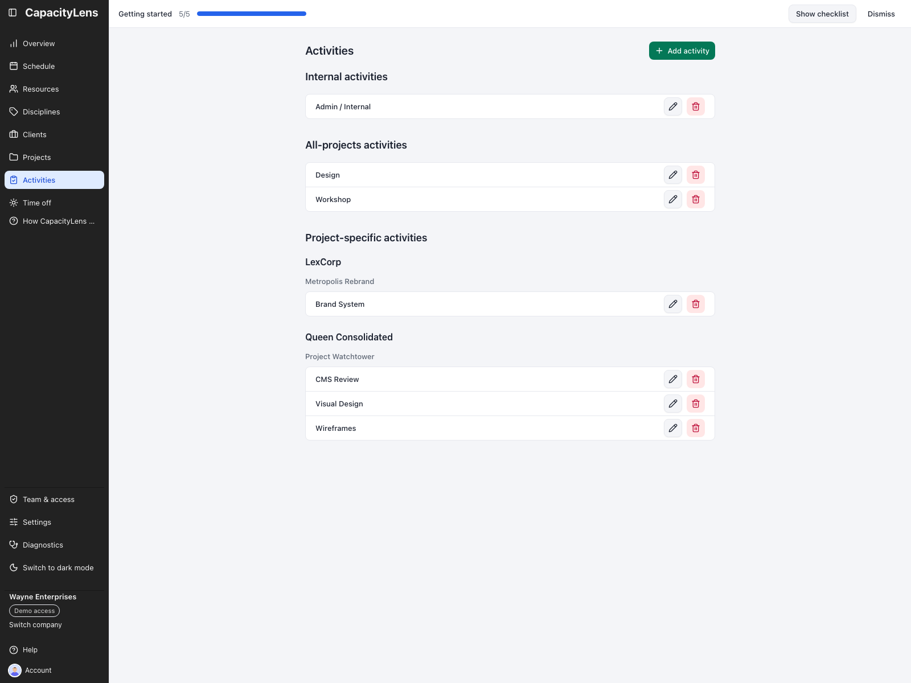

# Activities

Set up the kinds of work people are booked to do, such as Wireframes, Build or Admin, and choose where
each can be used. Only an Editor, Admin or Owner can add or change them.

Open **Activities**. It groups activities by where they can be used: **Internal activities**,
**All-projects activities** and **Project-specific activities**, the last listed under their client
and project. Internal and
All-projects activities are alphabetical; project-specific ones are ordered by client, project and
activity.

Your own assignments are in your [work list on Schedule](/using/read-the-schedule#your-work-list).

## Choose where an activity can be used

Select **Add activity** beside the page heading and choose its kind.

| Activity kind                                        | Use it for                                                           | Available                                                                    |
| ---------------------------------------------------- | -------------------------------------------------------------------- | ---------------------------------------------------------------------------- |
| **Internal**                                         | Non-billable work such as administration or an internal meeting      | Only when the booking's Project is **Internal**                              |
| **[All projects](/reference/glossary#all-projects)** | Work done the same way for many projects, such as account management | Under every real project, or under **No specific project** when unattributed |
| **Project-specific**                                 | Work for one project, such as its discovery or launch                | Only under its own project                                                   |

The kind controls where an activity is offered; each booking records where the time actually went.
One **All projects** activity can count towards Project Watchtower in one booking, Metropolis
Rebrand in another and **No specific project** in a third.

[Prepare clients and work](/admin/prepare-work) is the Admin's route through setting these up.

Next: [Choose the project and activity](/using/schedule-work#choose-the-project-and-activity) —
book against an activity.
