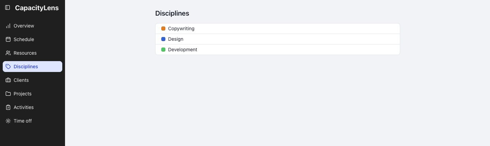
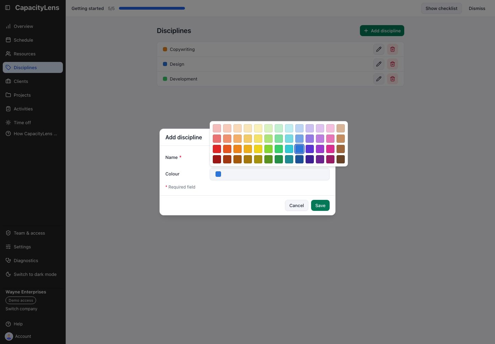
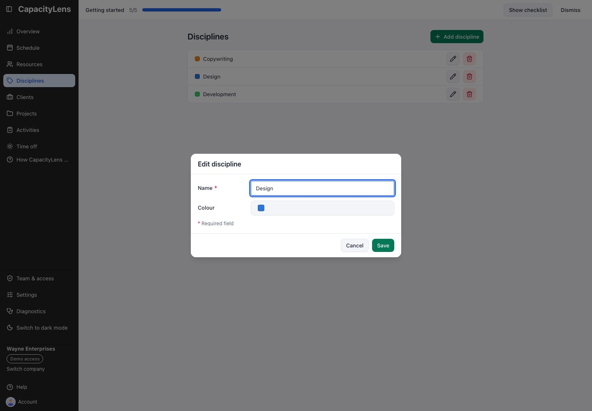
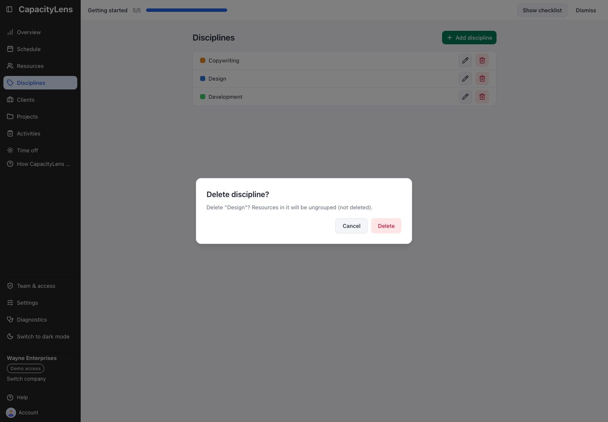

# Disciplines

Create the groups, such as Design or Development, that organise people on Schedule and give their
rows a shared colour.

Create a discipline here, then assign it to people in [Resources](/using/resources#add-a-person).

## Add or change a discipline

Select **Add discipline**, enter a name, choose a preset colour and save. It appears on Schedule
once someone is assigned to it, at the end of the schedule's group order. This list stays
alphabetical.

Select the edit icon on a row to change its name or colour. A blank name keeps the form open until
you correct it.

## Remove a discipline

Select the delete icon on its row and confirm **Delete discipline?** Its people are ungrouped,
not deleted, and keep their bookings. They appear in the **Unassigned** group, or the Studio and
Supplementary bands, until you assign another discipline.

Removed the wrong one? **Undo** restores the discipline and reconnects people who are still
ungrouped. Other edits to those people remain. **Redo** removes the group again.

## Turn disciplines off

When the company turns **Use disciplines** off in [Settings](/using/settings#disciplines), the
**Disciplines** page, its menu link and the Resources form's **Discipline** field are hidden;
`/disciplines` sends you to Schedule. Nothing is deleted, and turning it back on restores the
groups.
