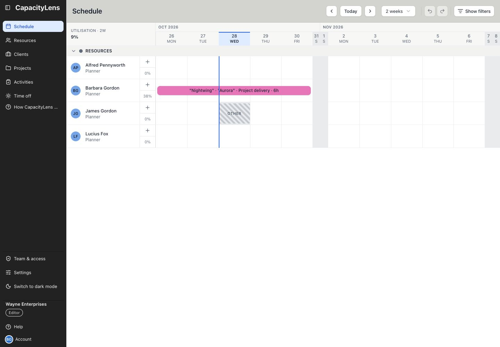
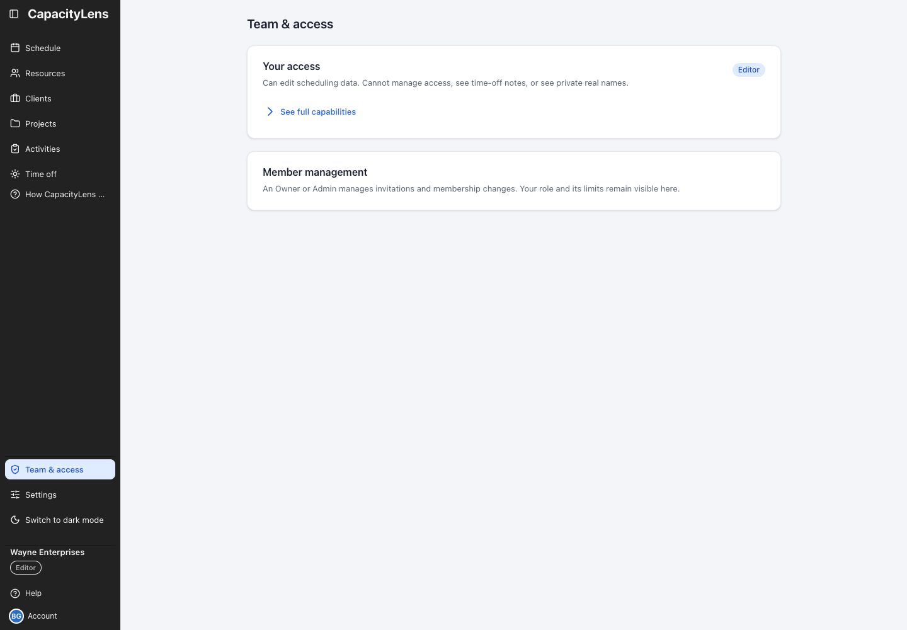
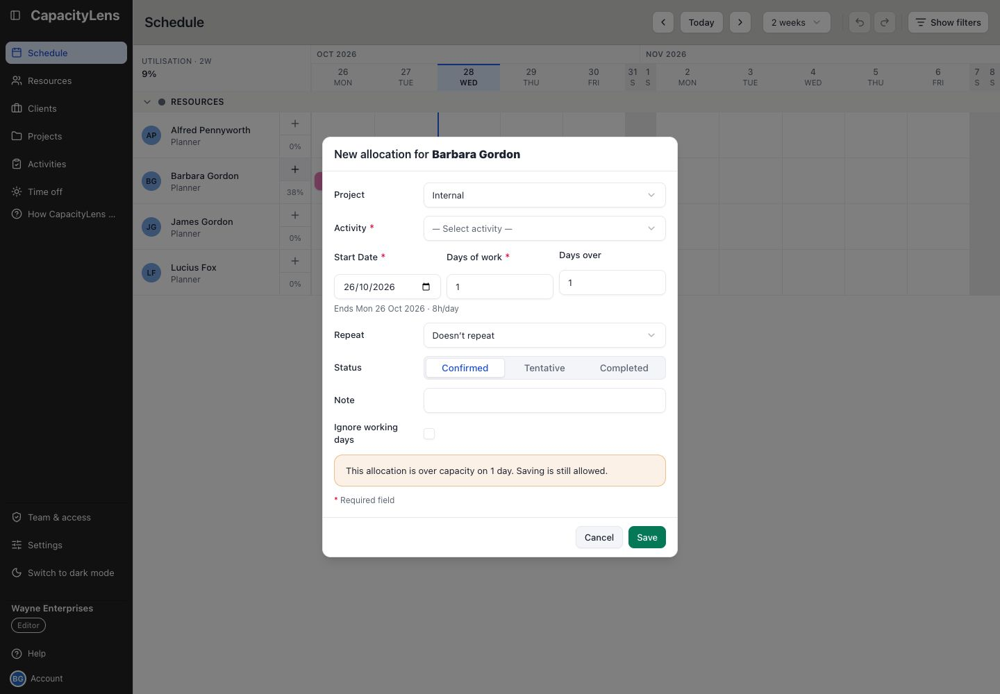

# Plan work as an Editor

Keep the team's plan up to date: bookings, resources, time off, clients, projects, activities and
ordinary company settings. Admins and Owners manage membership. Only the Owner decides who can
join, imports data, transfers ownership or deletes the company.

[See your work](/using/) covers joining and finding your way round Schedule.

## Check your role and company

Open **Team & access** near the bottom of the menu and check your role. If it says Viewer, ask an
Owner or Admin for Editor access. If you belong to several companies, use **Switch company** to
choose the plan you mean to change; your role can differ in each.

Signing in alone doesn't make you a member: follow [Join your team](/using/join-your-team) with
the address you were invited on. Being on the schedule doesn't give someone a sign-in, either.

## Check who has room

Before booking, read the person's row as a whole: utilisation, working days, time off and existing
bookings. Clear any filter when expected work is missing.
[Spot overwork](/using/read-the-schedule#reading-overwork) explains the percentage and why a blank
cell doesn't prove spare capacity.

If **Overview** is in your menu, use **Has availability** to compare the team week by week. Only
Owners and Admins see it by default; an Owner or Admin can open it to Editors. [Overview](/using/overview)
explains the figures.

## Prepare what the booking needs

Check **Resources** for the person and their working pattern, and add them if they're missing; an
invitation doesn't add them. When your company uses disciplines, **Disciplines** holds their groups.

Check **Clients**, **Projects** and **Activities** for the work. A project activity belongs to its
project; an internal activity is booked under the **Internal** project; an All-projects activity can be booked against any
project. Use existing records rather than making a second copy. If your company allows it, add an
activity from the booking form.

[Resources](/using/resources), [Disciplines](/using/disciplines),
[Clients and projects](/using/projects) and [Activities](/using/activities) explain the forms,
privacy and placeholders.
[Archive or delete a client or project](/using/projects#archive-or-delete-a-client-or-project)
explains what happens to their bookings.

## Book work

1. On **Schedule**, select **+** beside the person's name, or drag across the dates on their row.
2. Choose the project and activity, then the dates. Enter the amount in your company's units:
   Hours, Days or Blocks.
3. Mark the booking tentative or add a note if that helps. If you use **Repeat**, check the preview
   before saving.
4. Select **Save**, then check the bar sits on the right row and dates, and look at utilisation.

Bookings use only the person's working days and the company's working week, within the person's
start and end dates. A new booking must start on a working day inside those dates.
[Book on non-working days](/using/schedule-work#book-on-non-working-days) explains the exceptions.

An over-capacity warning is for you to resolve; CapacityLens never moves work for you.
[Schedule and change work](/using/schedule-work) covers every field, repeat and gesture.

## Change the plan

Select a bar to edit its amount, dates, status, note or assignee, or to duplicate or delete it.
Drag a bar to move or reassign it, or drag an edge to change its dates; the same working-day rules
apply.

**Undo** and **Redo** reverse changes still in your undo history. Check the schedule afterwards: a
teammate's later edit is not undone.

Record absences and closures on **Time off**, then check the affected weeks. Time-off notes are
visible only to Owners and Admins, even though you can create the entry.
[Time off](/using/time-off) covers repeats, conflicts and closures.

## Set your display and sign-in

**Settings → My display** changes this browser only. **Company setup** and **Scheduling features**
affect everyone, so check the plan after changing them. Week start and time zone are fixed when the
company is created. [Settings](/using/settings) explains each setting.

**Account**, at the bottom of the menu, shows your sign-in, its security controls and **Sign out**.
Ask an Owner or Admin if you are locked out. [Account](/using/account) explains sign-in, sign-out
and recovery.

## If something interrupts the work

### Why can't a booking start on the selected date?

Read the form's error first: **Ignore working days** doesn't remove every date restriction. Check
the person's start and end dates, their working pattern and the company's working days, then start
on an allowed working day.

### What if a save failed or someone changed the same record?

Use the retry or recovery control offered. If CapacityLens replaces your edit with the current
saved record, review it before editing again. A bar you can still see is not proof its last change
was saved. [Day-to-day FAQ](/using/faq) covers connection messages.

### Why do I see a code name instead of a client's name?

Only the Owner sees confidential real names, whatever your role. Use the code name.
