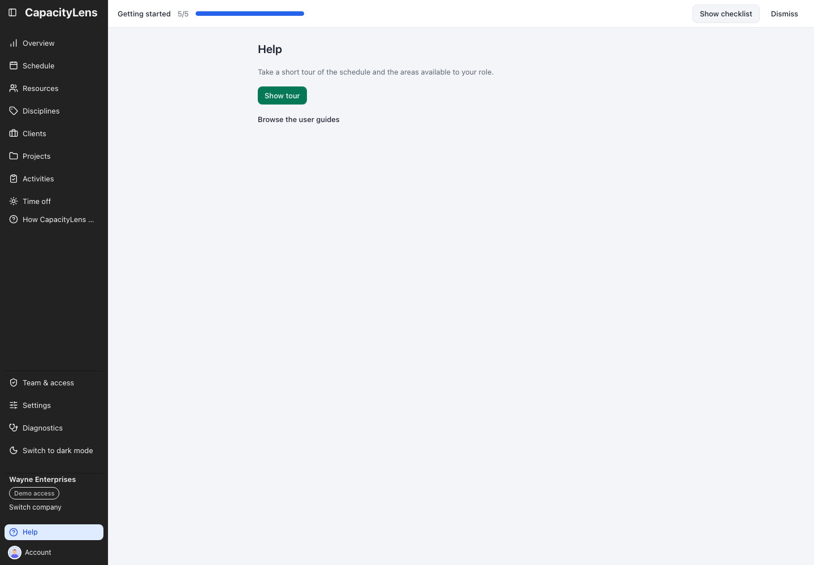

# Help

Start a short tour for your role, or open these guides. Every role can use it, even after Getting
started is dismissed.

Open **Help** near the bottom of the left menu, above **Account**, or from the command palette.

## Take the tour

Select **Show tour** to open Schedule and follow a tour for your role. Owners see company setup
and scheduling stops; Viewers see two stops about reading the schedule.
[Take a role-based tour](/getting-started/roles-and-permissions#take-a-role-based-tour) lists each
role's tour.

**Show tour** is disabled while your access is being checked or cannot be confirmed. If the tour
fails to start, an error appears so you can try again.

## Open the guides

Select **Browse the user guides** for the online [See your work](/using/) guide.
