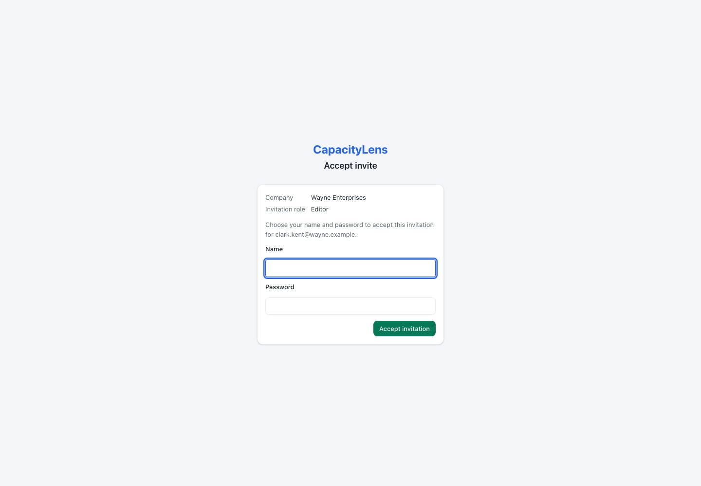
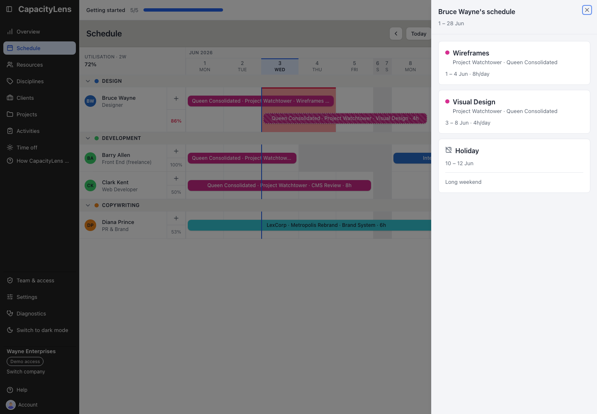
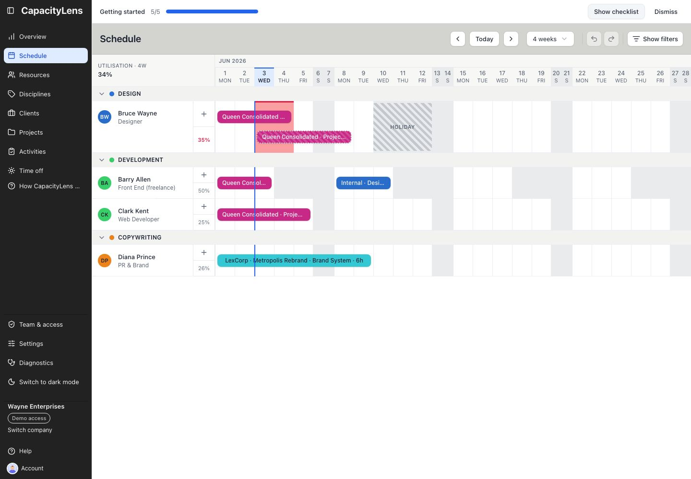

# See your work

Someone at your agency has invited you. CapacityLens shows what you're booked on, when, and
who else is busy. You don't need to install or set up anything.

1. 

   **Accept the invitation.** Open the link from your email. Sign in, or select **Create
   account** if you're new, using the address the invitation was sent to. Then select **Accept
   invite**. [Join your team](/using/join-your-team)

2. 

   **Find your week.** You land on **Schedule**. Find your name and select the avatar beside it.
   Your bookings, time off and remaining capacity open in one list.

3. 

   **Read the schedule.** Each bar is a booking: its project, its dates and how much of each day
   it takes. **Red** means someone has more work than time that day. The percentage beside a
   name shows how full they are across the weeks on screen. [Read the schedule](/using/read-the-schedule)

4. 

   **Look further ahead.** Use **Weeks visible** to show up to eight weeks, and **Today**,
   **Prev** and **Next** to move. **Show filters** narrows the view to one client, project or
   activity.

That's all most people need. If something looks wrong, tell whoever books the work: with the
**Viewer** role you can look but not change.

## If you book the work

With the **Editor** role you can also change the plan. Drag across empty days to book someone,
drag a bar to move it, and select **Undo** if you change your mind.
[Plan work as an Editor](/using/editor) covers the rest.

## Pages

- [Schedule](/using/read-the-schedule): the day-by-day grid of bookings, utilisation and time off.
- [Overview](/using/overview): each person's free days, week by week. Owners and Admins only,
  unless your company opens it to everyone.
- [Resources](/using/resources): the people, placeholders and partners you can schedule.
- [Disciplines](/using/disciplines): the coloured groups for people and schedule rows.
- [Clients and projects](/using/projects): the organisations and projects behind each booking.
- [Activities](/using/activities): the kinds of work you book.
- [Time off](/using/time-off): holidays, absences and company closures.
- [Team & access](/using/team-access): your role and, for Owners and Admins, the team's access.
- [Settings](/using/settings): company planning rules and your own display preferences.
- [Help](/using/help): a short tour for your role.
- [Account](/using/account): your sign-in and security.

## Tasks

- [Check the plan as a Viewer](/using/viewer)
- [Find available capacity](/using/overview#find-available-capacity)
- [Schedule and change work](/using/schedule-work)
- [Record time off](/using/time-off#record-time-off)
- [Day-to-day FAQ](/using/faq)
