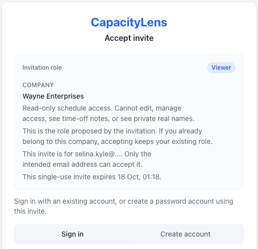
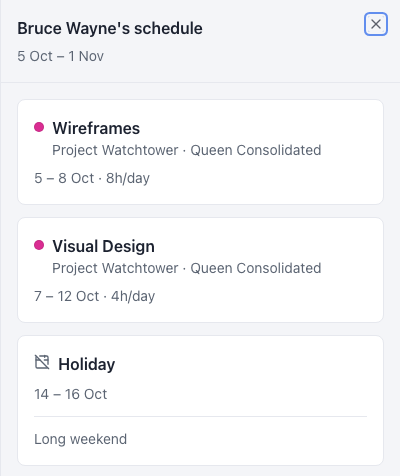
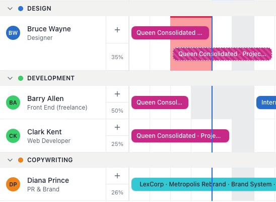
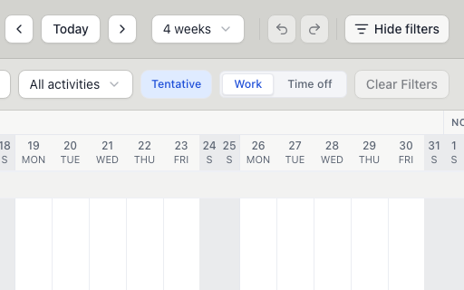

# See your work

Someone at your agency has invited you. CapacityLens shows what you're booked on, when, and
who else is busy. You don't need to install or set up anything.

1. 

   **Accept the invitation.** Open the link from your email and use the address it was sent to.
   Sign in, then select **Accept invite**. New here? Select **Create account**, then **Create
   account and accept**. [Join your team](/using/join-your-team)

2. 

   **Find your week.** You land on **Schedule**. Find your name and select the avatar beside it.
   Your bookings and time off open in one list. Not on the list? Ask whoever invited you to add you.

3. 

   **Read the schedule.** Each bar is a [booking](/reference/glossary#booking) (the app calls it
   an allocation): its project, its dates and how much of each day it takes. **Red** means someone
   has more work than time that day. The percentage beside a name, its
   [utilisation](/reference/glossary#utilisation), shows how full they are across the weeks on
   screen. [Read the schedule](/using/read-the-schedule)

4. 

   **Look further ahead.** Use the weeks menu to show up to eight weeks, and **Today** and the
   arrows beside it to move. **Show filters** narrows the view to one client,
   project or activity.

That's all most people need. If something looks wrong, tell whoever books the work: with the
**Viewer** role you can look but not change.

## If you book the work

With the **Editor** role you can also change the plan. Drag across empty days to book someone,
drag a bar to move it, and select **Undo** if you change your mind.
[Plan work as an Editor](/using/editor) covers the rest.

## Go further

- [Schedule](/using/read-the-schedule): the day-by-day grid of bookings, utilisation and time off.
- [Overview](/using/overview): each person's free days, week by week. Owners and Admins only,
  unless your company opens it to Editors or everyone.
- [Resources](/using/resources): the people, [placeholders](/reference/glossary#placeholder) and
  external parties you can schedule.
- [Disciplines](/using/disciplines): the coloured groups for people and schedule rows.
- [Clients and projects](/using/projects): the organisations and projects behind each booking.
- [Activities](/using/activities): the kinds of work you book.
- [Time off](/using/time-off): holidays, absences and company closures.
- [Team & access](/using/team-access): your role and, for Owners and Admins, the team's access.
- [Settings](/using/settings): company planning rules and your own display preferences.
- [Help](/using/help): a short tour for your role.
- [Account](/using/account): your sign-in and security.
- [Check the plan as a Viewer](/using/viewer)
- [Find available capacity](/using/overview#find-available-capacity)
- [Schedule and change work](/using/schedule-work)
- [Record time off](/using/time-off#record-time-off)
- [Day-to-day FAQ](/using/faq)
