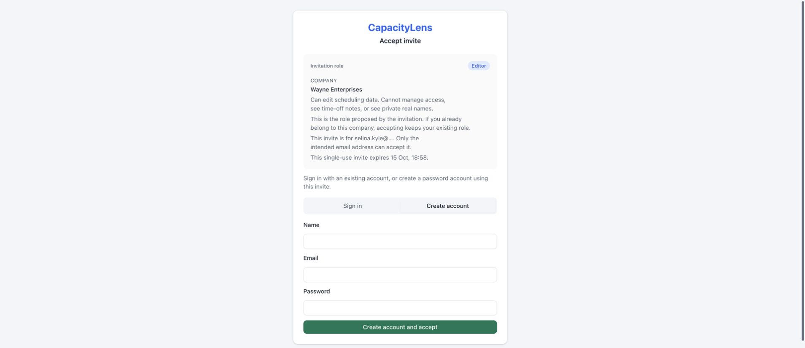
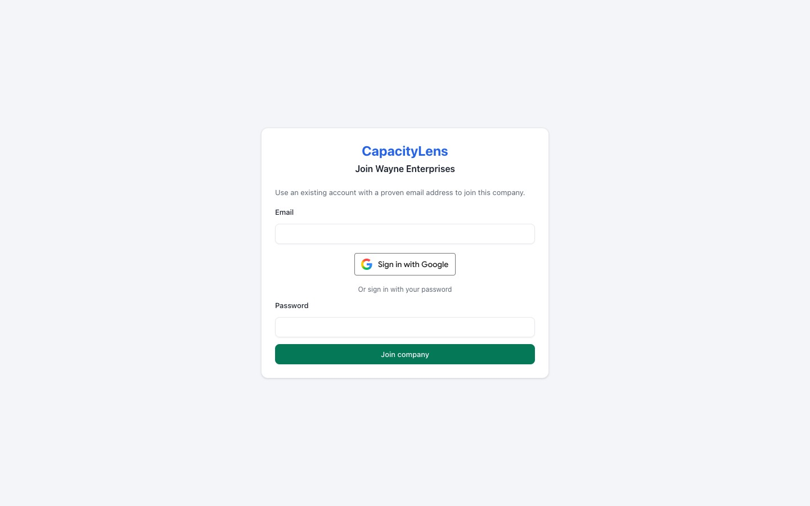
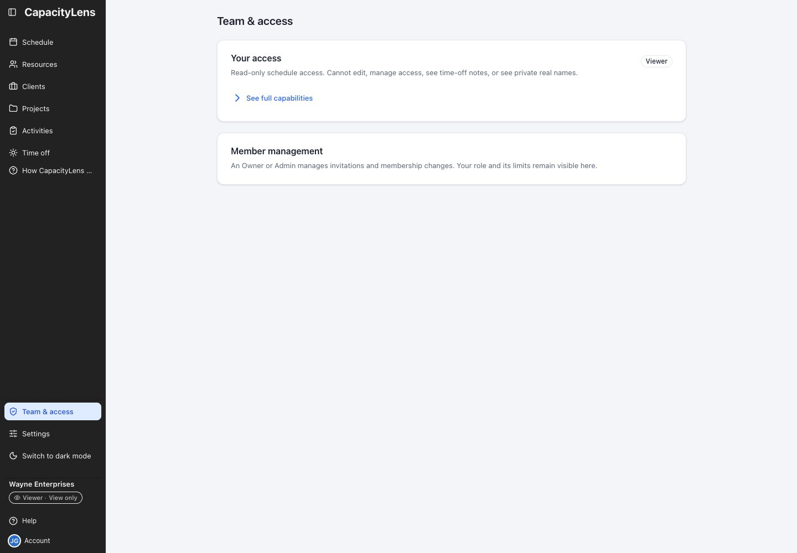

# Join your team

Accept your agency's invitation or company joining link and open its schedule. An invitation names
the company and your proposed role. A joining link names the company and applies its joining
policy.

## Accept an invitation

Open the link and check the company, role, expiry and any email hint. Opening it only previews the
invitation. If it is tied to an email address, only that address can accept it.

- With a password sign-in, enter that email and password, then select **Accept invite**.
- If company login is offered, choose the provider, complete its steps and return to accept.
- If you're already signed in, check the identity shown is the invited address. If not, select
  **Use a different account** before accepting.

New here? If **Create account** is offered, select it, enter your name, the invited email and a
password, then select **Create account and accept**. That one step creates your sign-in and
accepts the invitation.

You land on the company's Schedule with the invited role. If you were already a member, you keep
your existing role; ask an Owner or Admin to change it.

## If the invitation doesn't work

If the invitation is for the wrong email, has expired or was already used, ask an Owner or Admin
for a new one.

## Join with a company link

1. Check the page names the company you expect.
2. Enter your email, then sign in with a provider or an existing password account.
3. Select **Join company**.

A joining link can't create a password account. Open registration and approved-domain policies
need proof that you own your email. People who join this way get the **Viewer** role; an addressed
invitation can give the role it names.

## If the page can't prove your email

- Select **Email me a verification link**, if shown, and open the message while signed in. Select
  it again if nothing arrives.
- If Microsoft asks you to prove your email, open its message in the same browser. Use **Resend
  email** if it doesn't arrive, or **Start again** to restart. See
  [Set up Google or Microsoft sign-in](/company-login/set-up-company-login).
- Or sign in with a verified provider, or ask an Owner or Admin for an addressed invitation.

If joining is refused, ask an Owner or Admin whether the company's policy allows your address or
whether your access is disabled.

## Check your access after joining

Your role is under **Team & access → Your access**. Joining doesn't put you on the schedule.
If you can't find your row, ask your Admin to add you in **Resources** and link it to your sign-in.

Next: [Schedule](/using/read-the-schedule) — find your work.
