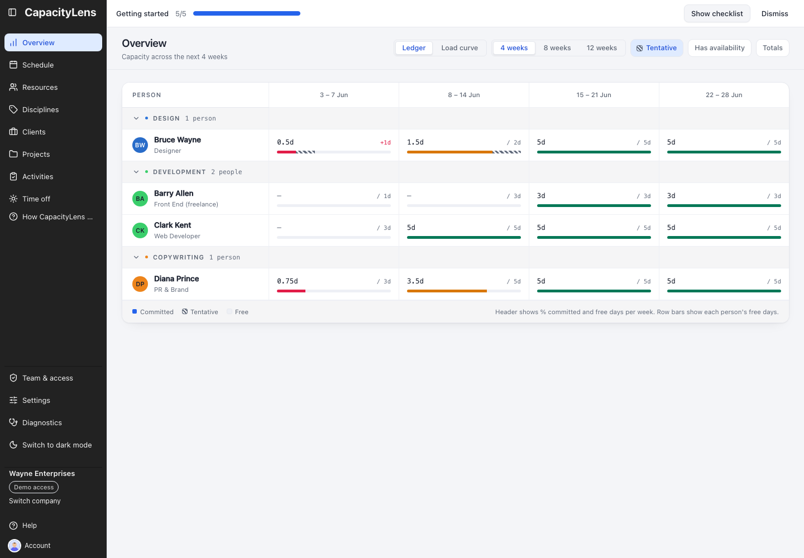
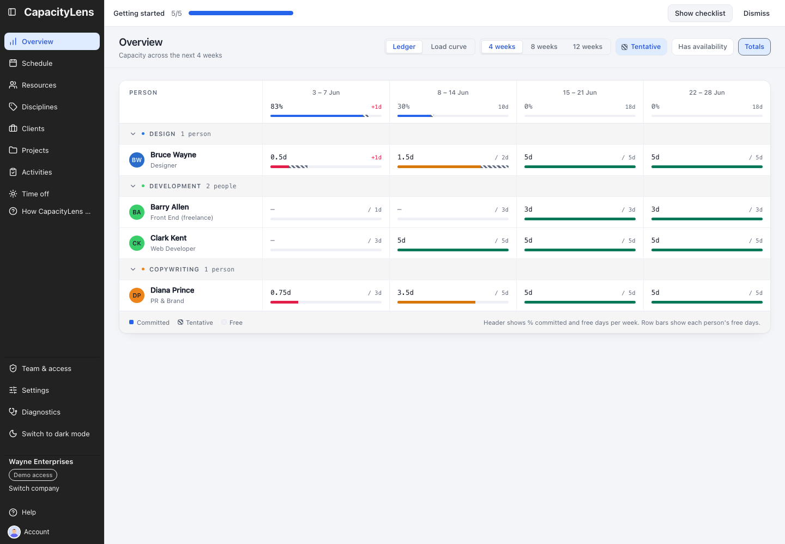
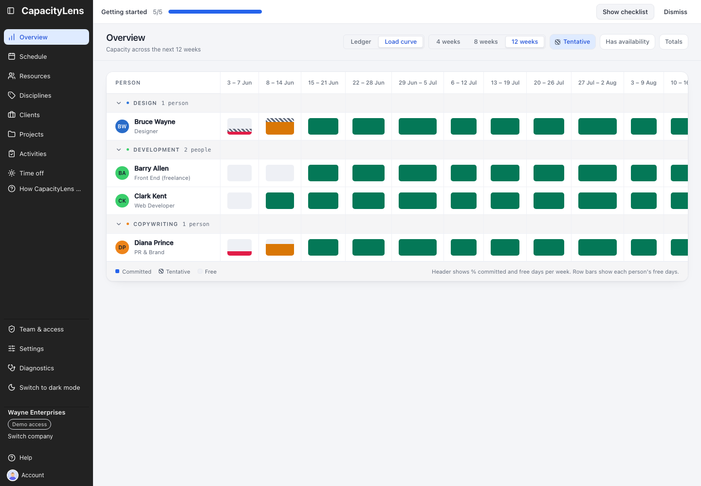

# Overview

See who has room for more work, one week per column. By default only Owners and Admins can open
it.

Open **Overview**, above **Schedule** in the left menu. It starts with the rest of this week
and the next three weeks.

If Overview is missing from your menu, your company restricts it; see
[Control who opens Overview](#control-access). It shows no capacity figures in Blocks mode: switch
to Hours or Days in **Settings** to use it.

## Read a week

People appear in the same order and groups as on Schedule. External resources and archived or
deleted people are left out. Overview uses the same working patterns, time off and closures as
Schedule.

Each cell shows free days out of that week's capacity, such as **2d / 5d**. The bar beneath fills
with the free share:

- green when at least 80% of the week is free;
- amber when at least 40% is free;
- red when less than 40% is free.

Grey hatching after the free portion is tentative work. A muted dash means no free time, whether
fully booked or unavailable. An overbooked week shows the overbooked days in red instead of the
capacity figure; the bar only ever shows free time. Hover over a cell for the full breakdown.

Free capacity rounds down to the nearest quarter-day and overbooking rounds up. Weekly totals use
exact values.

With placeholders turned on, their bookings appear as **Unassigned demand**. It rounds up to the
nearest quarter-day, doesn't count as people capacity and has no bar.

Select the avatar beside a name to open that person's
[work list](/using/read-the-schedule#your-work-list). It covers their own four weeks, not
Overview's columns, and leaves the table as it was.

## Look further ahead

Choose **8 weeks** or **12 weeks** to add more weeks, and scroll across to reach them. Weeks follow
the company's Monday or Sunday start, and each heading shows its dates. The subtitle under the
title names the range in use. The choice returns to **4 weeks** when you reopen or reload the page.

**Load curve** replaces the figures with a vertical fill that rises with each person's free share,
tentative hatching above it. Hover over a cell for its figures, or return to **Ledger**.

## Filter the table

**Tentative** starts on. Turn it off to count confirmed bookings only, for people and unassigned
demand.

**Has availability** shows only people with at least 0.25 free days in a displayed week.
Placeholders stay when they have demand in the displayed weeks.

## Show weekly totals

Turn on **Totals** to add a row above the table. For the people shown, each week gives:

- the percentage of their combined capacity committed to confirmed work;
- their combined free days;
- a bar with confirmed work in blue and tentative work as grey hatching.

The percentage turns red once confirmed and tentative work together reach 90% of the week. Hover
over a total for the days behind it.

## Find available capacity

In Overview, turn on **Has availability**.

Without Overview, open **Schedule** and use **Today** and **Weeks visible** to choose the period.
**Show filters** narrows it by person, discipline, client, project or activity. Then read each
person's utilisation; [Spot overwork](/using/read-the-schedule#reading-overwork) explains what an
empty day does and doesn't prove.

## Control who opens Overview

An Owner or Admin can open **Settings**, find **Overview access** and choose **Admins**, **Admins &
Editors** or **Everyone**. This applies to both the menu link and the `/overview` address.

It controls who can open the page, not who can see the data: everyone in the company already sees
the same bookings and resources on Schedule.

Next: [Schedule and change work](/using/schedule-work) — book the person with room.
