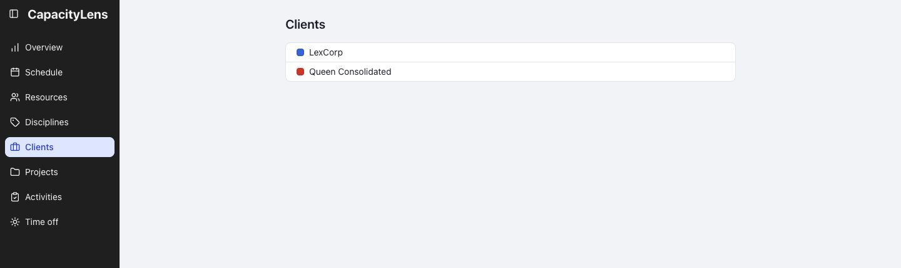
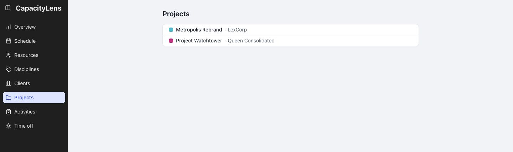
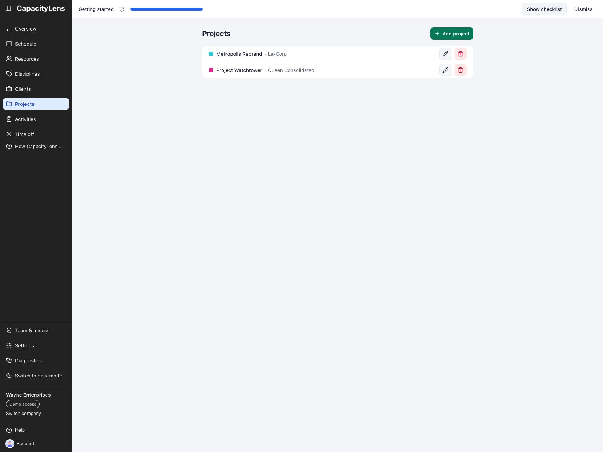
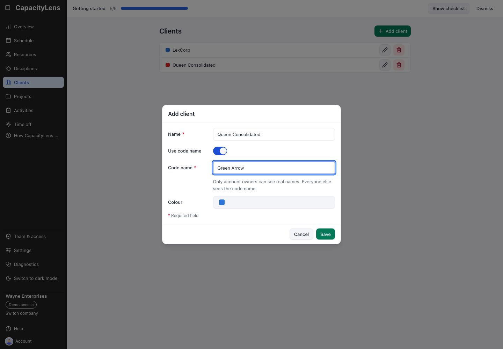

# Clients and projects

Set up the clients and projects your bookings are made against. A client owns projects, and each
booking is made against a project and an [activity](/using/activities). Only an Editor, Admin or
Owner can add or change them.

## Browse clients

Open **Clients** to see them alphabetically. Every company has a built-in **Internal** client for
non-billable work. It can't be renamed or deleted, and its projects and activities always show in
neutral grey, so the project form hides the colour picker for it.

## Browse projects

Open **Projects** to see them sorted by client, then by project, with the client in grey beside
each name.

To see a client's or project's bookings, open **Schedule**, select **Show filters** and choose it.
See [Filter and search](/using/read-the-schedule#filtering-and-searching).

## Add a client or project

1. Open **Clients**, select **Add client** and give it a name and colour.
2. Open **Projects**, select **Add project** and choose its client. Every project needs one.

## Hide a client or project name

To hide a name from most of the team, such as an unannounced prospect, turn on **Use code name**
when you create or edit the client or project. Everyone below Owner sees the code name; only the
Owner, or an Admin viewing the company as the Owner, sees both. A code name also sets the item's
alphabetical position. See [Roles and permissions](/getting-started/roles-and-permissions).

## Archive or delete a client or project

Select the delete icon in the row and confirm **Archive client?** or **Archive project?** Archiving
a client hides its projects and their bookings from Schedule. Archiving a project hides every
booking made under it, including All-projects bookings that count towards it. Nothing is lost.

Owners and Admins see **Archived clients** and **Archived projects** at the bottom of each page.
Select **Restore** to bring the item and its bookings back, or **Delete** to remove it from those
lists. **Delete** anonymises any personal data and can't be undone; the item's bookings stay hidden.

Next: [Schedule and change work](/using/schedule-work) — book against a project.
