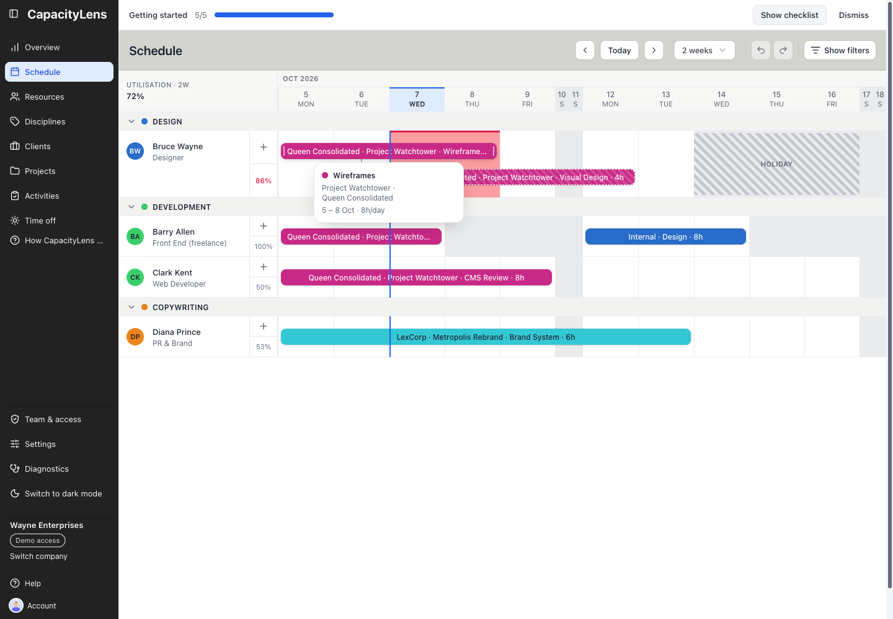
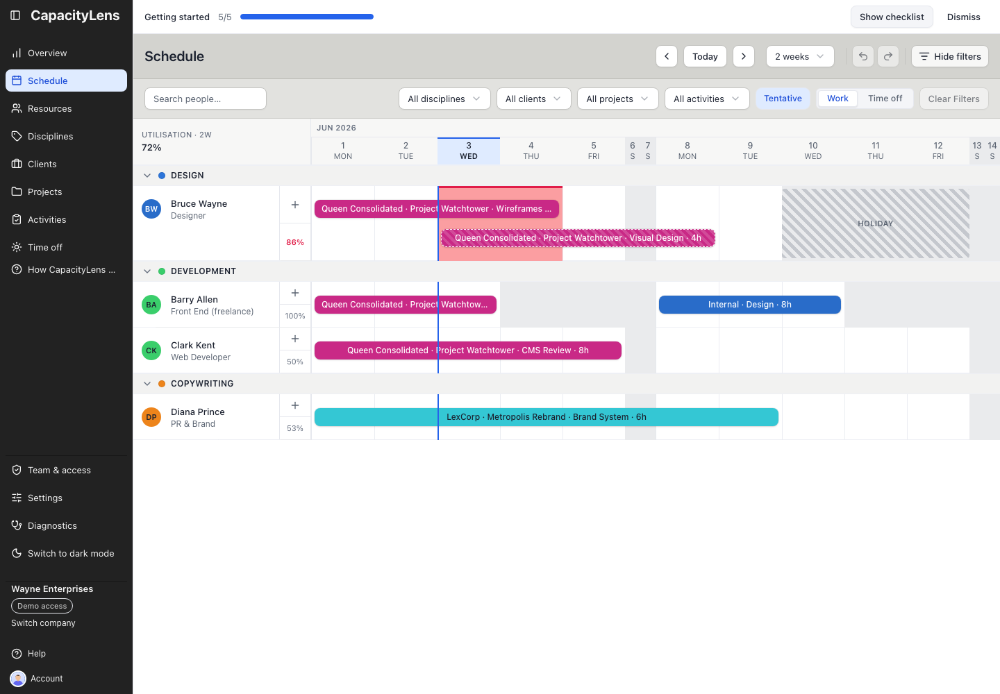
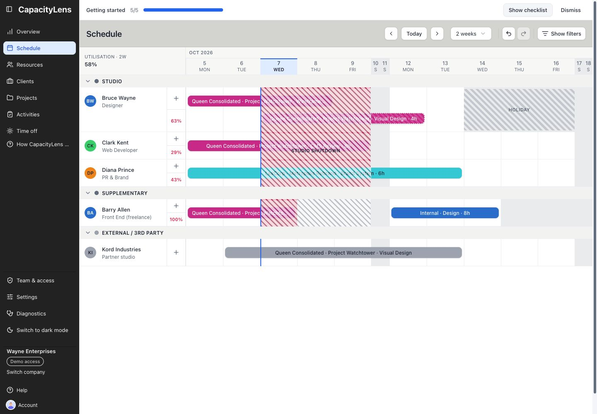
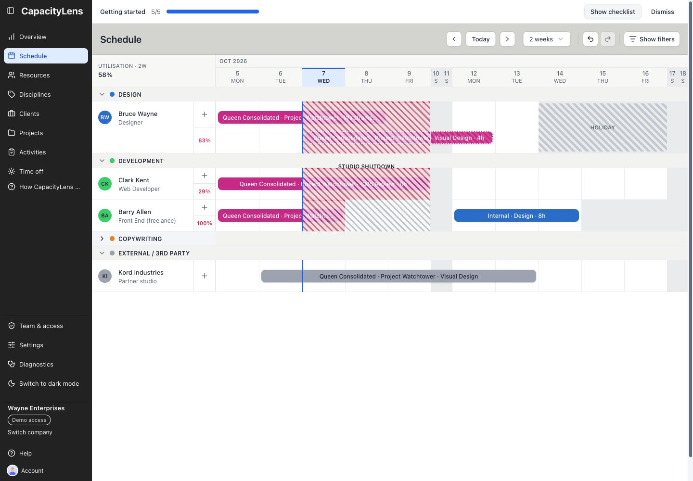
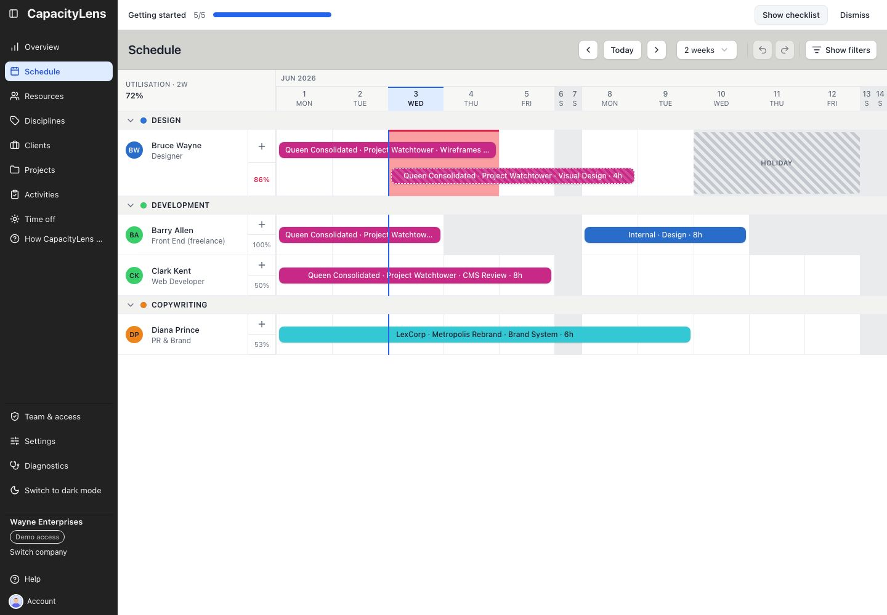
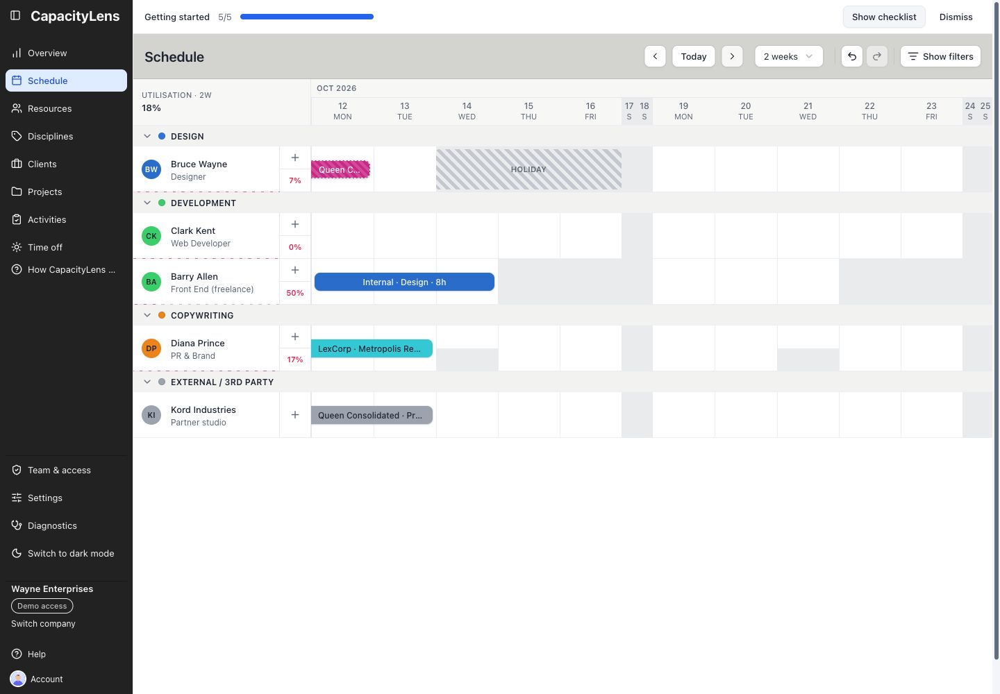
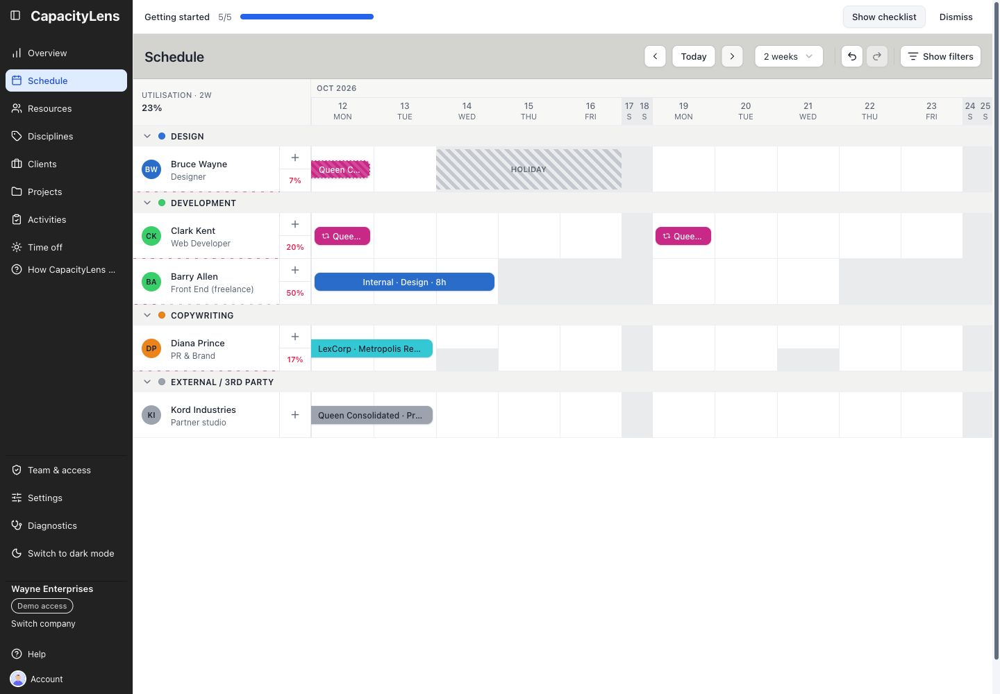
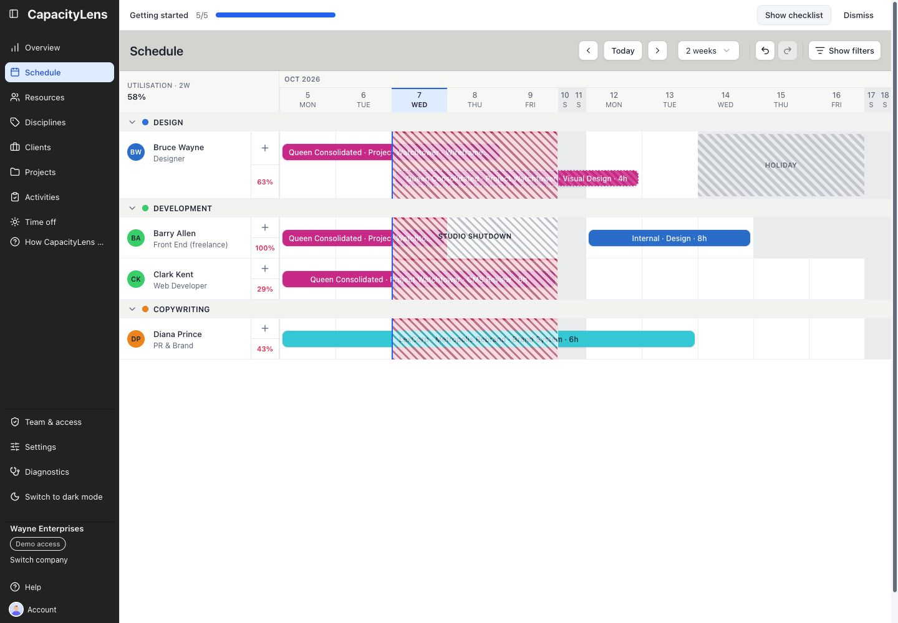
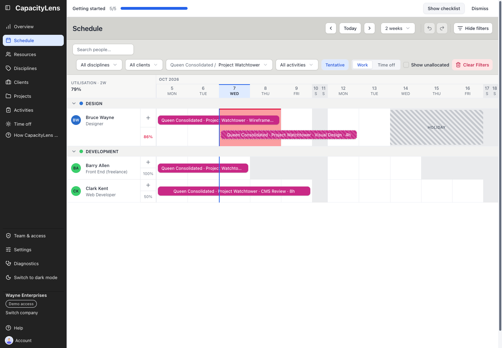
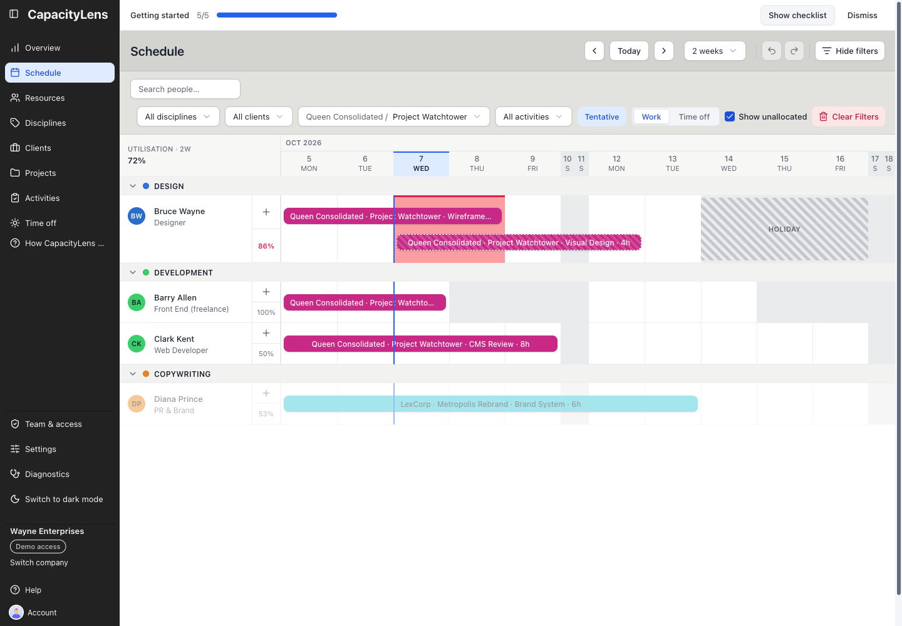

# Schedule

Schedule shows every person's bookings and time off, day by day. Use it to find your own work and
see who is busy.

Open **Schedule** in the left menu. Select the avatar beside your name to open your work list.
Hovering over the avatar, or focusing it with the keyboard, turns it into an eye icon.

## See your own work

The work list combines your bookings and personal time off for the current company week and the
following three weeks. It opens over the grid and works for anyone's avatar, not only yours.

The range is fixed. Panning, zooming or filtering the grid doesn't change it, and the list still
shows work that a search, filter, **Tentative** setting or draw mode hides on the grid. Company
closures and ordinary non-working days are left out.

Each booking shows its activity, project and client, then its dates and daily hours. A task or
note appears below when there is one.

## Check a booking's details

Hover over a booking, or focus it with the keyboard, to see its details. If your role allows
editing, select it to open its form.

## If your work is missing

Select **Show filters** and search for your name, or check for an active client, project or
activity filter. **Clear Filters** removes them. **Today** returns to the current week.

If you still can't find yourself, ask your Admin to check your access and schedule.

## Find a person's row

Each row is a [person](/reference/glossary#person): a teammate, a freelancer or a
[placeholder](/reference/glossary#placeholder) for an unfilled role. A placeholder row says "Placeholder"
instead of a name and has a faint diagonal hatch on its header.

When your company uses [disciplines](/reference/glossary#discipline), the default, rows are grouped under
them. Favourites come first in each group, alphabetically, then everyone else, then placeholders.
Favourites are shared with the whole company, not a personal preference. Favourite external
parties lead the External group.

When disciplines are off, people move into **Studio** and **Supplementary** bands, with **External
/ 3rd party** last. People without a discipline also fall back to these bands, after the
discipline groups. A team with no active Supplementary people gets one band instead:
**Unassigned** when disciplines are on, or **Resources** when they are off.

Select a group heading to collapse it, and again to expand it. A collapsed group shows its hidden
row count, such as `4 hidden`, and an average utilisation if that is turned on in Settings. The
average leaves out external people, so an all-external group shows none.

## Change the weeks on screen

Columns are days. **Weeks visible** shows one, two, four, six or eight weeks. **Prev** and **Next** move a
week at a time, and **Today** returns to the current week.

At close zoom, weekends are tinted and a person's **Half day** tints the bottom half of that
day's cell. The whole cell still works for selecting, drawing and editing. Time off or a full
non-working day fills the cell.

Days before a person's **Start date** or after their **End date** have zero capacity. Existing
bookings on those days stay visible so you can review them.

## Read a booking bar

A [booking](/reference/glossary#booking) is a bar across the days it covers, coloured by project or
[activity](/reference/glossary#activity):

- **Confirmed**: a plain, solid bar. New bookings start confirmed.
- **Tentative**: a dashed border and light diagonal hatch.
- **Completed**: a checkmark before the label.

Your display preferences can add the client, project and hours per day to the label. Companies
that plan in Blocks book no hours; see [Schedule and change work](/using/schedule-work).

Bookings created with **Repeat** show a small repeat cue at the start of each linked bar. Hover or
focus the bar to see the last date in the series. Each occurrence can still be edited on its own.

When your company turns on the [task field](/using/settings#allocation-task-field), a booking can
carry a short **Task**, shown above Notes in its details and in the work list.

## Spot overwork

- The **utilisation percentage** beside each person covers the dates on screen. At 100% a person
  is fully booked. It turns bold and red when the person is over capacity, with more booked time
  than available time, within the next 14 days, whatever you are viewing.
  [My display](/using/settings#my-display) can also show a company-wide total and a
  per-discipline average.
- A red band under the bars marks each day a person is booked for more than their available time.

Changing **Weeks visible** changes the percentage, because it is averaged over more or fewer days.
The red 14-day warning doesn't move when you zoom. Blocks don't measure capacity.

An empty day is not proof of free time: working patterns, closures and time off also count.

## See time off and closures

[Time off](/using/time-off) is a hatched block with no project colour, on the same row as work.

A company closure is one named band across every person and placeholder it covers. Personal time
off stays visible where it overlaps.

Work that overlaps time off or a closure is marked red.
[Resolve time off that overlaps work](/using/time-off#time-off-and-allocations) explains how each unit shows it.

## Filter and search

Select **Show filters**, after **Undo** and **Redo** in the toolbar, to open the filter row.
**Hide filters** closes it without clearing anything.

Search people on the left. On the right are the discipline, client, project and activity filters,
the **Tentative** pill and the **Work** / **Time off** draw mode.

The project menu lists **All projects** first, then projects by client, sorted by code name where
one is set. Selecting a client limits the project menu to that client. If the selected project
belongs to another client, it resets to **All projects**. An active filter turns **Clear Filters**
red, so a filtered view is never mistaken for the whole schedule.

With a client, project or activity selected, turn on **Show unallocated** to bring back people
with no matching work. Their rows are dimmed: candidates to staff, not people already on it.

**Clear Filters** resets the search, every dropdown and **Show unallocated**, and turns
**Tentative** back on.

With edit access, undo and redo every change from the toolbar or with **Ctrl+Z** (**⌘Z** on macOS). The grid
updates live as you drag; there is nothing to refresh.

## Jump to a page with the command palette

Press **⌘K** on macOS or **Ctrl+K** on Windows and Linux to open the command palette from any
screen, even in a text field. It is blocked while a dialog has unsaved changes or another dialog is
open. With no query, **Pages** lists every page, including **Account**. Type a page name, person,
project or date to narrow the results. Press **Escape** or select outside it to close it.

Next: [Schedule and change work](/using/schedule-work) — book and move work.
