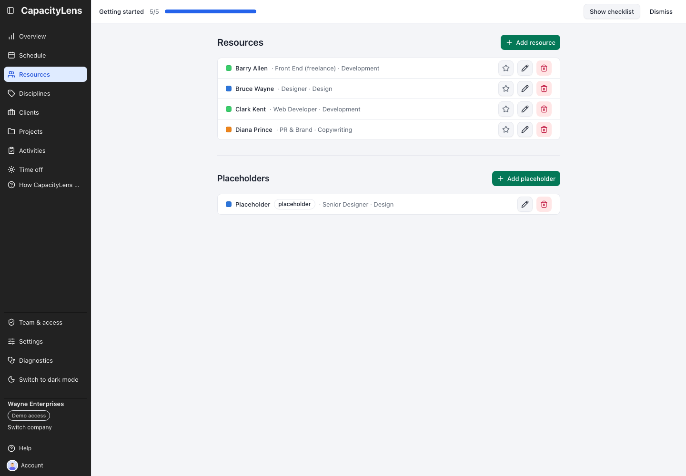
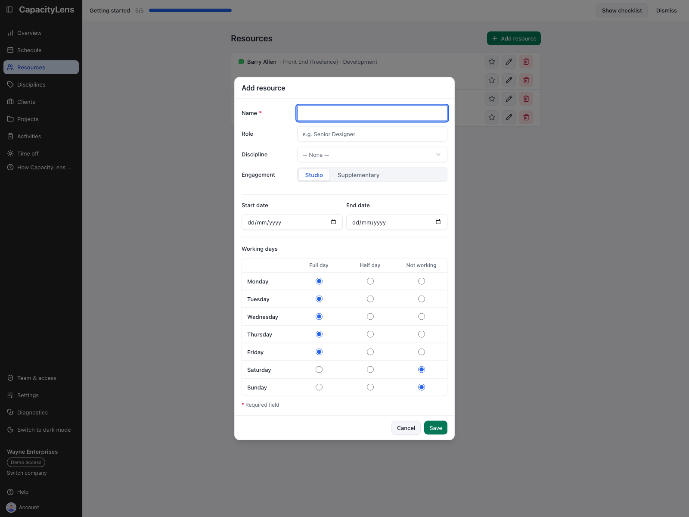
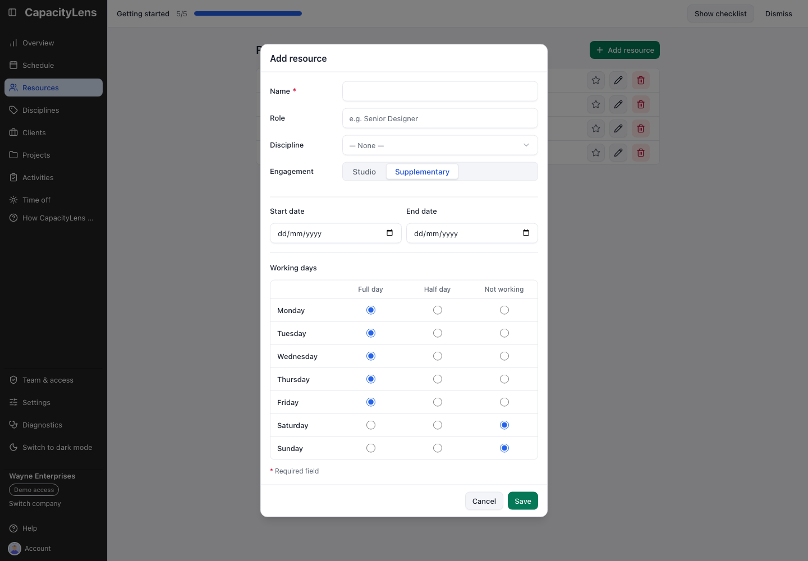
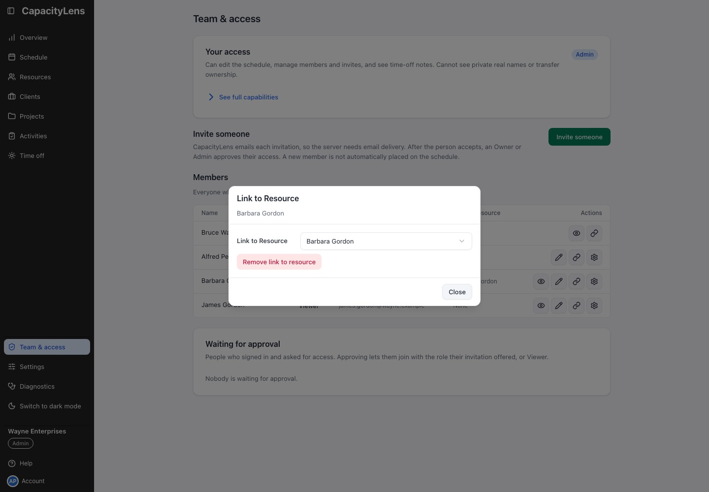
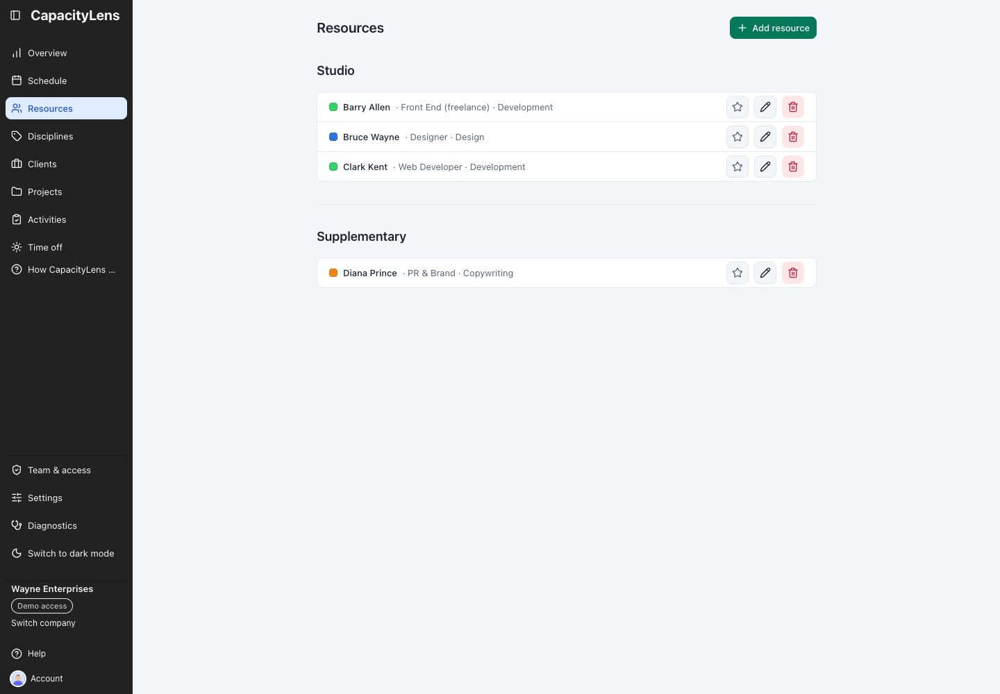
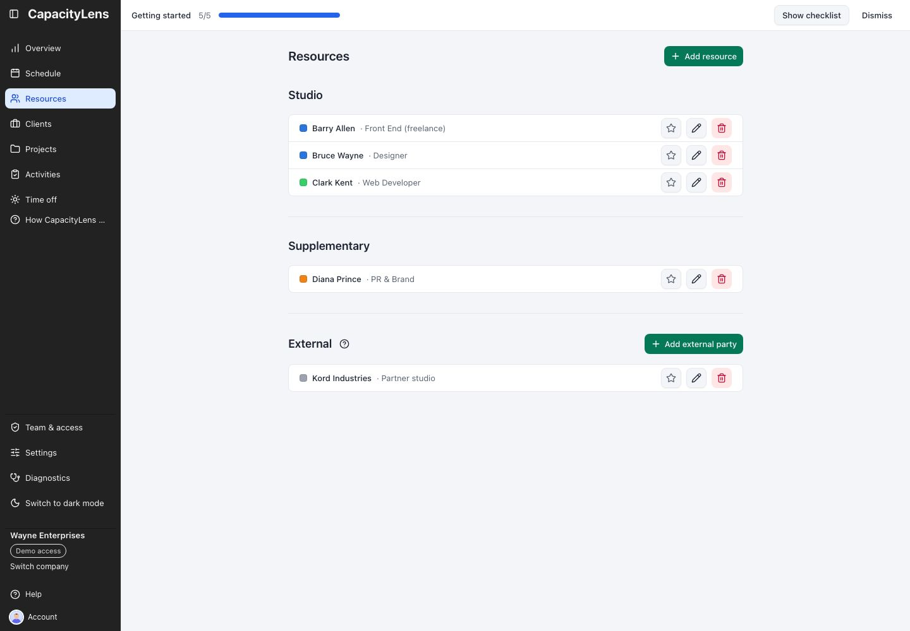

# Resources

Add and maintain everyone who can be booked on [Schedule](/using/read-the-schedule): your people,
plus any placeholders and external parties. Only an Editor, Admin or Owner can change them.

Open **Resources** to see each person with their role and discipline where supplied. To see
someone's work, open their [work list on Schedule](/using/read-the-schedule#your-work-list).

A person on Resources has no sign-in, and inviting a [member](/reference/glossary#member) adds no
row; a [link](#link-a-person-to-a-member) joins the two.

## Add a person

1. Open **Resources** and select **Add resource**.
2. Enter a **Name**. Everything else is optional.
3. Add a **Role** if useful, such as "Senior Designer".
4. Choose a **Discipline**: the group they appear under on Schedule, which also sets their colour.
   It shows only while the company uses [disciplines](/using/disciplines), the default.
5. Choose an **Engagement**: **Studio** for the core team or **Supplementary** for additional
   capacity. It only changes which section they appear in, not their discipline, role, working
   days or utilisation.
6. Set **Working days**: **Full day** (eight hours), **Half day** (four) or **Not working** for
   each day from Monday to Sunday.
7. Select **Save**. The new row appears on Schedule straight away.

Working days drive utilisation. Only days in both this pattern and the
[company-wide working days](/using/settings#company-wide-working-days) count, so a wrong pattern
makes the [overwork indicators](/using/read-the-schedule#reading-overwork) wrong for that person.

If the server rejects the change, the form stays open with the error so you can correct it.

[Add people to the schedule](/admin/add-people) is the Admin's route through this.

## Edit a person

Select the edit icon in the person's row, change any field and save. If someone goes part-time,
set the relevant days to **Half day** or **Not working**. Existing bookings aren't rewritten, but
utilisation reflects the new pattern from then on.

Profile pictures come from each person's own sign-in, not this form; initials are the fallback.

## Set availability dates

Studio and Supplementary people can have an optional **Start date** (first day they can work) and
**End date** (last day). Both are inclusive; leave either blank for no limit, or use the same date
in both for one day. An invalid date, or a start after the end, is rejected and the form stays open.

Capacity is zero outside the range. Existing bookings there stay visible and still count, so
narrowing the range doesn't delete or move anything. You can still edit the person's details, but
creating, moving, resizing, reassigning or repeating work onto a working day outside the range is
blocked. **Ignore working days** doesn't bypass these dates: extend the range first.

Placeholders and external parties don't have these fields.

## Link a person to a member

Only an Owner or Admin can link a sign-in to a person.

1. Open **Team & access** and select the link icon in the member's row.
2. Choose an available person. The choice saves immediately.

Choose another person to change it, or select **Remove link to resource**. Each member links to
one person and each person to one member. A link doesn't grant access or create schedule data.

Only active members and active people can be newly linked. A link to an inactive member or person
can still be removed. To move a person's link to another member, remove the old link first.

To invite someone and link them at once, use **Invite someone** and its **Link to Resource**
selector. See [Invite teammates](/admin/invite-teammates).

## Find people quickly

Once anyone is **Supplementary**, Resources splits people into **Studio** and **Supplementary**
sections, followed by Placeholders and External. A team with only Studio people sees one People
list. Archived people and external parties don't trigger the split. Each section is alphabetical.

Select the star in a person's or external party's row to make them a company favourite. The star
fills yellow and the row moves to the top of its section. Schedule keeps Studio before
Supplementary within each discipline, favourites first. Favourites are shared, so everyone sees
the same order. Placeholders can't be favourited.

## Add a placeholder

A [placeholder](/reference/glossary#placeholder) holds work for a role you haven't filled or assigned yet,
such as "a Design Lead". Use one when someone on your own team will do the work, even if you
haven't named them yet.

Placeholders are off by default; an Editor, Admin or Owner turns them on in
[Settings → Placeholders and external resources](/using/settings#placeholders-and-external-resources).
Then select **Add placeholder** in the **Placeholders** section.

The name is optional (it shows by its role instead), but a placeholder must be bound to a project.
Placeholders carry a "placeholder" badge and hatched styling on Schedule. They have no personal
working pattern, so they follow the company's working days.

## Add an external party

An [external party](/reference/glossary#external-party) is an outside company you hand work to, such as a print
shop or an overflow studio. Use one when the work is leaving your team. External parties appear on
Schedule so you can see the handoff, but carry no hours and never count towards capacity or
utilisation. Their bookings use their literal start and end dates.

External parties are off by default; turn them on in the same Settings section. Then, under
**External**, select **Add external party**, enter the **Company** and an optional **Descriptor**
such as "Print", and save.

Turning placeholders or external parties off hides their sections, rows and assignee entries
without deleting anything. Turn the switch back on to restore them.

## Archive someone who leaves

Select the delete icon in the person's row and confirm **Archive resource?** Archiving hides them
from Schedule and the assignee picker but keeps their past bookings.

Owners and Admins see archived resources at the bottom of Resources, grouped as **Archived
Studio**, **Archived Supplementary**, **Archived External** and **Archived placeholders**. Restore
someone there, or delete the archived record to remove it from those lists. Permanent deletion is
not available in the app.

Next: [Schedule and change work](/using/schedule-work) — book the person.
