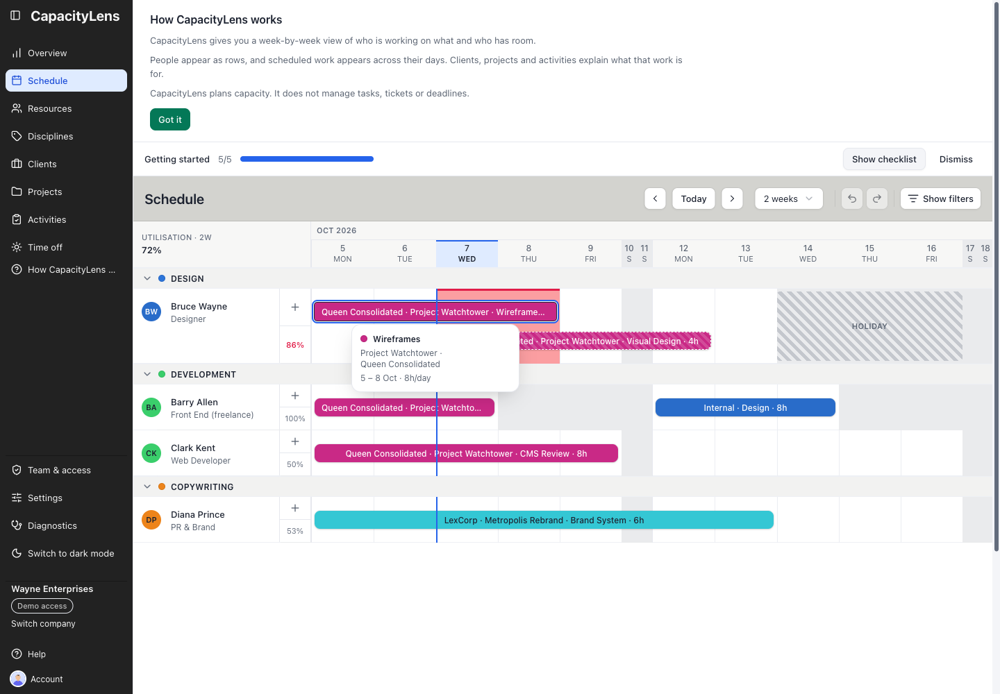
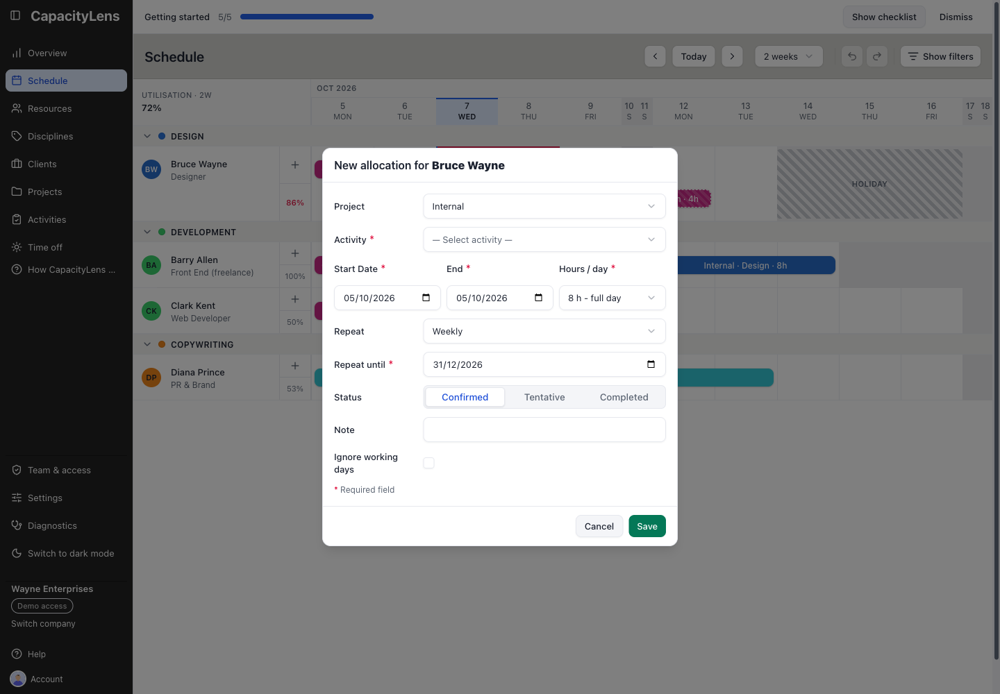
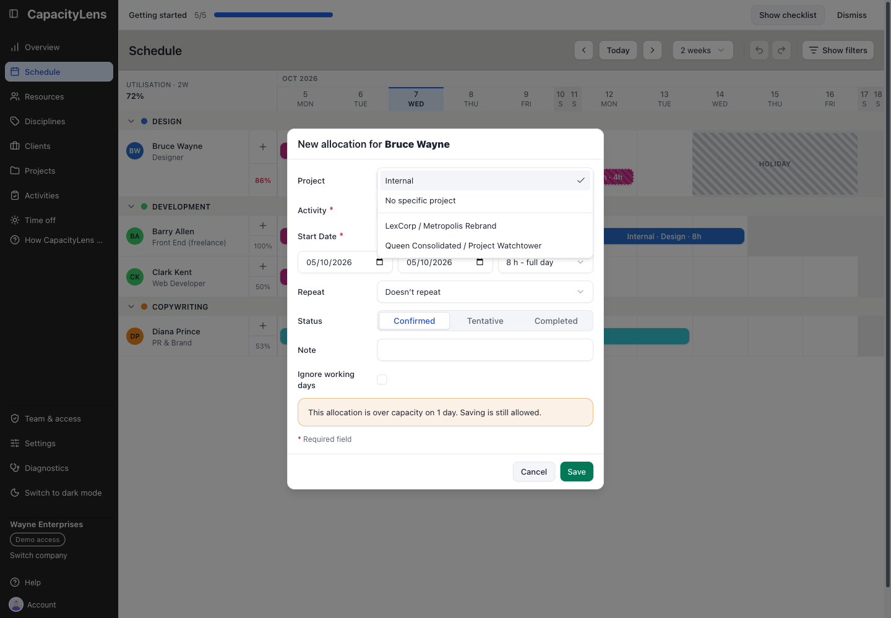
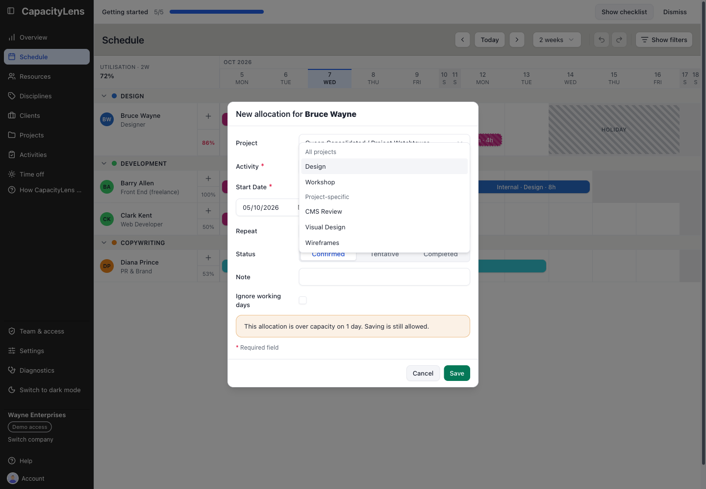
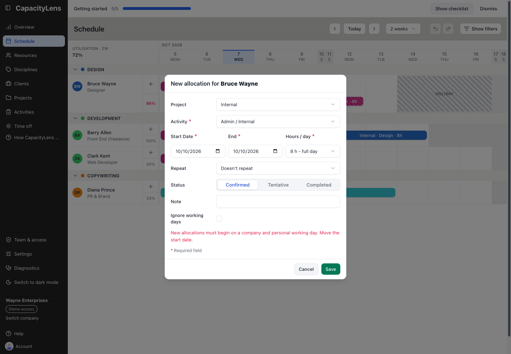

# Schedule and change work

Book a person's time against an activity on [Schedule](/using/read-the-schedule), then move,
change or remove it. Only an Editor, Admin or Owner can book or change work.

## Book work

You need the person in **Resources** and an activity to book. [Clients and projects](/using/projects)
and [Activities](/using/activities) cover setting those up.

1. Open **Schedule** and select **+** on the person's row. The form opens with the visible week
   filled in. Or drag across empty days on their row to choose the dates; selecting one empty
   cell opens the form for that day.
2. Choose **Project**, then **Activity**.
3. Check the dates, amount and status, then select **Save**. The booking appears on the person's
   row.

## Change or remove a booking

### Move or reassign a booking

Drag the middle of the bar along the row to move it, or onto another person's row to reassign it.

A reassigned booking keeps its start date and its number of working days, not its end date. Two
days of work running Thursday to the following Tuesday, for someone who works neither Fridays nor
Mondays, becomes Thursday and Friday for a Monday-to-Friday colleague. While you drag, the bar
shows the length you will get.

The drop is refused, and the bar stays put, if the start date is outside the company's or the
person's working pattern or the person's availability dates. With **Ignore working days** on, the
bar may use non-working days but still can't cross availability dates.

### Change the date span

Drag the left or right edge of the bar. Resizing outside the person's availability dates is
refused and leaves the booking unchanged.

### Edit, duplicate or delete a booking

Select the bar to open **Edit allocation**. Change the assignee, project, activity, dates, amount,
status, task or note, then select **Save**. Select **Duplicate** to copy the booking, or **Delete**
to remove it. Repeat occurrences can't be duplicated.

Select **Undo** in the toolbar, or press **Ctrl+Z** (**⌘Z** on macOS), if you change or remove the wrong booking.

### If a project is archived or deleted

Archiving or deleting a project hides every booking made under it, including All-projects
bookings that count towards it. Restoring an archived project brings them back.
[Archive or delete a client or project](/using/projects#archive-or-delete-a-client-or-project)
explains who can do each.

## Fill in the booking form

### Choose the project and activity

Choose **Internal**, **No specific project** or a real project:

- **Internal** offers only internal activities.
- **No specific project** offers only [All-projects activities](/reference/glossary#all-projects)
  and leaves the booking unattributed.
- A real project offers the shared **All projects** activities first, then that project's
  **Project-specific** ones.

For a real project, the **Activity** picker lists **All projects** and **Project-specific**
activities separately.

An All-projects activity booked under an active project, with an active client, counts towards
that project. The bar takes the project's label, colour and filters. Choosing **No specific
project** when editing removes that attribution. Existing unattributed bookings stay unattributed
until you change them.

If the activity doesn't exist, create it on **Activities**. If your company has turned on
[inline activity creation](/using/settings#inline-activity-creation), add it from the form; under
a real project it becomes project-specific.

### Set the status, task and note

Status is **Confirmed**, **Tentative** or **Completed**. Notes are one line. When the
[task field](/using/settings#allocation-task-field) is on, the form also has an optional one-line
**Task**.

### Book work you might not win

Set **Status** to **Tentative** for work you haven't won yet. Its bar gets a dashed border and a
light diagonal hatch. Turning off the **Tentative** pill in the filter row hides it from the grid.

Tentative work counts towards utilisation, red over-capacity days and the red 14-day warning on
Schedule, even while the pill hides it. On [Overview](/using/overview#filter-the-table), turn off
**Tentative** to count confirmed bookings only.

When the work is won, open the booking and change **Status** to **Confirmed**. If it is lost,
delete the booking.

### Enter the amount

A booking is a date range plus how much of each day it takes. Your company's
[allocation units](/using/settings#allocation-units) decide how you enter it:

- **Hours**: start date, end date and hours per day. **Hours / day** offers **1 h**, **2 h - quarter
  day**, **4 h - half day** or **8 h - full day**. An existing booking with another value keeps
  showing that exact value until you choose an option.
- **Days**, the default for a new company: how many days of work, spread over how many days.
  CapacityLens works out the hours per day. **Days of work** can be a positive fraction; the
  half-day steps are only suggestions. The amount spread across **Days over** can't exceed 24
  hours per day.
- **Blocks**: a span of days with no hours, which doesn't count towards utilisation.

Changing the units doesn't rewrite existing bookings. CapacityLens plans capacity; it is not a
timesheet. [What is CapacityLens?](/getting-started/what-is-capacitylens) explains why.

### Book on non-working days

Leave **Ignore working days** cleared to book only the days in both the
[company-wide working days](/using/settings#company-wide-working-days) and the person's own
pattern. Select it to use every calendar day in the span, including non-working weekdays.

Either way, a new booking must start on a working day that isn't covered by the person's time off
or a company closure. To book across non-working days, start on a working day with **Ignore working
days** selected, then drag or extend the bar.

A booking must also stay within the person's
[availability dates](/using/resources#set-availability-dates), and **Ignore working days** doesn't
bypass them. A booking that falls outside those dates later stays visible, and you can still edit
its details; only changes to its dates or assignee are blocked.

External-party bookings always use literal calendar days, so they have no checkbox.

### Repeat a booking

Under **Repeat**, choose **Weekly**, **Every 2 weeks**, **Every 3 weeks**, **Every 4 weeks** or
**Monthly**, then set **Repeat until**. The date can't be before today or the start, must allow at
least one repeat, and can be at most six calendar months after the start. An occurrence that
starts on or before it may finish after it. The form shows how many bookings it creates and the
last start date. Leave **Doesn’t repeat** for a single booking.

Saving creates the whole series, and one **Undo** removes it. After that, each occurrence is
edited on its own. Deleting one lets you remove only that occurrence or it and every later one.
With an All-projects activity, every occurrence keeps the chosen project.

Next: [Time off](/using/time-off) — record absences.
