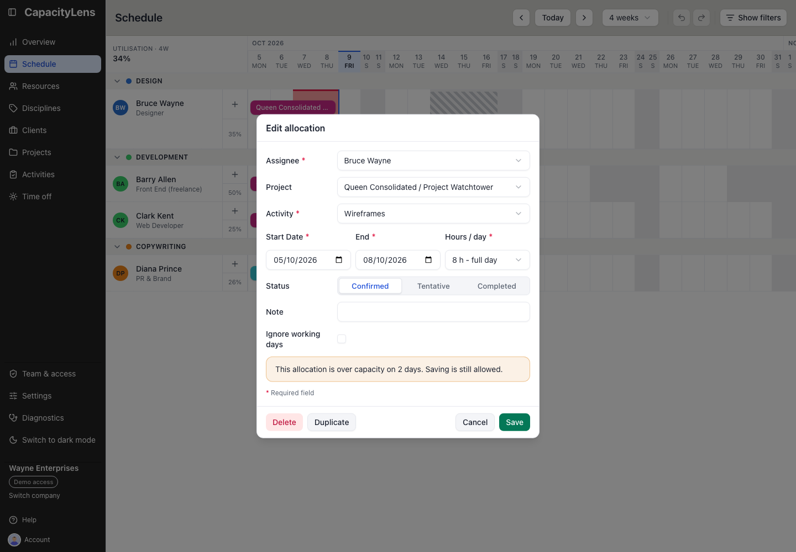

# Schedule and change work

An [allocation](/reference/glossary) books a person's time against an activity for a date range.
It appears as a bar on the [Schedule](/using/read-the-schedule). Editors, Admins and Owners can
add and change allocations.

## Schedule work

You need the person in **Resources** and an activity to book. [Clients and projects](/using/projects)
and [Activities](/using/activities) cover setting those up.

Open **Schedule** and select the **+** button on the person's row. The form opens with the visible
week filled in. Or drag across empty days on their row to choose the dates; clicking one empty
cell opens the form for that day.

Choose **Project**, then **Activity**. Check the dates, amount and status, then select **Save**.
The booking appears on the person's row.

## Change or remove scheduled work

### Move or reassign a booking

Drag the middle of the bar along the row to move it, or onto another person's row to reassign it.
The booking keeps its number of working days, so a different working pattern can change the
calendar dates it spans.

### Change the date span

Drag the left or right edge of the bar.

### Edit details or delete the booking

Click the bar to open **Edit allocation**. Change the assignee, project, activity, dates, amount,
status, task or note, then select **Save**. Select **Delete** to remove it.

Select **Undo** in the toolbar, or press Ctrl/Cmd+Z, if you change or remove the wrong booking.

## Create an allocation

### Project and activity

Choose **Internal**, **No specific project** or a real project:

- **Internal** offers only internal activities.
- **No specific project** offers only [All-projects activities](/reference/glossary#all-projects)
  and leaves the booking unattributed.
- A real project offers the shared **All projects** activities first, then that project's
  **Project-specific** ones.

An All-projects activity booked under an active project, with an active client, counts towards
that project. The bar takes the project's label, colour and filters. Choosing **No specific
project** when editing removes that attribution. Existing unattributed bookings stay unattributed
until you change them.

If the activity doesn't exist, create it on **Activities**. If your company has turned on inline
**Add activity** in [Settings](/using/settings), you can add it from the form; under a real
project it becomes project-specific.

### Status, task and note

Status is **Confirmed**, **Tentative** or **Completed**. Notes are one line. When **Show task
field in schedule** is on in [Settings](/using/settings), the form also has an optional one-line
**Task**, kept when the setting is turned off.

### Amount

In Hours mode, **Hours / day** offers **1 hour**, **Quarter day (2h)**, **Half day (4h)** or
**Full day (8h)**. An existing booking with another value keeps showing that exact value until you
choose an option.

In Days mode, **Days of work** can be a positive fraction; the half-day steps are only suggestions.
The amount spread across **Days over** cannot exceed 24 hours per day.

### Working days

Leave **Ignore working days** unticked to book only the days in both the
[company-wide working days](/using/settings#company-wide-working-days) and the person's own
pattern. Tick it to use every calendar day in the span, including non-working weekdays.

Either way, a new allocation must start on a working day that isn't covered by the person's time
off. To book across closed days, start on an open day with the box ticked, then drag or extend the
bar. A booking must also stay within the person's availability dates, and **Ignore working days**
does not bypass them. A booking that falls outside those dates later stays visible, and you can
still edit its details; only changes to its dates or assignee are blocked.

External-party bookings always use literal calendar days, so they have no checkbox.

### Repeat

Under **Repeat**, choose **Weekly**, **Every 2 weeks**, **Every 3 weeks**, **Every 4 weeks** or
**Monthly**, then set **Repeat until**. The date cannot be before today or the start, must allow at
least one repeat, and can be at most six calendar months after the start. An occurrence that starts
on or before it may finish after it. The form shows how many bookings it will create and the last
start date. Leave **Doesn’t repeat** for a single booking.

Saving creates the whole series, and one **Undo** removes it. After that, each occurrence is edited
on its own. Deleting one lets you remove just that occurrence or it and every later one. With an
All-projects activity, every occurrence keeps the chosen project.

## Edit, move and remove allocations

- **Moving to another row** keeps the start date. The drop is refused, and the bar stays put, if
  that date is outside the company's or person's working pattern or the person's availability
  dates. With **Ignore working days** on, the bar may use non-working days but still not cross
  availability dates.
- **Reassigning** keeps the number of working days, not the dates. Two days of work running
  Thursday to the following Tuesday, for someone who works neither Fridays nor Mondays, becomes
  Thursday and Friday for a Monday-to-Friday colleague. While you drag, the bar shows the length
  you will get, and does not move if the drop will be refused.
- **Resizing** outside the person's availability dates is refused, leaving the booking unchanged.
- **Opening** a bar lets you change its status, duplicate it or delete it. Repeat occurrences
  cannot be duplicated.

Archiving a project hides its bookings until you restore it. Permanently deleting a project
removes its project-specific bookings; shared All-projects bookings remain, unattributed.

## How allocation granularity works

An allocation is a date range plus how much of each day it takes. How you enter that depends on
your company's scheduling mode in [Settings](/using/settings):

- **Hours**: start date, end date and hours per day.
- **Days**, the default for a new company: how many days of work, spread over how many days.
  CapacityLens works out the hours per day.
- **Blocks**: a span of days with no hours, which doesn't count toward utilisation.

Changing the mode does not rewrite existing allocations. CapacityLens plans capacity; it is not a
timesheet. [What is CapacityLens?](/getting-started/what-is-capacitylens) explains why.

Next: record absences in [Time off](/using/time-off). The form warns you when a booking overlaps
one.
