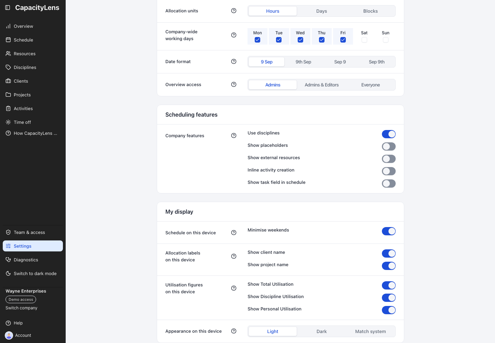
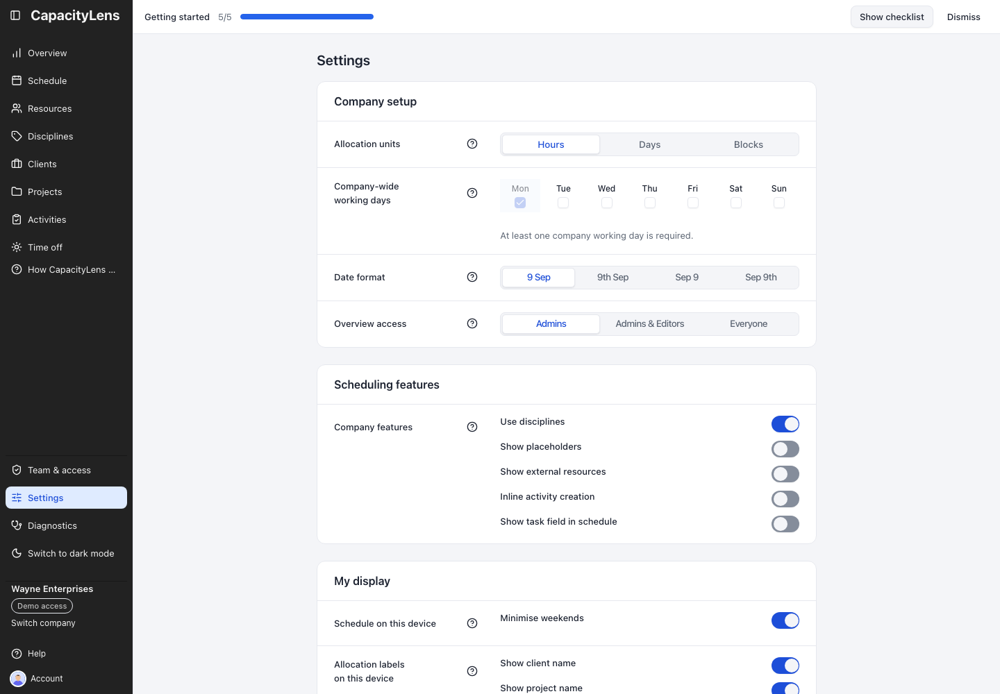
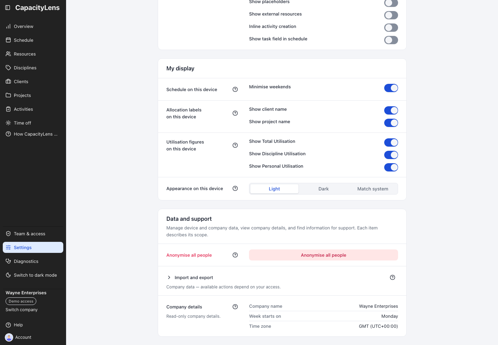

# Settings

Choose how the schedule looks in your browser, and set the planning rules your whole company
shares.

Open **Settings** near the bottom of the left menu. One scrollable page holds four groups. Each
row's question-mark button, **About &lt;section&gt;**, opens a fuller explanation.

| Group               | Who it affects and who can change it                                                                                   |
| ------------------- | ---------------------------------------------------------------------------------------------------------------------- |
| My display          | Only you, in this browser. Everyone can change it.                                                                     |
| Company setup       | Everyone. Editors and above change units, working days and date format; only Owners and Admins change Overview access. |
| Scheduling features | Everyone. Editors and above change the **Company features** switches. A Viewer sees them disabled.                     |
| Data and support    | Example data, import and export and company details. Actions depend on your role.                      |

[Choose company settings](/admin/company-settings) walks through each company choice for the people
managing the plan.

## My display

These preferences are saved in this browser. They don't change a teammate's display or travel
with an export.

- **Schedule on this device:** **Minimise weekends** narrows Saturday and Sunday so the working
  week gets more room. Weekend work still appears.
- **Allocation labels on this device:** show the client and project name ahead of the activity
  name on bars.
- **Utilisation figures on this device:** choose total, per-discipline and personal figures.
- **Appearance on this device:** **Light**, **Dark** or **Match system**. The moon or sun button
  below **Settings** in the left menu switches to the opposite of the scheme shown, even when the
  left menu is collapsed.

## Company setup

These settings affect everyone in the company.

### Allocation units

Choose whether bookings are entered as **Hours**, **Days** or **Blocks**. New companies start with
Days. [Enter the amount](/using/schedule-work#how-allocation-granularity-works) explains each.

### Company-wide working days

Select the days your company works. New companies start with the first five days of the week. At
least one day must stay selected: the last one is disabled until you select another.

Each person works only the days selected here **and** in their own working pattern. If the company
works Monday to Friday and Bruce Wayne works Monday, Wednesday and Friday, his capacity uses
Monday, Wednesday and Friday.

Other days hold no capacity. Bookings skip them and they don't count towards utilisation. You
can't start new work on them: the hover **+** doesn't appear, and a typed start date, duplicate
or reassignment is rejected. A booking drawn from a working day may still cross them.
[Book on non-working days](/using/schedule-work#book-on-non-working-days) explains **Ignore
working days**.

Changing the selection recalculates capacity, utilisation and conflicts straight away. Booking
dates never move, but work on days that are no longer working days stops counting unless the
booking ignores working days.

### Date format

Choose how planning dates read for everyone: **9 Sep**, **9th Sep**, **Sep 9** or **Sep 9th**.
It applies to dates and ranges across the app, including Schedule and Time off, and takes effect
without a reload. You can undo it.

- Compact weekday dates on Time off always keep the ordinal: with **9 Sep**, a Wednesday reads
  **Wed 9th Sep**.
- A range crossing a year shows the year at both ends, except in Overview's narrow week headings.
- The date format is not in the JSON from **Import and export**, and an import keeps the
  destination company's format.

Times tied to an event, such as session and invitation expiry and ownership-transfer deadlines,
use your browser's language and time zone instead.

### Overview access

Choose who can open Overview: **Admins**, **Admins & Editors** or **Everyone**. By default only
Owners and Admins can open it. Only an Owner or Admin can change it.
[Control who opens Overview](/using/overview#control-access) explains the effect.

## Scheduling features

The **Company features** section holds the company-wide switches. **Use disciplines** starts on;
the others start off. Turning a switch off hides the feature without deleting data, and turning
it back on restores it.

Internal projects and activities always show, in neutral grey, so they have no switch.

<!-- Compatibility anchor for existing links to resourcing options. -->

### Disciplines

**Use disciplines** groups people by [discipline](/reference/glossary#discipline), such as Design or
Development. Create disciplines and their colours on the [Disciplines](/using/disciplines) page.

### Placeholders and external resources

Two independent switches. **Show placeholders** adds placeholders: unfilled roles or tentative
people for planning future capacity. **Show external resources** adds outside companies, such as a
print shop or a partner studio, for work leaving your team; they carry no capacity.
[Resources](/using/resources#placeholders) explains both.

### Inline activity creation

New activities normally start on the **Activities** page, so the team reuses consistent names.
Turn on **Inline activity creation** to add **Add activity** controls to the booking form for
everyone who can edit bookings. Turning it off hides only those controls.

### Task field

Turn on **Show task field in schedule** to add an optional one-line **Task** to the booking form.
Task text appears above Notes in schedule details and the person's work list. Turning it off hides
tasks without deleting them.

## Data and support

What you can do here depends on your role. Archived items are restored from their own
Resources, Clients, Projects or Activities page, not from Settings.

### Connection errors

CapacityLens needs a server connection to read and save the company schedule. If a request fails,
use the retry or recovery control offered after reconnecting. A visible edit is not proof that it
was saved. The app never replaces a failed read with a browser snapshot or queues changes for later.

### Example data

Owners and Admins see **Example data** only while the company has no people, clients, projects or
bookings. **Add example data** adds two people, a client, a project and a few bookings across
this week and next. They are ordinary records; delete them like any others. The request is refused
if the company already holds any of these, including archived or deleted ones.

<!-- Compatibility anchor for existing links to import and export. -->

### Import and export

**Export JSON** downloads the current company's scheduling records. **Import JSON** replaces those
records after you confirm; in signed-in server deployments, only an Owner can import.

Files must contain valid JSON accepted by the server's standard request parser. Malformed JSON is
refused before anything is replaced. Recognised older record values may be repaired or skipped, and
the skipped count is shown afterwards. The company's settings, including date format, and your
browser preferences are not part of the file.

### Beta JSON preview {#beta-transfer-contract}

The beta preview checks a file without changing your data. It is not connected to Settings yet.
The **Export JSON** and **Import JSON** controls continue to use the existing format described
above.

### Company details {#calendar}

A read-only summary of the company name, week start and time zone. Week start sets where each
week begins. Time zone decides which date counts as "today". Both were chosen when the company was
created and cannot be changed.

Owners and Admins can copy build details and a support report from
[Diagnostics](/admin/diagnostics).

## Change your sign-in or password

Your sign-in, password, company login and **Sign out** are on the [Account](/using/account) page
at the bottom of the left menu, not in Settings.

## If a company won't load

If a selected company can't be loaded, a recovery screen hides the previous company's data.
Select **Retry** to load it again. The temporary demo also offers a return to its company picker.
