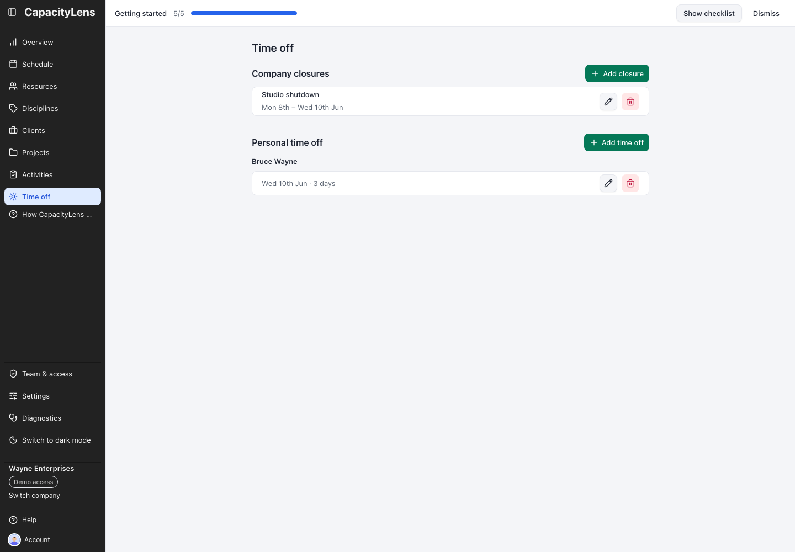
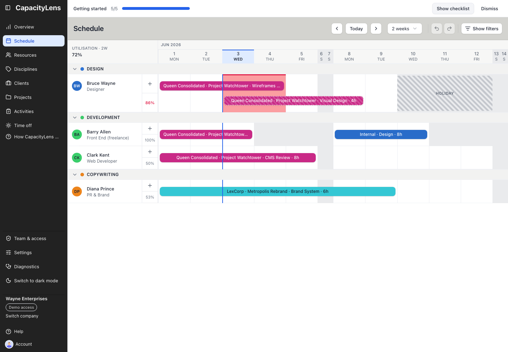
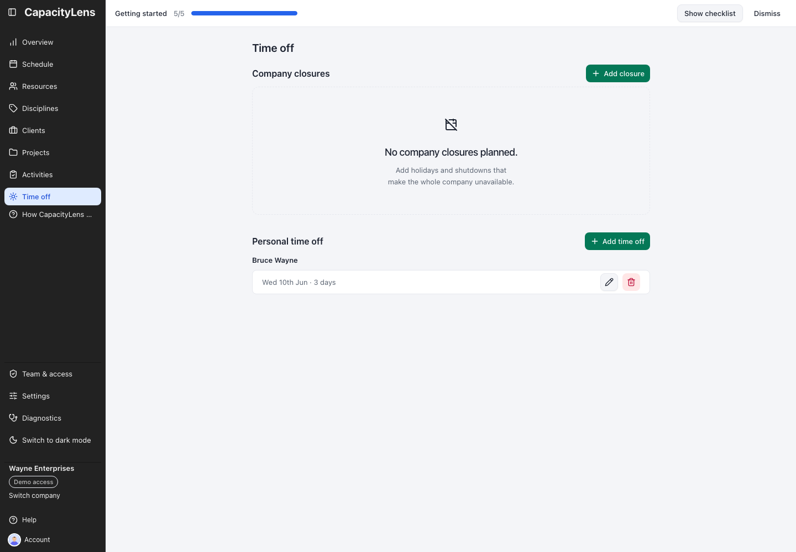
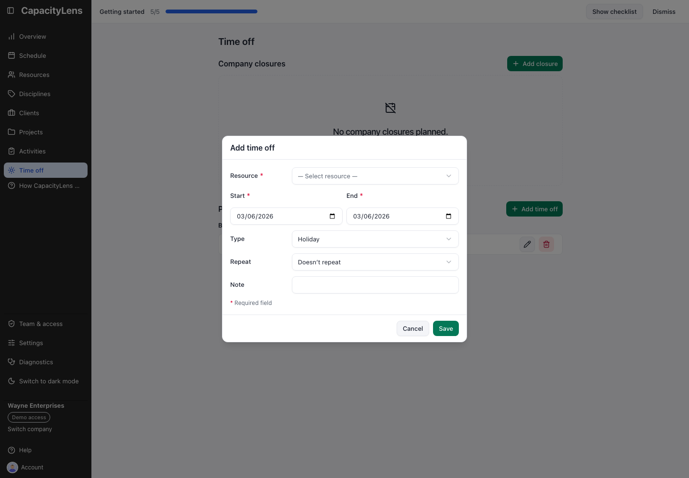
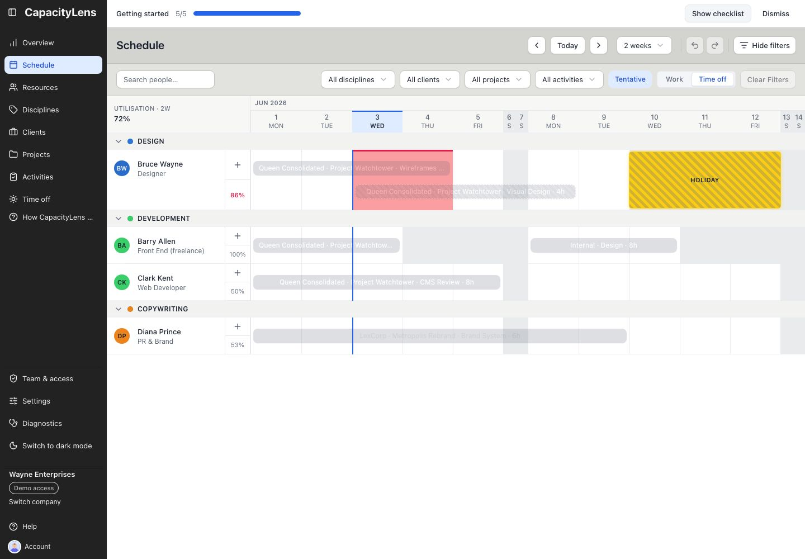
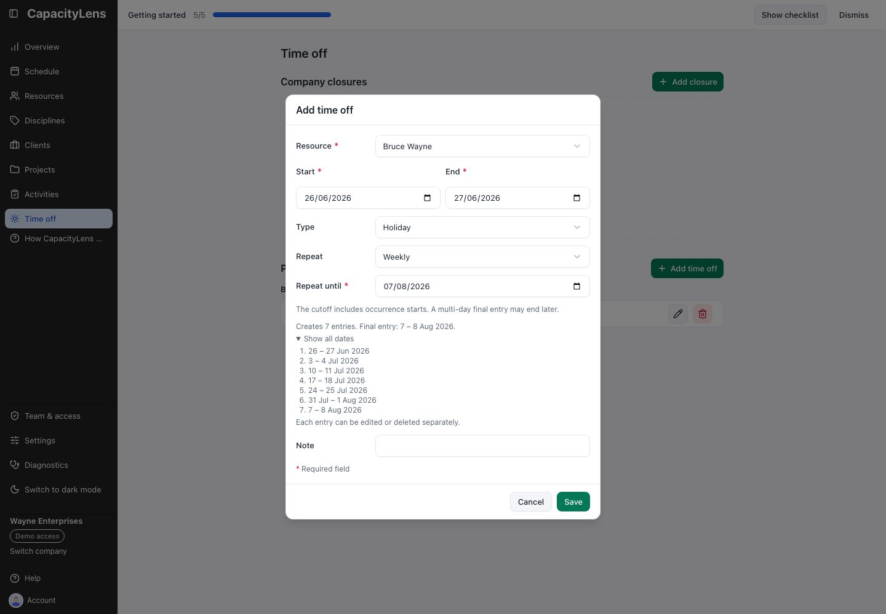
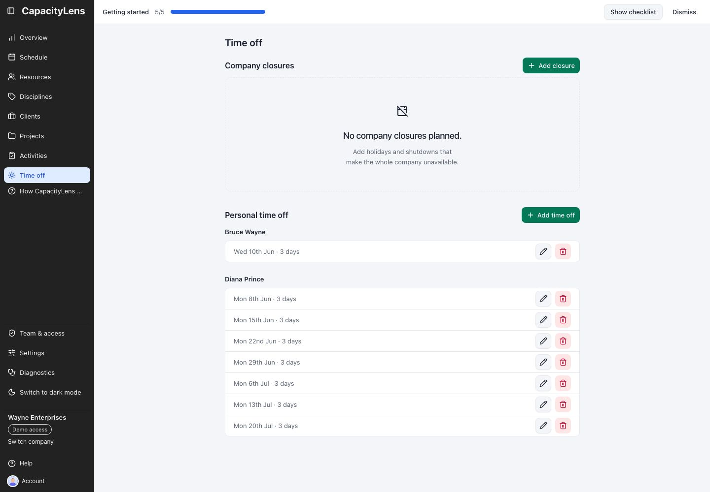
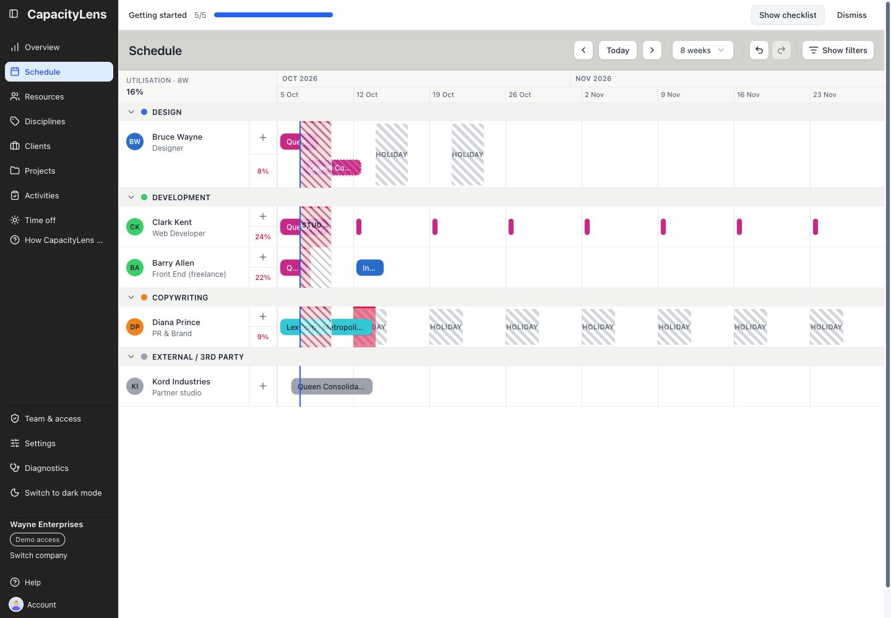
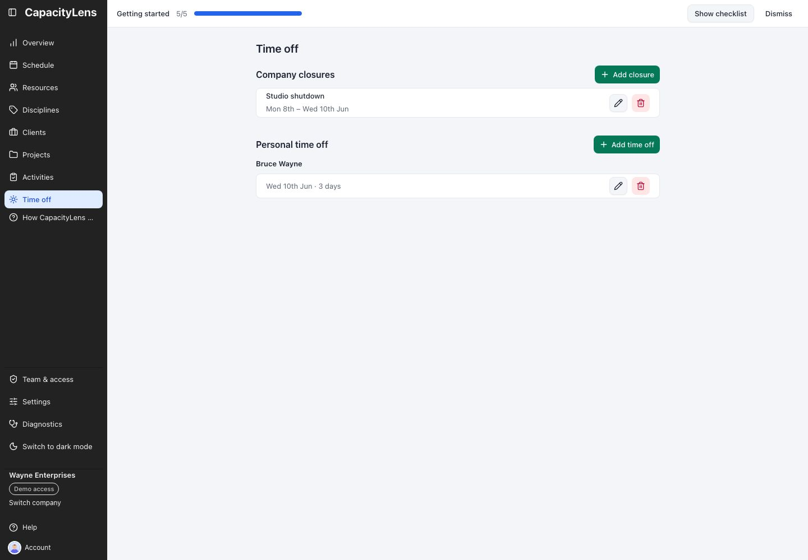
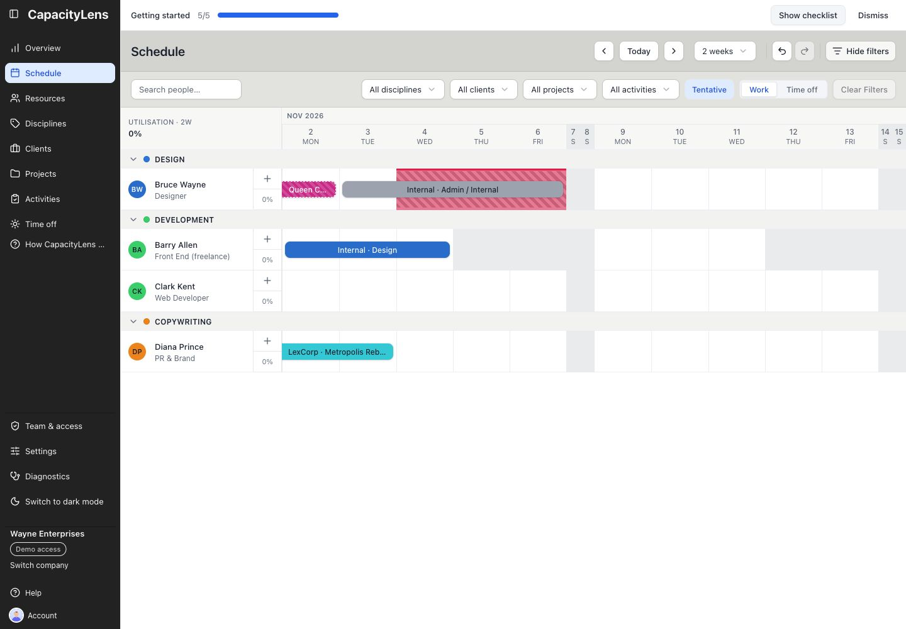

# Time off

Record holidays, sickness and company closures so the schedule shows who is really available.
Everyone can see time off; only an Editor, Admin or Owner can add or change it.

Open **Time off** and find your name under **Personal time off**. Company closures are listed
above it.

## Find time off on Schedule

The same absence appears as a hatched block with no project colour, on the same row as your work.
Time-off notes are visible only to Owners and Admins, including in the work list; everyone else
sees only the dates.

External parties have no capacity, so they can't have personal time off and closures don't cover
them. [Resources](/using/resources) explains external parties and placeholders.

## Record time off

1. Open **Time off** and select **Add time off**.
2. Choose **Resource**, **Start**, **End** and **Type**: holiday, sick, unpaid or other.
3. Leave **Repeat** as **Doesn’t repeat**, or choose a pattern and set **Repeat until**. The
   preview lists every entry it creates.
4. Add a one-line **Note** if useful, such as "Conference" or a return date.
5. Select **Save**.

The absence appears as a hatched block on the person's row, and those dates have no available
capacity.

### Draw time off on Schedule instead

On **Schedule**, select **Show filters** and choose **Time off** beside **Work**. Select **+** on a
person's row or drag across the dates. **Add time off** opens with the person and dates filled
in. Switch back to **Work** after saving.

## Repeat personal time off

Weekly repeats run every one, two, three or four weeks. Monthly repeats use either the same date or
the last matching weekday:

- A same-date repeat keeps its date after a shorter month: 31 January, 28 February, then 31 March.
- For the last Friday of each month, start on the last Friday of the first month and choose
  **Monthly on the last Friday**. CapacityLens never moves the first entry for you.

**Repeat until** includes an entry that starts on that date, so a multi-day entry can finish after
it. The suggested and latest cutoff is the end of the starting month plus eleven more months. Every
repeat must create between 2 and 54 entries.

Each entry keeps the original span of calendar days, even across weekends, holidays or non-working
days. Overlapping time off is allowed; nothing is merged or skipped.

Saving creates one undoable batch. After that, every entry is independent: it has its own row,
**Edit** and **Delete** on the Time off page, and changing one leaves the others alone. Repeat
controls appear only when adding.

All the entries still appear on the person's single row on Schedule.

## Review current and upcoming time off

The Time off page lists entries ending on or after the start of the current company week. Older
entries are kept but not shown.

Personal entries are grouped by person, alphabetically, then by date. Entries for a person who no
longer exists fall into a final "unknown" group. Placeholder time off follows the company's
**Show placeholders** setting.

## Plan a company closure

Under **Company closures**, select **Add closure**. Enter a name and the start and end dates. Dates
are inclusive and literal: a span through a weekend covers Saturday and Sunday.

A closure applies to every person and placeholder, including people added later, with no personal
exceptions. On Schedule it is one named band across their rows.

Covered availability drops to zero, but bookings keep their dates and hours. Work already planned
across the closure turns red instead of disappearing. Deleting or shortening the closure restores
capacity.

A closure is a dated, whole-day, one-off event. The company's non-working weekdays, set in
[company-wide working days](/using/settings#company-wide-working-days), are different: bookings
skip them. Bookings still place their time on closure days, as they do on personal time off.
**Ignore working days** never bypasses either, and a new booking can't start on a closure date.

## Resolve time off that overlaps work

Time off doesn't remove or block overlapping bookings. The booking form warns you about the
overlap, so you decide.

Hours and Days bookings show the usual red over-capacity band. A Block carries no hours, so
utilisation stays at 0%, but its overlap with time off is still marked red.

