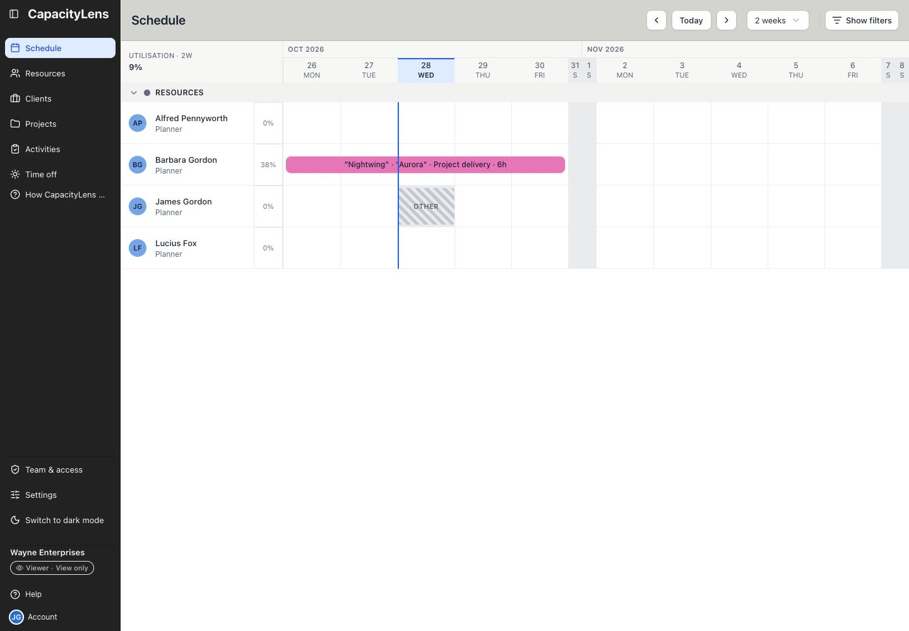
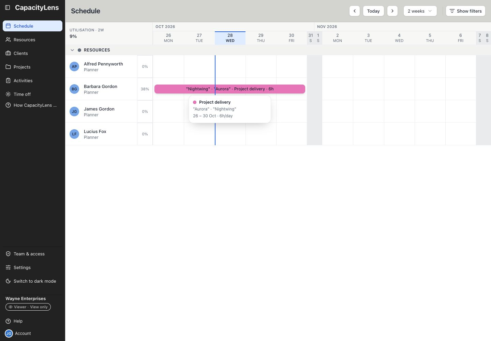
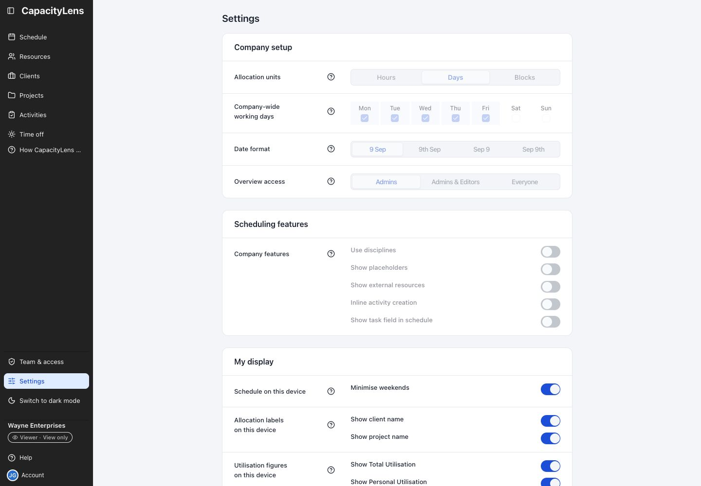

# Check the plan as a Viewer

As a Viewer you can read the whole plan and change only your own display. Changing bookings,
resources, time off or company settings needs the Editor role or above.
[See your work](/using/) covers joining and finding your week.

## Join and check your access

Open **Team & access** near the bottom of the menu to see your company and role. If you belong to
several companies, use **Switch company** to choose one. Ask an Owner or Admin if a company is
missing or you need a different role. Signing in alone does not admit you to a company: you need
the invitation or joining link. [Join your team](/using/join-your-team) covers both.

**Help**, just above **Account**, has a short Viewer tour.

Your sign-in is separate from your row on the schedule. An Admin can link the two. Until then,
find your row by name.

## Find and understand your work

Hover over a bar, or focus it with the keyboard, to see its dates and daily hours. A bar with a
dashed border and hatching is tentative. You can't move, resize, reassign or delete a booking; ask
whoever books the work. [Read the schedule](/using/read-the-schedule) explains the grid, filters
and your work list.

## Read availability in context

The percentage beside a person covers only the dates on screen. It turns red when the person is
over capacity in the next 14 days, whatever you are viewing. At 100% a person is fully booked;
over capacity means more work than time. Blocks do not measure capacity.

An empty day is not proof of free time. Working patterns, closures and time off also count.

**Overview** compares free capacity week by week. Only Owners and Admins see it by default, so a
missing menu link is expected until your company opens it to Viewers.
[Overview](/using/overview) explains the figures.

## Check people, work and time off

**Resources**, **Clients**, **Projects**, **Activities** and **Time off** are all readable without
edit buttons. **Disciplines** appears when your company uses them. Time-off notes are visible only
to Owners and Admins. Private client and project real names are visible only to the Owner;
everyone else sees code names. A missing confidential field is an access rule, not a failed load.

## Make the display comfortable

**Settings → My display** sets spacing, booking labels, utilisation figures and appearance for
this browser. It never changes anyone else's view. Company settings are read-only for you.

**Account**, at the bottom of the menu, shows your sign-in and its security controls. Use **Sign
out** on a shared device. [Settings](/using/settings) and [Account](/using/account) have the
details.

A Viewer export leaves out archived and deleted records and uses code names. It is a planning
download, not a backup. A Viewer cannot import.

## When you need help

### Why are there no buttons to add or change work?

That is expected for a Viewer. Ask an Owner or Admin for Editor access if you need to maintain the
plan.

### Why is a person or booking missing?

Check the company, the dates on screen and any active filters. The record may be archived, or a
feature such as placeholders or external resources may be turned off. Ask the person managing the
plan if it is still missing.

### Why can I not open Overview or Diagnostics?

Your company decides who opens Overview. Diagnostics is for Owners and Admins only. Ask an Admin to
check capacity or collect a support report.

### What if the page cannot load or shows an offline banner?

Use the retry or recovery control offered. An offline snapshot is read-only, expires after seven
days and may be older than the live plan. Reconnect before relying on a recent change.
[Day-to-day FAQ](/using/faq) covers more interruptions.
