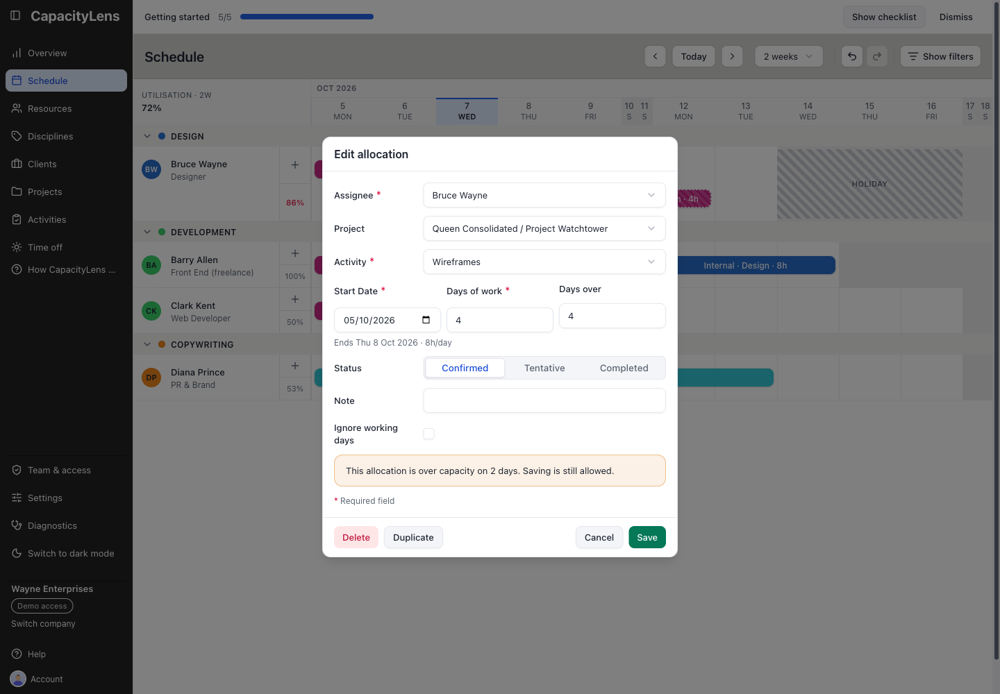

# How do I resolve an overbooked day?

Over-capacity means a person's allocated work exceeds their available capacity on a day. **CapacityLens does not move work automatically.** An **Editor**, **Admin** or **Owner** must decide what to change.

_Existing interface capture with illustrative October bookings; use the Assignee control shown here, not its sample names or dates._

Select the booking bar to open **Edit allocation**. Change its assignee, dates, activity or amount, then choose **Save**. This form is the keyboard-accessible alternative to dragging. You can also drag a bar along the row to move it or onto another person's row to reassign it.

## Check the destination before saving

For a reassignment, check the recipient's working pattern, **Start date** and **End date**. When dragging between rows, the booking keeps its start and number of working days, so its end can change. In the form, Days and Blocks calculate the end from the counted span; Hours keeps the entered date range. Check the resulting dates and amount. A normal booking cannot use days outside the effective working week; **Ignore working days** allows calendar days but does not bypass time off or availability dates. A new booking must start on a working day; check the error message if a move or reassignment is refused.

After saving, inspect the destination row and dates, then check the red day markers and utilisation again. A visible-window average at or below 100% does not rule out one overbooked day; utilisation and the red 14-day warning measure different ranges. If another person changed the schedule while the form was open, close it, reopen the booking and reapply the change to the latest plan.

For a wrong change made moments ago, select **Undo** in the Schedule toolbar. See [Update the plan safely](10-update-the-plan.md) for the limits of Undo and interrupted saves.
