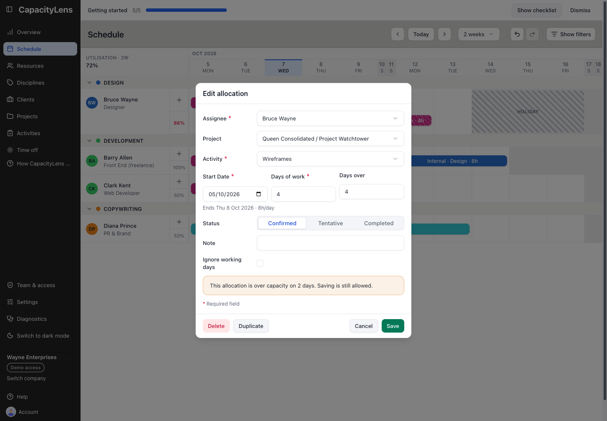

# Resolve the overbooking

The first booking fills Bruce’s Monday. A second one-day Design request for the same project arrives for that date. Diana adds it to Bruce to see the effect, then corrects the assignment: two full days of work on one full working day exceed his capacity.

_Existing interface capture with illustrative October bookings; use the Assignee control shown here, not its sample names or dates._

On **Schedule**, Diana selects **+** on Bruce’s Monday cell and saves another one-day **Website refresh / Design** allocation. The two bars remain visible and Monday is marked red. CapacityLens does not move work automatically or reject every over-capacity plan; the planner decides what fits.

To move the new request accessibly, Diana selects its bar to open **Edit allocation**. She changes **Assignee** from Bruce to Diana and selects **Save**. She checks Monday on both rows: Bruce now has the original booking, and Diana has the added day. If Diana does not have a full working day available, she should choose another person or change the amount or dates rather than assume this assignment fits.

Use the form when dragging is difficult or when a precise assignee or amount needs changing. In this Days-mode example, reassignment keeps the start date and counted working-day span; other modes can handle the end date differently, so always check it. Check the destination’s working pattern and **Start date** / **End date** before saving. CapacityLens can still show an overbooked result for the planner to resolve.

An average utilisation below 100% is not proof that every day is clear. Look for red days on each affected row after the save. If an edit form says the schedule changed while it was open, close it, reopen the bar, and apply the change again; see [Update the plan](10-update-the-plan.md).
