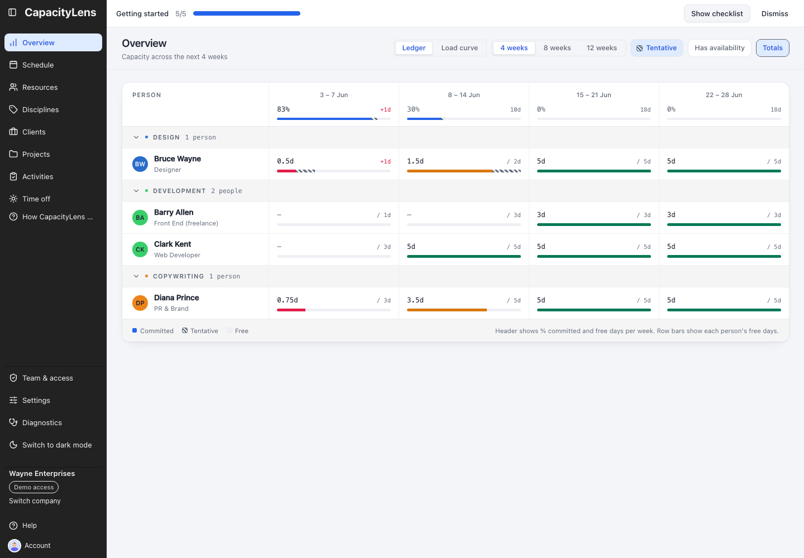

# Find capacity

Open **Schedule** and choose **Weeks visible** to cover the period you are planning. **Prev** and **Next** move one week at a time; **Today** returns to the current week. Use **Show filters** to narrow the grid by person, discipline, client, project or activity.

| Schedule indicator     | What it means                                                                                                   | What changes it                                              |
| ---------------------- | --------------------------------------------------------------------------------------------------------------- | ------------------------------------------------------------ |
| Utilisation percentage | Booked time compared with available time across the visible date window. **Weeks visible** changes this window. | Zooming or moving the grid can change it.                    |
| Red daily band         | The person is booked for more than their capacity on that day.                                                  | Check the date, working patterns, availability and time off. |
| Red percentage         | The person is over capacity at least once in the next 14 days from today.                                       | This warning stays fixed when you pan or zoom.               |

At exactly 100%, booked time equals available capacity; over capacity means booked time is greater. An empty cell alone does not prove someone is available. Check **Resources** and **Time off** before booking.

_Illustrative interface capture; its dates do not show completion of your plan._

**Overview** is optional. It compares capacity one week per column, starting with four weeks. By default, only Owners and Admins can open it; an Owner or Admin can choose **Admins & Editors** or **Everyone** in **Settings → Overview access**. **Blocks** bookings do not measure workload. Review their spans and overlaps on Schedule; Overview has no capacity figures in this mode.

When you have a suitable person and date range, [Book work](07-book-work.md). For a red daily band, see [Resolve overbooking](08-resolve-overbooking.md).
