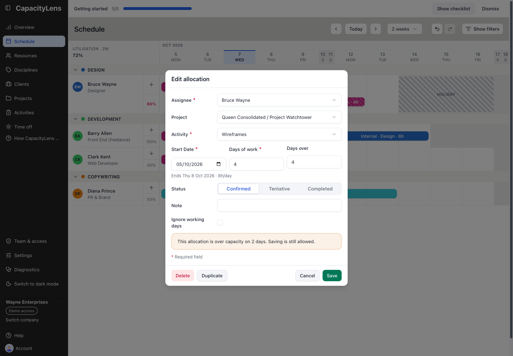

# Resolve overbooking

On **Schedule**, select the booking bar to open **Edit allocation**. This form is the accessible way to change dates, amount or assignee; you do not need to drag the bar.

_Existing interface capture with illustrative October bookings; use the Assignee control shown here, not its sample names or dates._

Choose an action:

- **Reduce the amount** or shorten the date span if the person can take less work.
- In **Assignee**, choose someone with room. Check the destination person's working pattern, availability dates and time off before saving.
- **Keep the dates but change the plan** outside CapacityLens if the team decides the work itself must move; CapacityLens does not automatically reschedule bookings.

Select **Save**, then review the destination row and the affected dates. In Days or Blocks mode, changing the assignee keeps the start and counted span, so the end date can change with the new person's working pattern. In Hours mode the form keeps the entered date range; review its amount and end date yourself. A reassignment must start on an allowed working day and stay within the destination's availability dates. Correct those dates or choose another person, then try again.

A visible-window average at or below 100% does not guarantee there is no daily overload or 14-day warning. Check red daily bands and the red percentage as well as the dates where work overlaps. [Find capacity](06-find-capacity.md) explains the two indicators.

If the form says **The schedule changed while you were editing. Close and reopen the form, then re-apply your changes**, close it, open the booking again and make the change against the latest schedule. See [Update the plan](10-update-the-plan.md) for other save interruptions.
