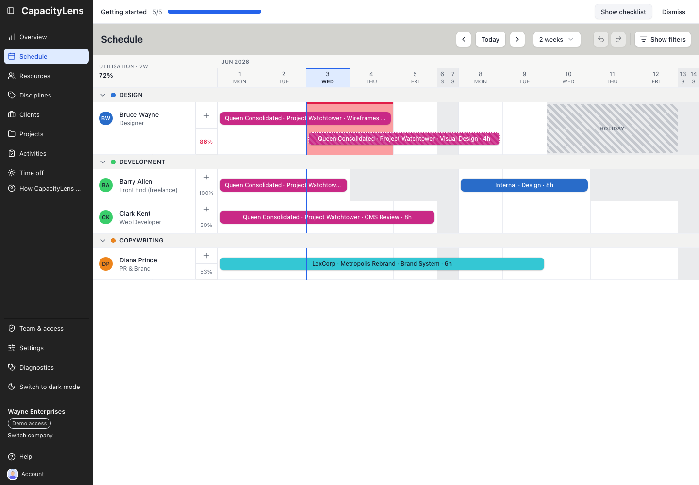

# Check your week

## Find your work list

Open **Schedule**. If you have a schedule row, select the avatar beside it to see that person's bookings and personal time off for the current company week and the next three weeks. A sign-in does not automatically create a schedule row. The work list's range stays fixed when you change the grid's **Weeks visible**, filters or draw mode.

_Illustrative interface capture; it does not show completion of your plan._

## Inspect next week's grid

From the current week, select **Next** once. Select **Show filters** to search for a person or narrow the grid to a client, project or activity. Select **Clear Filters** to restore the full schedule. Filters change your view, not the shared plan.

Viewers can read the schedule but cannot edit bookings or time off. Only the Owner sees confidential real client and project names; other roles may see code names or redacted names. Time-off notes are visible only to Owners and Admins.

## If a booking is missing

Check the week and active filters, then check the work list: it can show items hidden by the grid's filters. If you have no schedule row or still cannot find the booking, ask an Owner or Admin to check your access and the plan. Describe the dates and work that need correction so the planner can update it.
