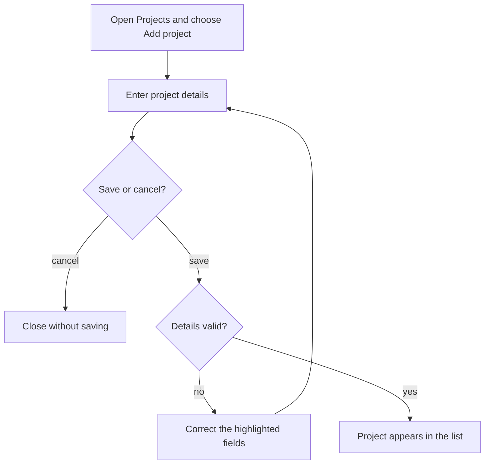
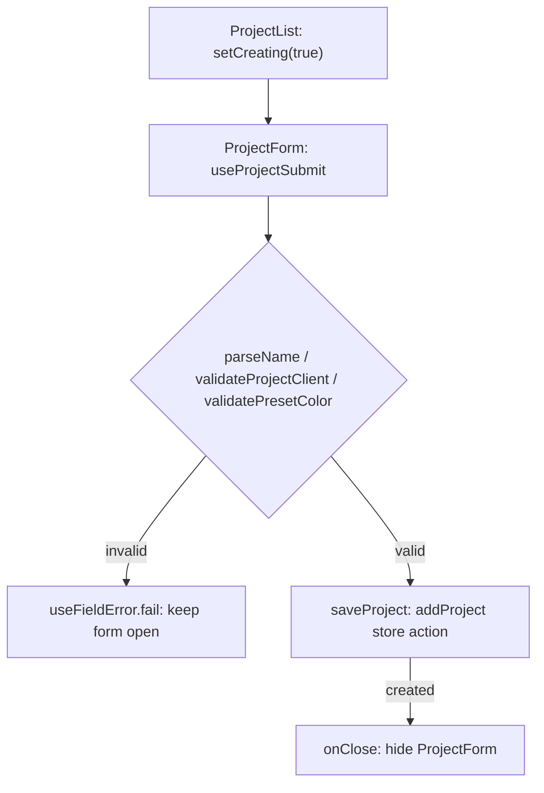

# Story format

A story records one meaningful user action and why it matters. Use actual permission roles,
visible control names and current form fields. Keep implementation contracts in
[DECISIONS.md](../DECISIONS.md), instructions in the guides, and test scripts in the test suite.

Copy only the story example when creating a story; replace its content with source-backed details.
Keep the writing and maintenance guidance in this template, outside individual stories. The example
shows a form excerpt; a completed story must cover every relevant field. Its guide, source and test
paths are relative to the story's area folder. Omit the optional Coverage line when no useful test
link exists. For actions without input fields, use the controls/results alternative below and adapt
both diagrams to the actual journey.

## Story example

````markdown
# US-XXX-NN — Action title

As an Editor, I want to create a project and assign it to a client so that I can schedule people to work on it.

**Status:** Current
**Access:** Editor and above.
**Entry:** Projects → Add project.
**Documentation:** [Clients and projects](../../docs-src/using/projects.md)
**Source:** [Project form](../../apps/frontend/src/components/projects/ProjectForm.tsx)
**Coverage:** [Project form tests](../../apps/frontend/src/components/projects/ProjectForm.test.tsx)

## Acceptance criteria

| Field  | Control       | Required/default/conditions                                              |
| ------ | ------------- | ------------------------------------------------------------------------ |
| Name   | Text input    | Required; initially blank.                                               |
| Client | Client picker | Required; no default; Internal first, then other active clients by name. |

## User flow



## Code flow

This example shows the form-to-store boundary.



**Code references:** [ProjectList](../../apps/frontend/src/components/projects/ProjectList.tsx), [ProjectForm](../../apps/frontend/src/components/projects/ProjectForm.tsx)
````

## Actions without input fields

Replace the field table with a short list of controls and their visible results. Do not create
empty or artificial field rows. For example, the Today action uses:

```markdown
## Acceptance criteria

- **Today** returns the schedule to the start of the current week in the company time zone.
```

Include confirmation controls and relevant cancellation or failure results when they affect the
action. Keep both diagrams in these stories; navigation and read-only actions do not imply a save.

## Writing and maintenance rules

- Include every field in the relevant form, including conditional and read-only fields.
  Record required/optional state, defaults, important field limits, available options and dependent
  choices. For dynamic choices, describe their source and filtering rules rather than listing
  transient data. Use the exact UI labels.
- Create and edit are distinct actions. Link an identical shared field list and describe only
  differences; do not make a reader chase several links to discover a form.
- For actions without input fields, use a short list of controls and their visible result.
  Confirmation buttons belong here too. Avoid detailed test scenarios and backend guarantees.
- Use one story for a meaningful outcome rather than one for each click or implementation guard.
  An inseparable set of controls may share a story; independently useful actions deserve their own.
- Keep identifiers and filenames stable. Add the next unused identifier within the area.
  Do not delete a story when its feature disappears: retain its intent and mark its status.
- Use **Current**, **Hidden**, **Removed**, **Demo**, **Operator** or **Planned**.
  Explain why a feature is unavailable and identify its historical or intended controls clearly.
  Retention is a record of interest, not a commitment to reintroduce the feature.
- Read status together with Access and Entry; use the [status definitions](REFERENCE.md#reading-the-catalogue).
  A configured feature switch is a condition, not proof of removal. Current describes source-reviewed
  availability, not a browser test result.
- Add an optional **Coverage:** test link when useful; omit it when no useful link exists.
  The link identifies supporting tests and does not claim they were run. Report runtime results
  separately from source review.
- Update the [index](README.md), [coverage matrix](COVERAGE.md),
  [shared reference](REFERENCE.md) and [decision gaps](GAPS.md) alongside affected stories.
  Verify the source rather than inheriting stale copy. In the matrix, New means newly documented,
  not newly implemented. Record differences between agreed decisions and current implementation
  without silently changing either.

## Diagram conventions

- Every story has a **User flow** chart and a **Code flow** chart, each in a `mermaid` fence. Both render as diagrams in GitHub. The first uses screens, actions, decisions and outcomes that a person
  understands; the second names the actual implementation behind that journey.
- Keep diagrams focused on the story. Include meaningful choices, cancellation and failure
  outcomes where they affect the journey. Avoid repeating every validation or security rule.
- Trace real producers and consumers: the entry, handler, state or service, persistence when
  applicable, and the resulting UI. Read-only views and device preferences do not become
  server writes. The disposable demo uses the same server path.
- Link the implementation files under **Code references**. A code label must name an existing
  symbol or clearly identify an absent or intended control. State the scope when a diagram
  stops at a shared boundary.
- For hidden, removed or planned features, label the intended user journey as unavailable.
  The code diagram shows the actual missing entry point and any retained support; it must
  not imply an unavailable journey currently executes.
- Check Mermaid syntax and representative rendering when changing diagrams. Syntax checks do
  not establish behavioral correctness; reconcile labels and branches against source.
