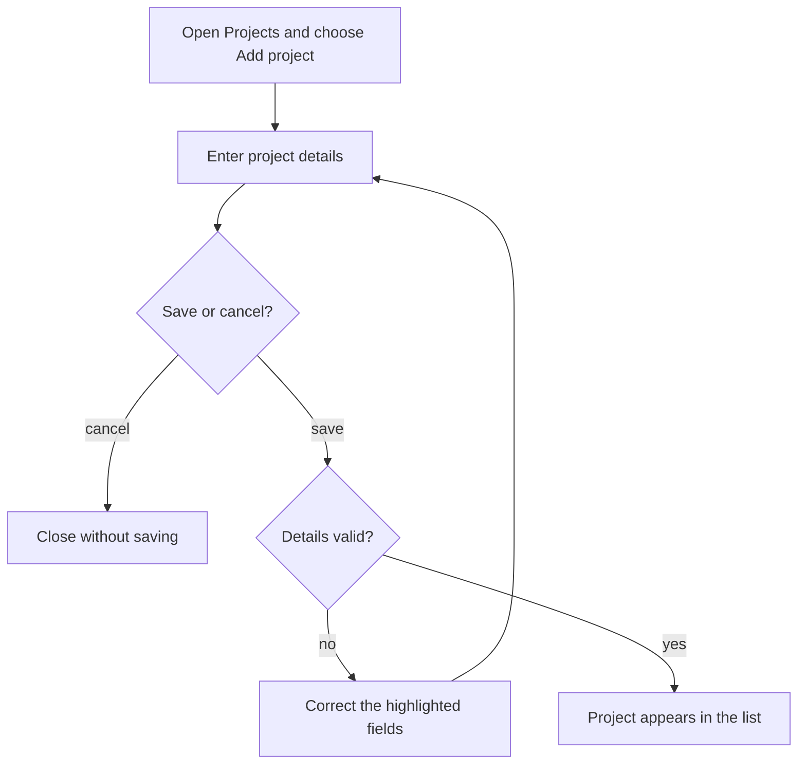
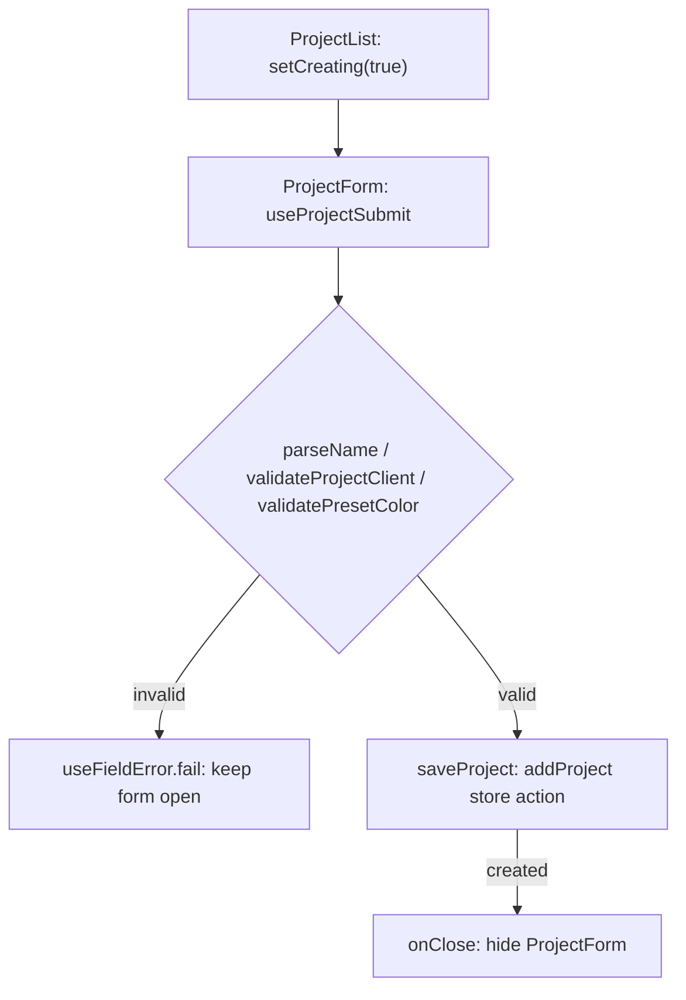

# Story format

A story records one meaningful user action and why it matters. Use actual permission roles,
visible control names and current form fields. Keep implementation contracts in
[DECISIONS.md](../DECISIONS.md), instructions in the guides, and test scripts in the test suite.

````markdown
# US-XXX-NN — Action title

As an Editor, I want to create a project and assign it to a client so that I can schedule people to work on it.

**Status:** Current
**Access:** Editor and above.
**Entry:** Projects → Add project.
**Documentation:** [Clients and projects](../../docs-src/using/projects.md)
**Source:** [Project form](../../apps/frontend/src/components/projects/ProjectForm.tsx)

## Acceptance criteria

| Field  | Control       | Required/default/conditions |
| ------ | ------------- | --------------------------- |
| Name   | Text input    | Required.                   |
| Client | Client picker | Required; active clients.   |

## User flow



## Code flow

This example shows the form-to-store boundary.



**Code references:** [ProjectList](../../apps/frontend/src/components/projects/ProjectList.tsx), [ProjectForm](../../apps/frontend/src/components/projects/ProjectForm.tsx)
````

- Include every field in the relevant form, including conditional and read-only fields.
  Record required/optional, defaults and important field limits. Use the exact UI labels.
- Create and edit are distinct actions. Link an identical shared field list and describe only
  differences; do not make a reader chase several links to discover a form.
- For actions without input fields, use a short list of controls and their visible result.
  Confirmation buttons belong here too. Avoid detailed test scenarios and backend guarantees.
- Use one story for a meaningful outcome rather than one for each click or implementation guard.
  An inseparable set of controls may share a story; independently useful actions deserve their own.
- Keep identifiers and filenames stable. Add the next unused identifier within the area.
  Do not delete a story when its feature disappears: retain its intent and mark its status.
- Use **Current**, **Hidden**, **Removed**, **Demo**, **Operator** or **Planned**.
  Explain why a feature is unavailable and identify its historical or intended controls clearly.
  Retention is a record of interest, not a commitment to reintroduce the feature.
- Add an optional **Coverage:** test link when useful; a link does not claim a test was run.
- Update the [index](README.md), [coverage matrix](COVERAGE.md) and
  [decision gaps](GAPS.md) alongside the story. Verify the source rather than inheriting stale copy.

## Diagram conventions

- Every story has a **User flow** chart and a **Code flow** chart, each in a `mermaid` fence. Both render as diagrams in GitHub. The first uses screens, actions, decisions and outcomes that a person
  understands; the second names the actual implementation behind that journey.
- Keep diagrams focused on the story. Include meaningful choices, cancellation and failure
  outcomes where they affect the journey. Avoid repeating every validation or security rule.
- Trace real producers and consumers: the entry, handler, state or service, persistence when
  applicable, and the resulting UI. Read-only views and device preferences do not become
  server writes. Distinguish the temporary demo from the persisted server path.
- Link the implementation files under **Code references**. A code label must name an existing
  symbol or clearly identify an absent or intended control. State the scope when a diagram
  stops at a shared boundary.
- For hidden, removed or planned features, label the intended user journey as unavailable.
  The code diagram shows the actual missing entry point and any retained support; it must
  not imply an unavailable journey currently executes.
- Check Mermaid syntax and representative rendering when changing diagrams. Syntax checks do
  not establish behavioral correctness; reconcile labels and branches against source.
