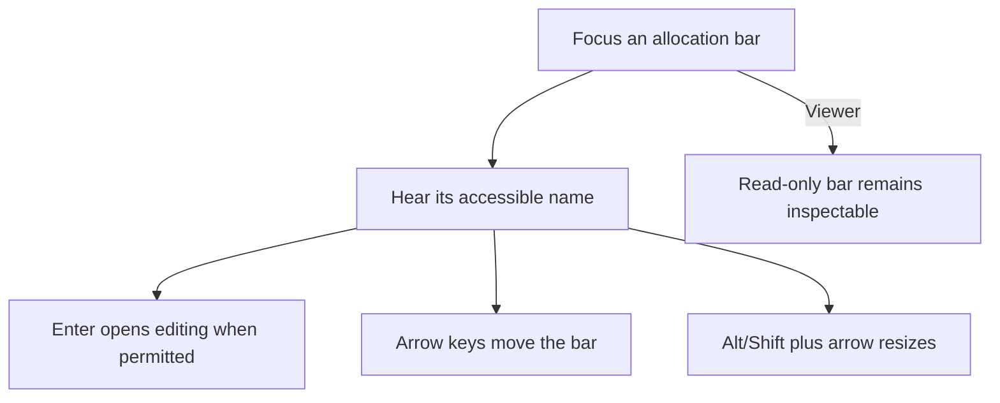
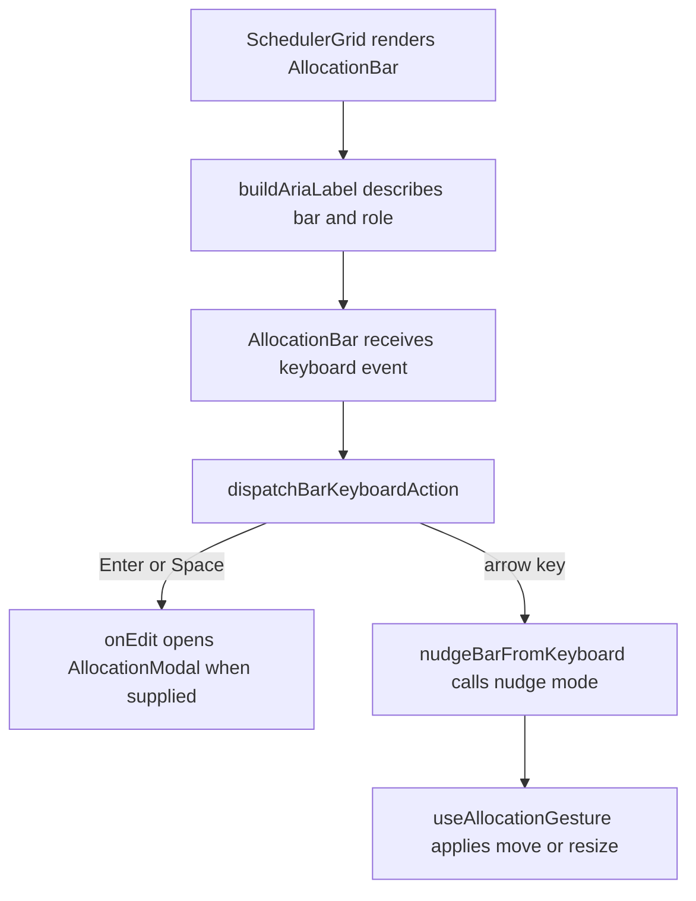

# US-KBD-01 — Operate schedule allocations by keyboard

As a keyboard-only scheduler, I want to focus, move, resize, and open allocation bars by keyboard so that I can manage work without dragging.

**Status:** Current

**Access:** Owner, Admin, Editor; Viewer is read-only

**Entry:** Schedule allocation bar keyboard focus and arrow keys

**Documentation:** [Read The Schedule](../../docs-src/using/read-the-schedule.md)

**Source:** [AllocationBar.tsx](../../apps/frontend/src/components/scheduler/AllocationBar.tsx)

## Acceptance criteria

- Focused bars have an accessible name; Enter opens editing when permitted and arrow-key commands move or resize as available.

## User flow

## Code flow

**Code references:** [AllocationBar.tsx](../../apps/frontend/src/components/scheduler/AllocationBar.tsx); [AllocationBarView.tsx](../../apps/frontend/src/components/scheduler/AllocationBarView.tsx); [useAllocationGesture.ts](../../apps/frontend/src/components/scheduler/useAllocationGesture.ts); [AllocationModal.tsx](../../apps/frontend/src/components/scheduler/AllocationModal.tsx)
