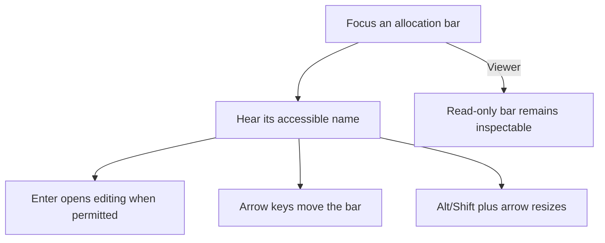
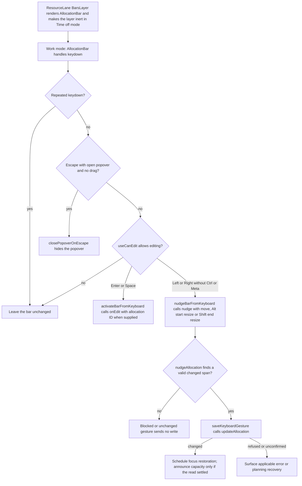

# US-KBD-01 — Operate schedule allocations by keyboard

As a keyboard-only scheduler, I want to focus, move, resize, and open allocation bars by keyboard so that I can manage work without dragging.

**Status:** Current

**Access:** Owner, Admin, Editor; Viewer is read-only

**Entry:** Schedule allocation bar keyboard focus and arrow keys

**Documentation:** [Read The Schedule](../../docs-src/using/read-the-schedule.md)

**Source:** [AllocationBar.tsx](../../apps/frontend/src/components/scheduler/AllocationBar.tsx)

## Acceptance criteria

- Focused bars have an accessible name; Enter opens editing when permitted and arrow-key commands move or resize as available.

## User flow

## Code flow

The allocation mutation and server checks are traced in [US-ALL-02](../allocation/US-ALL-02-edit.md#code-flow). The keyboard path uses the live store action after gesture checks, without the edit dialog’s draft check.

**Code references:** [ResourceLane.tsx:34](../../apps/frontend/src/components/scheduler/ResourceLane.tsx#L34) · [AllocationBar.tsx:20](../../apps/frontend/src/components/scheduler/AllocationBar.tsx#L20) · [AllocationBar.tsx:96](../../apps/frontend/src/components/scheduler/AllocationBar.tsx#L96) · [AllocationBar.tsx:136](../../apps/frontend/src/components/scheduler/AllocationBar.tsx#L136) · [useAllocationGesture.ts:454](../../apps/frontend/src/components/scheduler/useAllocationGesture.ts#L454) · [useAllocationGesture.ts:362](../../apps/frontend/src/components/scheduler/useAllocationGesture.ts#L362) · [useAllocationGesture.ts:398](../../apps/frontend/src/components/scheduler/useAllocationGesture.ts#L398)
